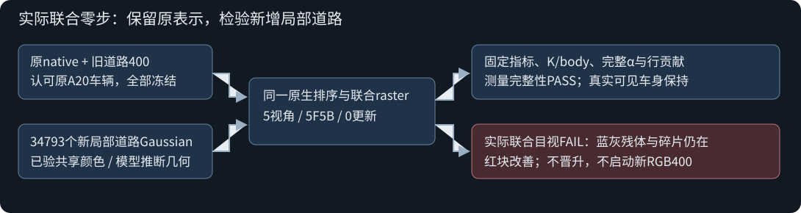

# 新局部道路零步联合对照：独立核验

整体画质为FAIL，保持 `newRGB400_authorized=false`。大片红色残影明显减少，车前下方蓝灰残体、亮点和左侧碎片仍在五帧中可见。输入共享外观与局部几何的限定验收不变；当前实际联合结果不晋升。

独立CPU读取全部原生float输出、固定评价mask及五视角行贡献：其他车辆K的RGBA逐字节一致，原车photo-proxy五帧逐字节一致，已打开的strict V仅86/110且逐字节一致。宽的isolated-actor footprint包含地面侧Gaussian投影，变化单列，未据此把车辆真实可见区误判为受损。相机、时间戳与原measure精确一致；原ab4车辆、旧road400与相关parent/code六项SHA核对通过，native退行gate为空。

| 固定视角 | 固定道路加权MSE：原表示 → 加局部道路 | 原固定红块剩余 | 原固定蓝灰剩余 |
|---|---|---|---|
| 086 | .00426245 → .00417033 | 2 / 357 | 3266 / 3389 |
| 110 | .00379586 → .00356200 | 33 / 692 | 4370 / 4575 |
| 134 | .00333192 → .00298946 | 未定义该颜色诊断 | 未定义该颜色诊断 |
| 179 | .00196060 → .00156388 | 未定义该颜色诊断 | 未定义该颜色诊断 |
| 198 | .00183153 → .00149286 | 未定义该颜色诊断 | 未定义该颜色诊断 |

原mask和未知目标分母全部保留，未知像素未当零RGB监督。五个完整band内场景α<.95均为0，不能把road-only层低α解释为整场景几何洞。颜色阈值只用于固定残留跟踪，未重新筛选评价域或自动批准退行。

新局部34793行在五视角均有实际K/body VJP测量，质量值有限且非负；25104行满足K/body全零颜色可训条件，9689行冻结。这个guard的PASS只接受测量和颜色梯度mask，不接受画质或授权opacity/scale更新。

本次原生对照实际5F5B、0更新；R10四个实际阶段累计20F10B、0新formal。旧表示正式400仍计入2000上限。此独立复核新增GPU调用0。

收据：`numeric_review.json`（测量与冻结完整性通过）、`visual_review.json`（实际联合画质FAIL）。五张1152×768原图均逐张目视核验，未采用photo fallback替代实际原生输出。
