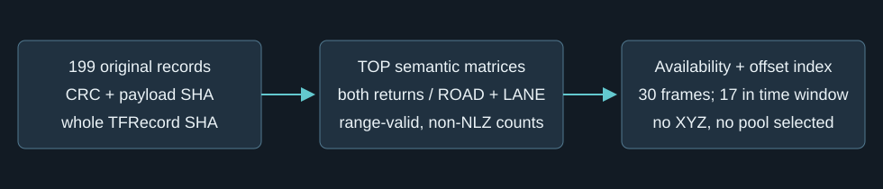

# 原199帧官方TOP语义可用性

实际原record逐条核对完成：30帧有TOP语义，为raw25、30、35、40、45、50、55、60、65、70、75、80、85、90、95、100、105、110、115、120、125、130、135、140、145、150、155、160、165、170。175–198没有TOP语义。

86–198时间窗内有17帧：90、95、100、105、110、115、120、125、130、135、140、145、150、155、160、165、170。其中不在现有八训练帧中的12个额外可用索引为90、100、105、115、120、130、135、140、150、155、160、170，尚未选择参考池或通过配准资格。134、179、198没有TOP语义，仍为本轮禁止参与拟合的geometry heldout。

`TOP_segmentation_availability.json` 保存两return的压缩标签可用性、官方ROAD18/LANE19与全部class计数、range>0且非NLZ的计数。无标注帧的CSV零值表示没有可计数的官方标签，不表示物理道路不存在；两return计数不是去重后的世界点数。此次未生成XYZ、未转换点云、未读取RGB、未按Z或残差筛点、未改任何训练划分。

`source_record_index.jsonl` 保存全部199帧的record offset、payload长度、SHA256及CRC检查，可供后续定点读取。原935,219,451字节TFRecord整文件SHA本轮重新计算为`286c3b2f627234a85a67005589b577bf4358e9a6a947aef2c42587807d1a1912`，与原receipt一致。主JSON SHA为`93d6238e8bfa0ff923fb3386ebe69392d779b096ea8e51b691845a145c680f87`，本地取回及附属索引/CSV/contract SHA核对通过。
