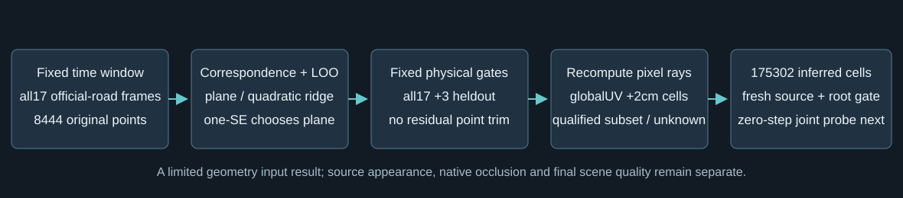

# 固定时间窗17帧局部几何对照

所选斜面通过训练留一与封存视图的固定物理门。新几何`0d62e87a…da269b`的175302个有支持cell获得独立限定零步输入意见；root授权、重新投影的外观来源及原生联合画面验收分别进行。raw86原band的62个未知像素保留，不声明完整道路恢复。

参考池按预先固定的评价时间窗86–198及官方TOP语义可用性确定，纳入90–170每5帧的全部17帧。原始ROAD18/LANE19点8444个，实际请求范围内3613个；取点仅按finite和原requested footprint加0.4m的XY范围，没有Z、残差、OBB或照片语义预裁。134、179、198不参与拟合。旧八帧及全部失败现场保留；本组同时改变时间窗和有效观测数量，不能作为仅数量的消融。

跨帧矩阵先于LOO完成，固定XY半径2、5、10cm，保留有向匹配分母与mutual匹配。17帧均纳入，未进行pose同步或按高度差删除帧。10cm域最大成对绝对高度差中位数5.43cm，成对p95最大8.98cm；矩阵本身不作为几何通过证据。

原9模型族、0.1m medoid、Huber 3cm/IRLS8与one-SE选择规则保持。斜面LOO MAE为1.21762cm，均值最优二次为1.17195cm，one-SE选择斜面。所选模型17折实际区域的最坏高度median为1.966cm、p95为4.101cm，均满足原4cm/10cm门。独立原点审计保存所有frame和空间桶；旧copy遗留的`all8`字段已另存schema v2为`all17`，原版本保留并断言数值相同。

选择收据写完后才读取本组扩域封存输入。134/179/198原始458/452/456点全部评价，绝对高度p95分别1.704/2.827/2.901cm，法线p95分别13.60/9.87/17.09度，通过原固定门。134的最大高度离群1.091m仍保留，未按模型残差裁点。512次frame-cluster bootstrap仅描述参数条件敏感度，不代表全部模型误差。

新斜面重新与五视图原像素射线相交，再确定globalUV范围`[174,16,1096,289]`与0.2m环；不是只替换旧1844的Z。worldUV的XY变换保持，Z解析取新模型。175302个asset cell全部属于17帧训练凸包及声明的XY context，3736个requested cell超支持仍未知。参数bootstrap SD的asset p95为3.637mm。所有新几何标记为模型推断source kind 2。

五张1152×768原尺寸几何context已独立目视，无明显翻折或粗坐标错配。原照片中的待移除A9只作显示context，网格不代表照片车体成为道路监督。A20 GT底面中心到新道路的高度差依次1.783、2.587、3.386、4.885、5.518cm；原车未移动，此量只是间接接地交叉检查。原生K/车辆遮挡仍需实际joint渲染验证。

原红区357/357与692/692全部有几何支持；蓝灰区为3369/3389和4575/4575。raw86原band为22226/22288，余62个未知像素中22个属于原ground_eval，20个属于蓝灰诊断。后三视图的红蓝空mask表示本轮未测，不表示没有残影。固定分母均保留，未知位置不作为黑色材质监督。

关键入口：`candidate_reprojected_v1/candidate_geometry.npz`、`independent_limited_geometry_review.json`、`fixed_target_coverage.json`与`independent_audit_v1/`。本组新增GPU前向、反向、Gaussian更新与扩散均为0；原车、相机、旧道路与旧来源图保持。
