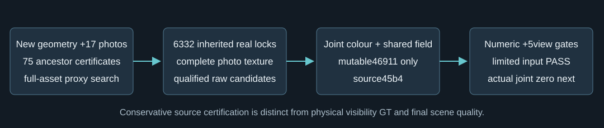

# 新几何共享源45b4：限定输入通过

数值和五视图目视门均通过，绑定`45b4b9d752f1584019e6687008de489de071a81907ab2c3c1b61b20964f64d32`与新几何`0d62e87a…da269b`。本意见仅允许限定零步联合对照，最终车辆、原生遮挡和整体画面另验。

修改范围46911texel由46836个新增地址和75个来源资格修复地址组成。其他父域RGB及6332个继承real锁逐字节不变。75个地址撤销当前real认证，重新获得完整相似实拍纹理来源链，并由原raw教师候选联合校色；未回改旧eb86、5eeb或原6407记录。

完整175302cell、176465vertex的17帧检索保留2999905条原候选，固定拒绝顺序和非互斥bits独立重算吻合，当前严格代理证书为0。GT OBB、动态矩形及阴影均为保守代理，0证书不能解释为所有照片物理不可见，更不代表199帧均无真实道路。旧照片候选和全部理由保留。

50251个共同有效texel、150753个RGB channel的分母未缩：fullRGB残差下降21.8883%，0.12m低频下降48.8610%。相对完整照片seed的2cm/4cm高频相关分别0.999999124、0.999996799，RMS比1.000003、1.000029。边界低频p95由seed的0.00563099到0.00559963，作为诊断报告，不新增0.005硬门或调参压数值。

已保存的五张1152×768直接材质图逐张目视；有效材质域无明显黑轮廓、宏观色缝或格纹，颗粒可见、色调略平。材质域缺失及maxRGB低于40/255的像素均为0；独立逐像素线性采样、曝光和sRGB读出重放最大差不超过1/255。域外深色背景不作为道路监督。

`numeric_gate.json`与`visual_gate.json`均为complete/PASS，root认可单独绑定。审计未重跑renderer、全池检索或fuser，新增GPU/反向/Gaussian更新为0。首轮审计的context索引工程错误及原代码快照保留；修正只在实际asset scope读取较小source canvas，没有改变场或方法。
