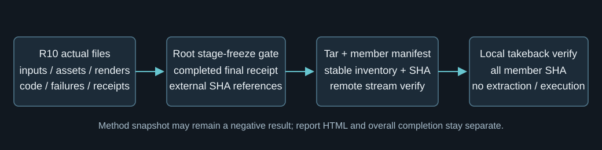

# 当前阶段归档与出版命令

当前是活跃阶段准备，未冻结、未打包、未提交 Git。输入为新几何 `0d62e87a…`、共享来源 `45b4b9d7…`；资源实时读取 `docs/current_resource_ledger.json`，旧 36F/16B 是新 17 帧阶段前的基线，包含工程失败 1F/1B。后续仅累加实际收据；旧表示正式 400/2000、新局部正式更新及 smoke 分列，计划调用不计入实际账。



`docs/current_stage_publication_inputs.pending.json` 给出当前绑定、技术待项及来源语义；`authorization_pending=false`，不是等待用户授权。`docs/final_method_snapshot_receipt.timewindow17.pending.json` 保持冻结开关为 false，列出准确的最后完成测量、包含对照及 64 个当前关键文件。root 完成实际新阶段后替换最终收据、资源账及关键成员，再另存正式冻结信号。

`archive_r10_stage.py` 的实时 inventory 已确认收集完整 17 帧 × 176465 顶点候选、原图 RGB/UV、拒绝 bitmask、75 点旧锁及修复历史、新几何、种子、融合状态和实际曲面证据。当前检查覆盖 58 个成员；全量普通文件均归档，27 件轻量取回不替代完整包。原 17 张数据集照片、LiDAR、原生大模型继续通过原目录和逐输入 SHA 外引。

同位置检索的 0 strict 是保守资格结果，不代表这些位置在全部照片中从未真实可见。GT OBB、动态矩形和阴影仍明确是代理。

现在可执行的 CPU 准备：

```bash
R10_TASK='/root/autodl-tmp/drivingeditor_repro/campaign/road_underbody_local_20261123_r10'
R9_TASK='/root/autodl-tmp/drivingeditor_repro/campaign/old_raw_teacher_joint_20261123_r9'
CPU_TASK='/root/autodl-tmp/envs/motionproj/bin/python'
CUDA_VISIBLE_DEVICES= "$CPU_TASK" "$R10_TASK/code/summarize_actual_resources_cpu.py" --r10 "$R10_TASK" --r8 '/root/autodl-tmp/drivingeditor_repro/campaign/road_vehicle_joint_dggt_20261123_r8' --output "$R10_TASK/docs/current_resource_ledger.json"
CUDA_VISIBLE_DEVICES= "$CPU_TASK" "$R10_TASK/code/prepare_current_publication_stage_cpu.py" --root "$R10_TASK"
CUDA_VISIBLE_DEVICES= "$CPU_TASK" "$R10_TASK/code/archive_r10_stage.py" estimate --receipt "$R10_TASK/archives/live_payload_estimate.json"
CUDA_VISIBLE_DEVICES= "$CPU_TASK" "$R9_TASK/publication/prepare_inputs.py" --root "$R9_TASK" --archive-receipt "$R9_TASK/publication/R8_R9_local_takeback_receipt.json"
CUDA_VISIBLE_DEVICES= "$CPU_TASK" "$R9_TASK/publication/qa_publication_current_snapshot.py" --root "$R9_TASK"
```

仅当 root 确认本阶段队列结束、文件稳定并写好 `docs/final_method_snapshot_receipt.json` 后创建归档：

```bash
CUDA_VISIBLE_DEVICES= "$CPU_TASK" "$R10_TASK/code/archive_r10_stage.py" create --archive "$R10_TASK/archives/r10_method_stage_timewindow17_v1.tar.gz" --manifest "$R10_TASK/archives/r10_method_stage_timewindow17_v1.manifest.json" --root-delivery "$R10_TASK/docs/final_method_snapshot_receipt.json"
```

将 tar、manifest、`.tar.gz.remote_verify.json` 取回本工作区 `outputs/road_underbody_local_20261123_r10/method_archive/` 后，在本地流式复核全部成员：

```powershell
python 'C:/Users/dengyunlong/Documents/Codex/2026-11-22/065-file-c-users-dengyunlong-documents-2/work/road_underbody_local_20261123_r10/code/archive_r10_stage.py' verify --archive 'C:/Users/dengyunlong/Documents/Codex/2026-11-22/065-file-c-users-dengyunlong-documents-2/outputs/road_underbody_local_20261123_r10/method_archive/r10_method_stage_timewindow17_v1.tar.gz' --manifest 'C:/Users/dengyunlong/Documents/Codex/2026-11-22/065-file-c-users-dengyunlong-documents-2/outputs/road_underbody_local_20261123_r10/method_archive/r10_method_stage_timewindow17_v1.manifest.json' --receipt 'C:/Users/dengyunlong/Documents/Codex/2026-11-22/065-file-c-users-dengyunlong-documents-2/outputs/road_underbody_local_20261123_r10/method_archive/local_takeback_receipt.json'
```

将这份真实本地收据传到远端 `R9/publication/R10_local_takeback_receipt.json`，重新生成最终待审清单：

```bash
CUDA_VISIBLE_DEVICES= "$CPU_TASK" "$R9_TASK/publication/prepare_inputs.py" --root "$R9_TASK" --archive-receipt "$R9_TASK/publication/R8_R9_local_takeback_receipt.json" --r10-archive-receipt "$R9_TASK/publication/R10_local_takeback_receipt.json"
CUDA_VISIBLE_DEVICES= "$CPU_TASK" "$R9_TASK/publication/qa_publication_current_snapshot.py" --root "$R9_TASK"
```

root 随后审阅这次快照 SHA，填写最终 `README.md`、`compact_result.json`、`publication/narrative.json`、`publication/final_delivery.json`；新的待填叙述模板为 `publication/narrative.current_status.pending.json`。状态字段用 `status_replacement`，提供一个当前小节与历史导航，替换原本线 marker 至 EOF；其他任务前缀不动。EXPERIMENTS 只作实验导航，F06 只追加新证据，不复制整段状态。显式保留整场景验收结论和阶段交付范围。对应选中文件变化时重新 prepare，不在已审清单上替换内容。正式出口另要求真实 R10 本地全成员验证收据；R8/R9 的 1700 成员收据不能代替它。

最后由 root 执行 `prepare_inputs.py --finalize-config --selection <本次已审清单>`，再运行 wrapper 的 `--prepare` 和 `--stage`，检查独立索引差异后提交、推送。修改候选 F06 后，stage 必须在独立 origin 快照实际运行官方 failure 索引生成器，把导航差异加入独立索引；无差异也保存真实收据。CPU 预检已完成，结果只验证接线，不代替最终候选重建。wrapper 保留来源纠正及既有 V82-F06，`human_verdict` 与 `problem_solved` 保持 null。本文未执行 Git 变更或关机。
