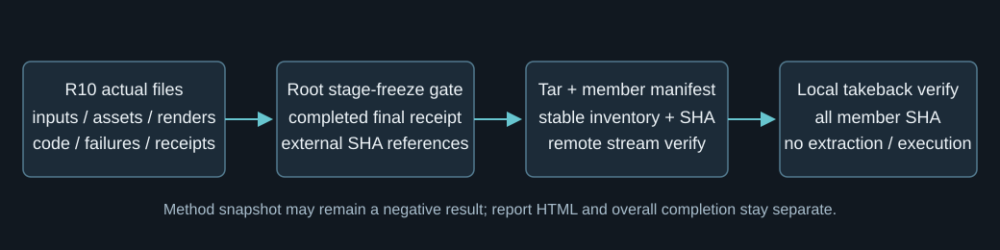

# R10 方法阶段归档与安全取回

此工具仅归档 `road_underbody_local_20261123_r10`。当前仅完成工具准备与合成数据测试；实际实验尚未冻结，不执行 create。归档可保存未解决质量问题的完整阶段，`method_stage_frozen` 与整场景恢复验收分别记录。



`code/archive_r10_stage.py` 自动收集本轮全部普通文件，包括代码、输入 NPZ、世界来源图、新资产、实际渲染、逐行测量、失败版本及收据。排除 `archives/`、`report/`、`publication/`、`__pycache__/`、`.pyc`、`.part` 与 HTML；唯一报告页面的最终快照另外保存。符号链接不跟随，并记录为外部保留项。

归档前由 root 复制 `final_method_snapshot_receipt.template.json` 为实际收据，填写最后已完成的 footprint 收据相对路径与 SHA，并填写所有需要冻结的后续阶段收据和关键文件。只有待测队列结束后才设置 `complete=true`、`method_stage_frozen=true`、`pending_next_footprint_experiment=false`。`overall_run_complete=false`、`whole_scene_restoration_accepted=false`、`GPU_stays_on=true` 是合法阶段快照，不要求将失败质量结论改成通过。

远端实时大小估计，不打包：

```bash
CUDA_VISIBLE_DEVICES= /root/autodl-tmp/envs/motionproj/bin/python /root/autodl-tmp/drivingeditor_repro/campaign/road_underbody_local_20261123_r10/code/archive_r10_stage.py estimate --receipt /root/autodl-tmp/drivingeditor_repro/campaign/road_underbody_local_20261123_r10/archives/live_payload_estimate.json
```

收到真实阶段冻结收据后，root 执行：

```bash
CUDA_VISIBLE_DEVICES= /root/autodl-tmp/envs/motionproj/bin/python /root/autodl-tmp/drivingeditor_repro/campaign/road_underbody_local_20261123_r10/code/archive_r10_stage.py create --archive /root/autodl-tmp/drivingeditor_repro/campaign/road_underbody_local_20261123_r10/archives/r10_method_stage_snapshot_20261123_v1.tar.gz --manifest /root/autodl-tmp/drivingeditor_repro/campaign/road_underbody_local_20261123_r10/archives/r10_method_stage_snapshot_20261123_v1.manifest.json --root-delivery /root/autodl-tmp/drivingeditor_repro/campaign/road_underbody_local_20261123_r10/docs/final_method_snapshot_receipt.json
```

create 检查冻结收据、完成收据、关键成员和外部依赖索引；读取前后核对文件指纹与 SHA，发现任何变化即停止并保留失败现场。完成后自动验证外层 tar SHA 与全部成员 SHA，输出 `.remote_verify.json`。同名归档不覆盖，重试应采用新版本名。

取回目录采用本工作区 `outputs/road_underbody_local_20261123_r10/method_archive/`，取回 tar、manifest 与 `.remote_verify.json`。本地执行：

```powershell
python 'C:/Users/dengyunlong/Documents/Codex/2026-11-22/065-file-c-users-dengyunlong-documents-2/work/road_underbody_local_20261123_r10/code/archive_r10_stage.py' verify --archive 'C:/Users/dengyunlong/Documents/Codex/2026-11-22/065-file-c-users-dengyunlong-documents-2/outputs/road_underbody_local_20261123_r10/method_archive/r10_method_stage_snapshot_20261123_v1.tar.gz' --manifest 'C:/Users/dengyunlong/Documents/Codex/2026-11-22/065-file-c-users-dengyunlong-documents-2/outputs/road_underbody_local_20261123_r10/method_archive/r10_method_stage_snapshot_20261123_v1.manifest.json' --receipt 'C:/Users/dengyunlong/Documents/Codex/2026-11-22/065-file-c-users-dengyunlong-documents-2/outputs/road_underbody_local_20261123_r10/method_archive/local_takeback_receipt.json'
```

本地 verify 只流式读取明确提供的 tar 和 manifest，不解压、不执行归档代码、不加载模型或 NPZ、不解析执行远端路径；拒绝绝对成员名、路径穿越、链接、重复或遗漏成员。合成测试收据为 `archive_helper_synthetic_test.json`，不是本轮真实资产的归档完成证据。

恢复索引为 `provenance/previous_stage_archive_reference.json`。R8/R9 已验证归档为 2,163,874,181 字节、1700 成员，SHA `41f79eda42cd03385fa135fbc783e279aca2a85d63a5a0b4997b36006f5d544c`。原生 C++/runtime 代码和前序阶段来源通过该包及索引外引；static/dynamic/environment 原模型与 DGGT 主权重仍为原目录外部不可变 SHA 引用，不重复复制数 GB。当前 R10 新资产和世界颜色来源必须随本包收齐；恢复完整原场景仍需索引中的外部模型与数据。

资源账从最终实际收据汇总，历史失败、smoke 与正式更新分别保留；归档动作本身不新增 GPU 前向、反向、训练或扩散。远端保持开机。
