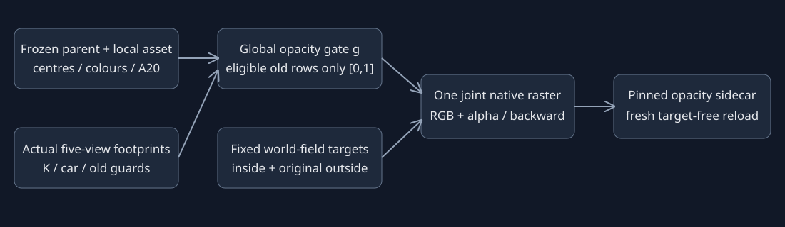

# 固定几何的局部 opacity 替换原型

输入为 v4 干净局部资产及其实际五视角足迹。仅 59,878 行可训练：18,468 行未归属原生 Gaussian 与 41,410 行旧 RoadRows；其中 29,457 行同时影响外域。资格不使用 RGB 或残差，所有实际 K／车辆可见区域质量非零行、原生正归属行和永久保护行均不进入参数向量，隐式 gate 恒为 1。



唯一变量是原有 opacity 的全局行乘数 g，初始精确为 1，每步投影至 [0,1]。新局部道路、认可车辆、原始中心／尺度／旋转／轨迹／颜色均冻结。采用单次原生 joint 深度排序，直接比较真实联合 RGB。86／110 平衡采样；134／179／198 只评价。方法合同固定 Adam 学习率 0.001，最多 400 正式步，旧 400 步计入总预算，smoke 与重放更新单列。

固定监督域为允许修改像素与已验收实际直接曲面的交集，颜色使用共享场 canonical linear RGB。预测先 EOTF 再乘相机曝光增益；目标不重复乘增益。未知像素不提供 RGB 目标，但仍进入原 full-band 的 α95 保持检查。外域目标是原基线；v4 原有 102 个外域浮点差像素按独立有界初始化收据保留。

训练权重为 inside MSE 1，外域 RGB／α MSE 各 100，外域最大差平方各 10，K／车辆 RGB 与 α MSE 1000，full-band α95 floor 100，稀疏 opacity 降低先验 1e-4。外域 RGB 上限 1/255，α 上限 .5/255。当前版本保留实际 K／车辆逐字节硬检查；原生光线提前终止导致的细微差异需另行记录，不能自动解释为车辆视觉受损。

100 步训练域固定 joint MSE 改善不足 2% 则停止；200 步相对 100 步改善不足 1% 则停止。效果候选须改善至少 10%、五视角保护与外域／孔洞门通过，并经 root 对实际 joint 图目视核验。数值通过不代表整场景修复成功。

`opacity_gate_inputs_v1/contract.json` 已实际 CPU 生成，SHA256 `1cb87f9f2121372ea92ce50a5dcbee9fbbcd7e56d241fdd4dc3f281ffd935bbd`。三入口：`prepare_local_opacity_cpu.py` 固定资格与监督；`fit_local_opacity.py` 运行生命周期；`local_opacity_gate.py` 只读持久 sidecar。

```bash
ROOT=/root/autodl-tmp/drivingeditor_repro/campaign/road_underbody_local_20261123_r10
PY=/root/autodl-tmp/envs/drivingeditor/bin/python
# Root 串行调度；需已写明精确合同 SHA 的授权文件。+$PY "$ROOT/code/fit_local_opacity.py" --mode smoke --execute \
  --contract "$ROOT/opacity_gate_inputs_v1/contract.json" \
  --approval "$ROOT/root_opacity_smoke_approval_v1.json" \
  --output "$ROOT/opacity_gate_smoke6_v1"
# 仅在实际 smoke 完成后运行新进程；不读取训练合同或目标。
$PY "$ROOT/code/fit_local_opacity.py" --mode verify --execute \
  --sidecar "$ROOT/opacity_gate_smoke6_v1/asset" \
  --expected "$ROOT/opacity_gate_smoke6_v1/step000006" \
  --output "$ROOT/opacity_gate_smoke6_v1/fresh_reload"
```

smoke 预期六个逻辑更新，额外一次 step5 恢复重放，共七次实际更新。复用 R8 全参数、Adam、sampler、Python／NumPy／Torch／CUDA RNG 保存与恢复；恢复必须精确，下一步全状态重放采用已注册 4ε 数值界及 loss≤1e-7。资源按实际 receipt 计数。持久文件只保存全局行 gate、行分组、道路行映射及父资产 pin，加载不读取监督。
