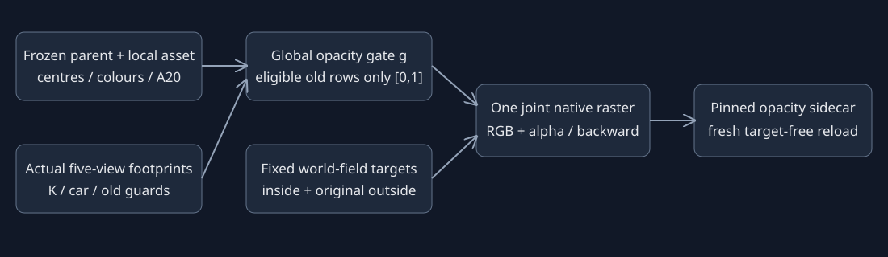

# 固定几何的 opacity 控制：短程负结果

当前合同的全局行 opacity 控制未完成生命周期 smoke，未解锁正式训练。原车、新局部道路、正归属原生行及全部几何／颜色保持冻结；保护行资格阈值为实际质量精确零。

| 实际阶段 | F / B | 更新 | 停止原因 |
| --- | --- | --- | --- |
| v1 smoke | 8 / 2 | 2，单列 smoke | raw86 外域绝对 α 变化 .003477 超门 |
| v1 原样单视角重放 | 1 / 0 | 0 | 诊断：唯一超门点为已支持道路上的 α 增加；外域最大降低仅 .00003761，无新增孔洞 |
| v2 smoke | 9 / 3 | 3，单列 smoke | raw110 外域 RGB 最大变化 .009077 超过 1/255 |

v2 仅将 α 读出改为最大降低≤.5/255及外域／原 full-band 无新增 α95 孔洞，允许有限 [0,1] α 增加。原 v1 失败保持不变。损失、学习率 .001、资格行、监督域、共享源及所有资产均未改。

两次 smoke 的 K／车辆 RGBA 检查均保持精确，未新增覆盖孔洞；v2 因 RGB 保护失败按预先约定停止。两次均未到 step4 checkpoint，恢复、下一步重放及新进程加载尚未获得生命周期认证。正式更新为 0，旧正式预算保持 400/2000。

实际资源与执行代码分别保存在 `opacity_gate_smoke6_v1`、`opacity_failed_state_replay86_v1`、`opacity_gate_smoke6_coverage_v2`。唯一已保存的更新后实图来自 v1 两次更新的原样 raw86 重放；v2 未保存更新后 RGBA，不以初始图或参数缓存替代。
