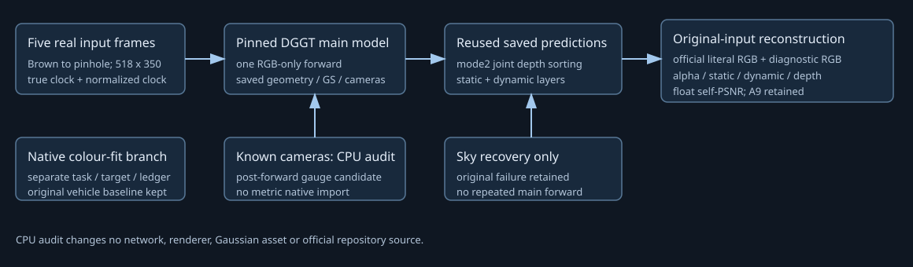

# DGGT 原始输入自重建控制

主网络完成一次前向，保存的全部预测均有限。原照片、Brown→针孔预处理、输入像素、时间、已知相机、官方源码和 5.411 GB 权重均通过独立 CPU 核对。sky 环境失败现场保留，恢复仅复用已保存预测。

| 项目 | 实际结果 |
|---|---|
| 输入 | 原始五时刻实拍，518×350；A9 仍保留 |
| 主网络 | 唯一已完成前向 1 次，1.310 秒；恢复新增 0 次 |
| 原 sky 失败 | API 尝试 1、完成 0；相机栅格尝试 4、完成 0 |
| sky 恢复 | API 2/2，相机栅格 5 次 |
| mode2 读出 | 同次深度排序静／动态层，5 API、5 相机栅格 |
| 官方原文合成 | 全五输入帧 PSNR 23.085273 dB |
| 单 α 诊断合成 | 全五输入帧 PSNR 22.993655 dB，独立命名 |

PSNR 来自未取整 float RGB，与网络已经见过的原始输入比较。原文合成为 `α·RGB_premult+(1−α)·sky`；诊断合成为 `RGB_premult+(1−α)·sky`，二者共享同一次 raster，没有以诊断结果替换官方控制。静／动态 RGB 与 α 求和误差均低于 1e-6；深度为模型自身坐标尺度下的可见性加权期望值。

相机对齐候选比例为 25.720894 米／模型单位，坐标分量 RMSE 0.020026 米，三维相机中心 RMSE 0.034686 米，最大方向残差 0.115770°。相机路径接近直线，候选只在前向后计算，尚未用于转换高斯或导入原生道路／车辆资产。

原生颜色拟合分支单列：968F／833B，正式 400 更新与丢弃 smoke 13 更新；R9 语义前向 2 次，本轮新扩散 0 次。该分支使用道路删除目标和保留车辆，与 DGGT 原始输入重建的任务及目标不同。

后续读出需保持同一输入／预测／sky 哈希、预测相机、mode2 反投影点、官方归一化时间和 raw-logit 静态选择规则；实例语义、米制深度、原生导入及车辆轨迹须另行验证。新增 A9 过滤控制已按最新任务优先级暂停，未执行。

免责声明：本控制不代表道路删除成功、未见视角重建通过或完整 DGGT 运动流程复现；proxy 语义及动态概率不是对象身份真值，单相机近直线相机对齐不能替代独立表面几何验收。
