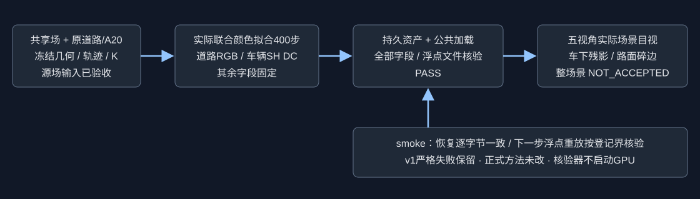

# 联合颜色资产核验与最终目视

正式400步持久资产与新鲜公共加载核验PASS；实际场景目视为NOT_ACCEPTED。道路内域色调更均匀，车辆颜色变化有限，车下残影和道路碎边仍需保留为未解决结果。

道路596100行只放开reference_srgb与新增derived reference_linear，当前effective_row_rgb与sRGB一致。历史capacity_effective_rgb保留原字节。车辆419005行只允许coefficients的DC项变化，SH1..15、XYZ、尺度、不透明度、旋转、active和全部原lineage冻结。轨迹、相机、上下文和源场SHA固定。

五视角真实VJP保护并集冻结道路3463行、A20 DC6570行。所有质量数组行数完整、finite且非负，并集由原mass重新核对；后三视角严格V未打开，仅用于评价，不当零真值。原生渲染保护区RGB对A0逐字节一致。

独立核验器verify_joint_asset_cpu.py提供freeze、check、render-check三个CPU入口。新鲜加载证据来自root显式GPU进程；CPU逐文件核对五帧全部joint/component键、所有像素、dtype/shape/bytes和finite，另核相机K、时间戳、模型时间、全局alpha。静态gate合法迁移路径时，对NPZ IDs和checkpoint原始tensor storage/元数据独立比较，不导入Torch。

smoke_v1严格下一步重放失败保留。v2完整恢复1290叶逐字节一致；下一步1291叶按预登记4eps(dtype)*(1+abs(ref))全量核对，参数最大差2.98e-8、optimizer状态最大差2.27e-13、loss差0。RNG、step、非float及optimizer超参严格一致。正式400步方法、采样、学习率、先验与source/guard合同未变。

正式资产门为formal400_v1_joint_asset_gate.json。最终五视角观察和原像素对照位于formal_visual_review/final_visual_review.json；输入共享场PASS、持久加载PASS与整场景NOT_ACCEPTED分别记录，未以数值通过替代目视判断。所有本核验器工作为CPU，未新增GPU、扩散或训练。
