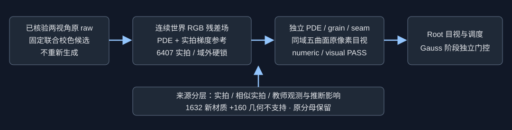

# R9 连续共享外观场 v2 独立验收

共享曲面材质的数值与独立目视均 PASS，等待 root 独立目视与后续阶段调度。当前 field SHA `2eaf1569a97fb8ee6907696dfa28db91bb5f3072f74d37491007c87012e2c647`；v1 失败对照保持不变。

原 raw、合法观测、联合校色候选、非平面几何及6407实拍锁固定。v2求解相对于完整实拍seed的连续RGB残差，以实拍梯度保留颗粒。数据可见性进入变分目标，不再作为逐点RGB覆盖系数。

独立四邻差分模板重算PDE，保存float32状态的相对残差约1.98e-5至2.17e-5，处于严格传播的导出量化界约6.11e-5至6.67e-5内；原double CG阈值1e-6未改。真实锁与权限外逐字节不变，RGB=seed+δ独立重放通过。全部103469合法视角样本仍有正权重，未按robust权重缩减固定分母。

完整实际更新域212193 texels的2cm高频相关性0.99999125、HF变化/seed HF RMS为0.004198；4cm为0.99993436和0.011645。固定v1边界低频跳变p95=.0014863（seed=.0016208）；当前来源边界=.0031048（seed=.0032403），均符合原接缝合同。旧130872通道全RGB/低频改善只表示沿用候选校色质量，不冒称当前field的新指标。

五张1152×768纯材质图已逐一目视，与v1逐位相同显示域。v1明显条带及孤立深色印记已消退，未见同等级新增硬接缝；旧C/S/W与原图RGB没有混入默认材质。1792黑边仍完整拆分1632新材质、160现有几何不支持，已覆盖部分旧暗阈值计数0；几何和全场景修复不由此项PASS表示。

来源kind3阈值为条件teacher influence>.001，观测和推断另有mask。kind2是相似实拍占主导，包含40850个有微弱连续teacher尾部的texel（最大linear RGB变化.00020972），不能写成全部bitexact纯seed。influence和confidence均非校准概率；v2 influence也不是RGB逐点混合alpha。

独立入口numeric_acceptance.json、visual_review.json；CPU验收新增GPU、扩散、Gauss更新均0。
