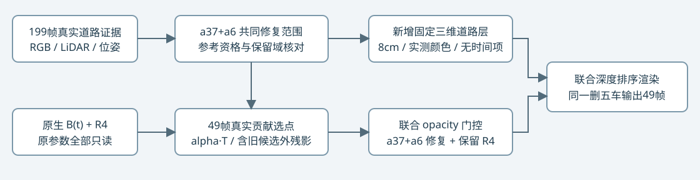

# R4上的a37/a6联合残影修复

[同一R4底图、raw105局部与完整49帧](result_report.html)。共同删除a5/a26/a18/a6/a37，联合修复a37/a6，原B与R4只读；新增1000正式步+34验证/恢复更新。原a5阴影指标保持，a37/a6有效参考域均改善，后段无参考区域仍有残留，人工结论留空。GPU保持开启。

解包joint_a37_a6_replay.tar.gz，两个campaign目录保持同级。在新联合运行目录执行：`python source/joint_runtime.py --output restored_review --resume formal/checkpoint001000.pt --evaluate`。

包内R4依赖保留联合回放所需的精确字段；不替代历史R4完整数据快照。仍需原生v41 B四份权重、V3坐标bundle和原Python/CUDA环境。重新构建传感器证据还依赖远端完整199帧RGB/LiDAR及原R4输入。参考为BUILD代理，不是独立无车真值。
