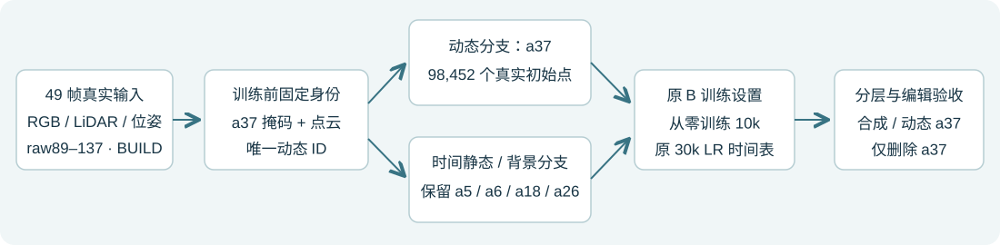

# 单 a37 身份 B10k

输入端只选 a37，原 B 设置 fresh 10k，原30k学习率horizon在10k完整节点截止。

[完整报告与49帧分层](result_report.html) · [配置](config.json) · [身份输入与差异](identity_contract.json) · [原B采样/LR全10k配对](original_B_schedule_pairing.json) · [结果/更新记账](result_summary.json)

当前是单车身份基线，尚未叠加道路修复；动态图未再用输入mask裁剪。质量和泄漏看原生完整图像及分母，不以训练重建分数替代无遮挡道路真值。

原生 static/dynamic/environment/training_state 四件10k权重包不进入Git，保留于远端现场 `scene008_a37_only_B10k_20261103_r1/a37_B10k_replay.tar.gz` 及本地Codex outputs。训练恢复依赖原输入RGB/LiDAR路径和既有原生CUDA环境；包内含新身份输入、配置、代码和完整Adam/RNG状态。smoke失败/重放和所有旧现场保留。
