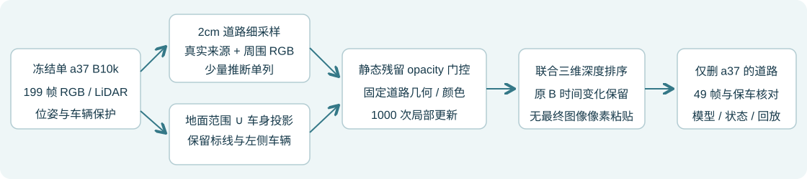

# 单a37 B10k道路修复 R3

[完整49帧、红框与左车对照](result_report.html) · [设置](settings.json) · [完整统计](result_summary.json) · [状态恢复](restore.json)

冻结单a37 B10k，最终道路子分支fresh1000步；真实199来源与少量显式沥青推断分开，车身投影补齐修复范围，保留原生标线和左车。无最终图像像素粘贴，父参数和时间状态保持。少量边缘差异/底部推断色差仍展示，人工质量评分未代填。

最终修复状态见checkpoint001000.pt；约189MiB回放包与历史证据保留于远端scene008_a37_only_B10k_road_20261103_r3及本地outputs。既有B10k四权重、原生CUDA环境与V3坐标是外部依赖；原始/中间模型未覆盖，GPU未关。
