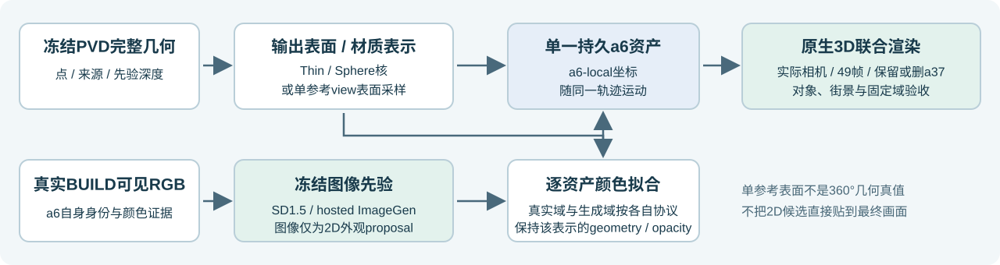

# Scene008：冻结 PVD 的车体外观补全

灰白下车身主要来自下游材质回退，PVD 本身只输出 XYZ。本轮接入预训练外观候选、原始分辨率观测拟合和表面重采样，生成一份可独立渲染、随轨迹运动并参与统一遮挡的 a6 资产。PVD 和外观模型权重始终冻结，道路分支未优化。

[完整49帧交互报告、候选和资产下载](delivery/index.html)。报告分别展示二维生成候选、三维黑底资产以及保留／删除 a37 的实际场景渲染；三套图库各有独立 receipt，不能混接。

当前最清楚的路线将 PVD 派生深度重采样为47,544个对象坐标 surfel，保留2,778个未在参考相机贡献的先验基元，再按相同40个 BUILD 视角、相同真实 RGB 域执行1,000步数值颜色拟合。原生 a6 行退出成像；两种编辑状态使用同一资产，只关闭 a37。

**当前尚未达到用户参考图的完整写实程度，也未自动替换保留基线。** 牌照槽、保险杠和轮胎已有可读细节，但先验深度仍造成表面弯曲、边缘破损。单参考视角重采样不等于已验证的360°恢复；生成的隐藏纹理没有独立真值。

| 固定评价域 | 球核＋外观 | 重采样表面＋40 BUILD 正式拟合 |
|---|---:|---:|
| 9 HELD 原始分辨率可见 RGB MAE | 0.0419967 | 0.0411078 |
| 全49帧原始分辨率可见 RGB MAE | 0.0436344 | 0.0425577 |
| 全49帧固定 LiDAR 深度 MAE，米 | 0.285799 | 0.317099 |

原薄片 M2 深度 MAE 为0.274980米。这些 RGB 数值使用相同原始分辨率观测域，不与历史480分辨率均值拼接，也不代表隐藏补全准确率。HELD9未进入颜色拟合，但已用于跨表示缺陷分析，属于内部开发诊断留出，不能作为独立最终确认集；几何仍继承本场景上下文。

背景参数冻结不等于其他成像完全不变。原生480分辨率49帧成对检查中，相对球核＋外观，a37 的 RGB 变化超过0.02者为0/536,128；保留状态道路为32/1,075,281；保留／删除状态 outside 为7,037／10,528个像素，分母均为6,312,448。局部颜色、期望深度和遮挡变化完整披露。

## 复现与执行记录

远端运行：`/root/autodl-tmp/drivingeditor_repro/campaign/scene008_a6_appearance_formal_20261105`。

最终研究资产：`output_adapter/projective_surface/formal_observed/formal/complete_a6.npz`，本报告同样提供于 `delivery/data/`。SHA256：`70826fc7c9c011ee073f7ffea4f22501a57f39ffa2cd0d52cd5ebd9c37b14e53`。

SD1.5＋IP-Adapter执行固定8个候选和单列的 CUDA smoke；更强 hosted 生成器执行2次候选生成。Hosted 模型没有公开本次 checkpoint hash 或确定性重放，因此只记录实际返回图、完整请求和下游可重放资产，不冒充可复现模型训练。

三组真实观测控制各执行32步 smoke＋1,000正式颜色步；五个生成颜色分支各1,000步，均非神经模型权重训练。实际覆盖 checkpoint 保存、完整下一步恢复、资产导出和场景入口。各正式运行均远短于一小时；失败 dtype／准备／评价及额外重放独立记账。

最终观测拟合保持几何、透明度和来源；30,190个 BUILD 零贡献列保留原 SH。生成材料仅来自 BUILD106；HELD 未进入生成候选选择或颜色拟合，但参与了表示缺陷诊断。独立 CPU 审查覆盖像素中心变换、米制／模型制转换、预乘透明度、来源及保护列。交互 QA 覆盖147个实际 JS 状态和294个图片来源，三套图库各49帧完整。

本轮新增知识：在 PVD 权重冻结的前提下，外观先验和输出适配仍能替换全局灰色回退，但点到表面／材质的输出表达会丢失二维先验细节；改进清晰度仍不能代替正确的测量深度。后续优先做观测约束的表面几何和多视图一致性，暂不因灰色回退而启动 PVD 后训练。

`failure_ledger_refs=[]`；`failure_ledger_delta=none`。人工画质 verdict 留给用户。所有原始现场、基线与正负结果保留；AutoDL 按用户要求保持开机。[更新前的状态归档](prior_research_status.md)。
