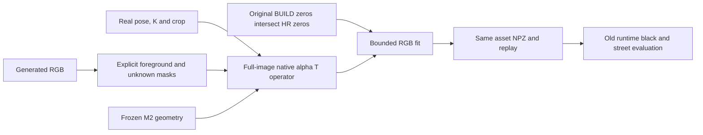

# a6 external appearance fitting adapter

The adapter maps one or more generated straight-sRGB images and separate
foreground/unknown masks onto the same 18,432 M2 primitives. PVD geometry,
opacity, normals, thickness, child ancestry and model weights stay frozen.
Generated colours remain inferred; a black image background is never a target.



## Permission and observation rules

- `original BUILD design.npz` defines exact zero columns, with no threshold.
- The basic M2 diagnostic can update those 10,557 columns only. All 7,875
  contributing columns keep every SH/RGB/flag byte.
- The HR main branch also intersects `highres/inputs.npz:unknown` with the
  original zeros. On this run HR has 9,770 zeros and the intersection has
  9,630 columns. Thus all 8,802 columns with either real observation remain
  unchanged. The core directly checks both sparse designs before export.
- A candidate target must pass an explicit foreground and unknown mask,
  native alpha >= .9, and permitted-unknown normalized contribution >= .25.
  The last threshold uses the intersection in the HR branch.
- The candidates are straight RGB. Native `W` is divided by alpha once to
  form `A`; candidate RGB is not divided by alpha.
- Candidate geometry/alignment is not assumed correct because an image
  generator was asked to preserve it. Actual asset renders are required.
- HELD9 frames are final evaluation only. Do not choose a candidate or tune
  its fit by viewing HELD metrics or renders.

## Executables

`adapter.py` is a NumPy/SciPy CPU solver. Its manifest accepts one or multiple
views and requires exact camera/mask pixel identities. It exports old-runtime
`complete_a6.npz`, `replay.npz`, `full_state.npz`, and `receipt.json` into a new
directory. It refuses synthetic test ray packets by default.

`bridge_packet.py` consumes the existing `inputs/raw106` or `inputs_hr/raw106`
packages. It samples the unchanged 512 candidate at native pixel centres using
the recorded full affine, and creates a manifest plus packet for `adapter.py`.
For HR, the transform is `low=(hr+.5)/4-.5` followed by the original low-to-512
affine. It asserts equality with every `samples.generated_xy` coordinate.

`native_extract.py` can create a new exact native W packet for any unit-explicit
camera package. It renders with a full-image camera and uses the crop only for
pixel selection. Replacing it with a cropped FoV changes native EWA clamping.
This optional extractor needs the drivingeditor GPU environment and has not
been newly executed by this adapter work.

`render_asset.py` accepts arbitrary same-M2 asset paths. It offers a short
actual black preview or fixed all49 low-resolution RGB/depth evaluation plus
1920x1280 black and frozen-street keep/delete renders. The renderer must use
`/root/autodl-tmp/envs/drivingeditor/bin/python`, not motionproj.

`cross_kernel_eval.py` separately compares the one sphere result to retained
thin M2 and thin HR assets over all49 original observations. It permits only
the declared `thickness=sigma` change, measures alpha/depth rather than
asserting equality, and adds a37/road/outside RGB, expected-depth and group
contribution deltas. All denominators stay fixed to the observation bank.

## HR main branch replay

From the remote campaign directory, with `RUN` denoting
`scene008_a6_appearance_formal_20261105`, the main strong v2 fit is equivalent to:

```bash
env CUDA_VISIBLE_DEVICES= OMP_NUM_THREADS=1 MKL_NUM_THREADS=1 OPENBLAS_NUM_THREADS=1 \
  /root/autodl-tmp/envs/motionproj/bin/python -B "$RUN/source/fit_adapter/bridge_packet.py" \
  --packet "$RUN/inputs_hr/raw106" \
  --mask-directory "$RUN/inputs/raw106" \
  --candidate "$RUN/inputs/raw106/strong_candidate_v2_512.png" \
  --asset "$RUN/highres/formal/complete_a6.npz" \
  --additional-zero-mask "$RUN/highres/inputs.npz" \
  --additional-protected-design "$RUN/highres/design.npz" \
  --output "$RUN/generated_fit/NEW_REPLAY_DIRECTORY" --steps 1000
```

The 1,000 CPU colour steps train no neural model. Complete x/y/momentum/loss/
step state is saved; exact next-step restoration is checked separately and
its two extra updates are reported. Output directories must be new, preserving
all prior models, logs and candidate packages.

## Manifest contract

```json
{
  "schema": "a6.external_appearance_candidates.v1",
  "views": [{
    "id": "raw106_generated",
    "camera_npz": "view.npz",
    "rgb": {"path": "candidate.npz", "key": "RGB_srgb"},
    "foreground_mask": {"path": "masks.npz", "key": "foreground_mask"},
    "unknown_mask": {"path": "masks.npz", "key": "RGB_unknown_mask"},
    "rgb_mode": "straight_srgb",
    "operator_dir": "operator",
    "weight": 1.0
  }]
}
```

Camera NPZ stores full-image K, crop K/offsets, full-image dimensions, native
`model_from_local` and `model_to_camera`, `meter_to_model`, independent
`camera_from_local_m`, and explicit known/unknown masks. Pixel centre projection
is `u=K*camera_xyz/z-.5`. No silent RGB/mask resize is allowed. Multi-view fits
give each view equal total weight by default; unseen/unhit columns stay intact.

## CPU validation and remaining quality limits

`test_adapter_cpu.py` uses the real M2 geometry and a real raw90 camera package,
with explicitly labelled small synthetic sparse rays. It checks independent
pose/crop projection, exact BUILD preservation, HR-only observation protection,
known/unknown admission, export/reload through old `SHAsset`, and full-state
next-step replay. It does not claim synthetic rays validate native rasterization.

Original prepared FRONT RGB is 1920x1280; the old fit used a 480x320 linear
downsample. The 1920x1280 body masks for a6 actor_3 and a37 actor_4 are strictly
4x-nearest replicas of the reviewed 480x320 masks in all 49 frames. HR RGB adds
image detail, not boundary annotation detail. A separate observed-region HR
refit is therefore appropriate; the unknown-only adapter's protection is a
safety boundary for this branch, not a permanent limit on appearance research.

The actual strong v2 asset is clearer than v1 but still contains splat-shaped
holes/streaks under the frozen geometry/kernel. Improving SH0 colours alone
does not repair those rendering limits. Additional generated views can improve
view coverage but cannot be treated as independent real evidence.

## Separate sphere output-kernel control

The later sphere control changes only `thickness=sigma` before its own
observed-colour fit. PVD point positions/count, tangent sigma, normal,
opacity, ancestry and PVD weights remain the same. This is a separately named
output-kernel experiment, not a replacement of the retained thin main result.

For that branch, pass its own `sphere_highres/design.npz` as `--build-design`
and its observed-only formal asset as `--asset`. Its raw106 W packet must be
newly extracted with the sphere kernel; the bridge checks geometry hash and
`samples.column_unknown` against the supplied real BUILD design. Do not reuse
the thin primitive permission mask. The sphere's own BUILD zero columns are
the only appearance freedom, and generated fitting must preserve its observed
predictions exactly. The receipt's legacy `original_BUILD_*` fields refer to
the supplied branch's fixed real BUILD operator.

Reuse the same strong v2 RGB and the same recorded 512 camera mapping, without
new generation. Compare sphere+texture against its sphere observed-only base
for colour-only invariance, and present the thin and sphere full-camera renders
at a common physical crop to show the output-kernel change plainly.

The completed sphere generated fit updated 7,237 of 9,956 zero columns and
preserved all 8,476 observed columns. Its all49 RGB MAE is 0.050076 (observed-only
sphere 0.050040), and its measured a6 depth MAE is 0.285799m (thin 0.274980m).
Thus visual smoothing is not an across-metric accuracy improvement. Cross-kernel
preservation found no a37 RGB delta above .02; road/outside have small mean
deltas but finite local outliers. Audit PASS records a complete measurement,
not scene-adoption approval or hidden-surface colour truth.
