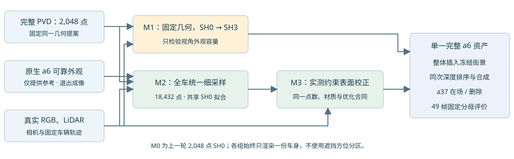

# Scene008: complete-asset material, discretization and measured correction controls

The first complete2048-point PVD asset preserved too little measured a6 detail. This follow-up separately tests view-dependent appearance, whole-car sampling, and measurement-supported geometry while keeping a single object asset. Native a6 contributes zero renderer rows; the trajectory, a37, static scene, road1K, saved world-road field and environment stay frozen.

## Findings

| Asset | Observed RGB MAE | Measured depth MAE /m | Core coverage |
|---|---:|---:|---:|
| Native a6 |.018733|.268565|.999890|
| M0:2048 SH0 |.049509|.326457|.985183|
| M1:2048 constrained canonical SH3 |.048565|.326457|.985183|
| M2:18432 whole-car SH0 |.038116|.274980|.996595|
| M3:M2 plus measured normal offsets |.038174|.274192|.996613|

The fixed39,308 observed RGB pixels and8,930 LiDAR measurements are shared. M2 provides the useful current research baseline; quality remains below native observed appearance. M3 adds less than1mm average depth improvement while slightly worsening RGB. No eligibility/parameter expansion followed the result.

M1 keeps alpha/depth exactly unchanged and only adds a safely bounded SH3 material. M2 replaces each proposal splat with one deterministic nine-child tangent family, not parent-plus-child bodies; child scales/opacities and alpha/depth really change. Integral normalization is not per-pixel or oblique-view equivalence. M3 keepsN, normal,scale,opacity,SH0 capacity, initial material prior and target pixels exactly matched toM2; only234/18432 centers pass the robust multi-frame checks and move along normals, up to5.54cm. Remaining centers stay exact. Supported local planes are interpolation/limited extrapolation, not a direct visibility certificate for every center.

InternalHELD9 has1,619 measured depths; BUILD has7,311. The parent PVD/native use full-scene context, including14 of200 PVD conditioning points fromHELD. This is an incremental same-scene control, not independent hidden geometry or cross-scene generalization.

## Road seam and blue-tone diagnosis

Three raw frames105/113/130, keep/delete: the road seam persists with the saved world colour field disabled and grows after the frozen recovered road is inserted. The field slightly reduces the measured boundary jump. Replacing a6 has zero effect on that boundary metric. Off-road field influence is at numerical noise (max2.98e-8).

The original RGB already has a broad cool tone: globalB-(R+G)/2=.0756–.0789 versusnative.0785–.0811. The learned environment is a direction-dependent background added as(1-alpha)*env; its cold background contribution is not evidence that all opaque surfaces are lit blue. The mean includes sky. The precise earlier contribution of reference texture, shadows, static gate and background fitting has not been uniquely isolated. Road parameters were not changed during vehicle controls.

## Validation and accounting

Each arm has2000 formal full-batch material steps, save/eval/full-state-next-step restore smoke and all49 paired frame evaluation. The first SH3 smoke found nondeterministic generic CSR reduction; a fixed-tree FP64 accumulation kernel passed exact replay and independent SciPy/adjoint checks before formal. M2 smoke caught an old2048-only Runtime import; explicit source binding was fixed before formal. Failed attempts,32-step smoke states, next-step replays and the extra2000-step original-SH0 optimizer audit are separately retained. No hour-long run was started.

M3 standalone metadata includes current geometry/provenance hashes, exact source/contract/builder SHA and all40 BUILD frame hashes. NPZ assets load without native modules; M2/M3 high SH are exactly zero. All source/data hashes, fixed masks and preservation tails are in the report. Published source text is LF-normalized; byte-exact executed versions including backups are retained in the evidence archive so source SHA checks remain reproducible.

[49-frame report and road diagnosis](index.html) · [Comparison CSV](comparison.csv) · [Quality status](quality_decision.json) · [Final QA](evidence/delivery_QA.json)

[M1 asset](assets/m1_complete_a6.npz) · [M2 asset](assets/m2_complete_a6.npz) · [M3 asset](assets/m3_complete_a6.npz) · [Independent loader](source/sh_asset.py)

Reproduction uses the existing campaign sibling data/environment layout. Copy `source/` into a new campaign run first; the source defaults depend on the saved native, road and observation directories. Compile `deterministic_csr.cu` with `nvcc -O3 -std=c++14 -shared -Xcompiler -fPIC -o libdeterministic_csr.so source/deterministic_csr.cu`. Standalone object loading only needs the explicit NPZ path plus sh_asset.py/full_pvd.py and standard NumPy/SciPy/Torch.

No source checkpoint was overwritten. Unrelated repository changes were preserved. AutoDL remains on; no shutdown was performed.
