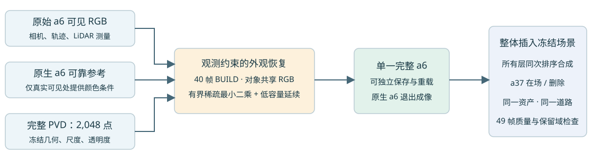

# Scene008: single complete a6 asset, first fixed-geometry control

The native a6 object branch and a partial PVD patch previously competed inside the car. This experiment replaces all100,358 native-a6 rows with one standalone2048-row full PVD asset, shared in both a37-present and a37-deleted scenes. The native asset conditions reliable observed appearance but has zero renderer input rows. Static scene, a37, road1K and the previously saved world road colour field remain frozen.

## Result

The engineering path passes: all49 paired frames, one depth sort, group alpha*T conservation, fixed geometry hashes, exact standalone asset save/reload, and original road1K baseline parity (maxRGB difference5.96e-8). **Quality is not accepted.**

On the same39,308 real observed a6 pixels, isolated nativeRGB MAE is0.018733, complete fitted assetRGB MAE is0.049509. On8,930 measured depth points, nativeMAE is0.268565m versus0.326457m. Complete asset coverage on the full fixed core is0.985183; incomplete core coverage alone does not explain the detail gap.

Native uses100,358 primitives and SH3, while the first control uses2048 primitives and SH0. Geometry, spatial resolution and material capacity are therefore not causally isolated. The next contract separates these factors before measured-surface correction; no occlusion-direction-specific clipping is used.

## Method and evidence

- Full original2048 PVD points:200 measured conditioning points plus1848 generated points, all retained. This is not the old de-duplicated1477-point patch.
- Fixed PCA Gaussianization, centres/normals/scales/opacity/trajectory frozen. Shared6144 boundedRGB parameters, BUILD40 real visible a6 pixels only, ridge lambda.001. Fit27,429 eroded pixels; native appearance reference restricted to reliable pixels within the same real mask. Unknown material uses a low-capacity object-colour prior and explicit inferred flags.
- InternalHELD9 is appearance-only: source geometry/full-scene native reference already use scene context, including14 PVD conditioning points from these frames. No independent geometry/generalization claim.
- RealGPU smoke includes nonuniform colour design parity, save/reload and next-stage entry. Fixed-geometry appearance solve took about62s; all49 evaluation about41s. No long neural training or geometry updates.
- Unknown hidden parts are assessed for continuity, ordering and stability; no hiddenRGB accuracy claim. Native static residue remains frozen diagnostic context; external static occlusion is not declared solved.

[49-frame interactive report](index.html) · [Fixed metrics](fixed_metrics.csv) · [Geometry/material capacity audit](evidence/capacity_audit.json) · [Next unified-asset contract, design only](evidence/next_unified_asset_contract.json)

[Standalone complete NPZ](assets/complete_a6_fitted.npz) · [SH0 Gaussian PLY](assets/complete_a6_fitted.ply) · [Independent loader](source/full_pvd.py)

## Old branch closeout

The full-basis clipping/moment branch was stopped and preserved. Its12 engineering smoke cases passed, but formal49 quality evaluation did not finish;34 partial derived NPZ files were integrity-checked, no new asset adopted, S/U arms not run. [Closeout](old_work_closeout/index.html).

AutoDL remains on. This task explicitly does not authorize shutdown.
