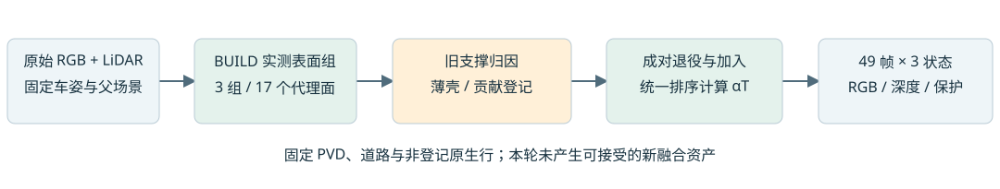

# Scene008：实测表面成对接管验证

本轮实现薄壳与贡献登记两种启发式接管，均枚举三组并验证完整49帧。执行与保存状态重放通过，三个小表面组在两种规则下均未通过完整方法验收。保留既有父资产，不采用本轮编辑。

固定PVD、道路、原始车姿与观测。先把上一轮399个实测代理面的深度损伤拆成联合贡献：原始投影最大偏差3.26e-5像素，独立面在alpha>=.02的面内深度MAE .0488m（分母与先前整面联合指标不同）。raw113同域中，叠加后近侧旧贡献 .383->.365、远侧 .617->.146，有符号深度误差 +.012->-.372m。仅插入正确深度的面会压制远支撑，不能保证最终深度正确。

## 构建与对照

实测锚点要求两个不同BUILD帧的真实RGB，邻域8cm、法线差20度、平面q95残差<=6cm。所有合格组为15/9/8锚点，切向采样后7/5/5代理面，尺度上限3.5cm。没有按渲染收益选组。

40 BUILD帧拟合；内部留出9帧为89/95/101/105/113/121/125/130/137。三组BUILD/留出像素141/26、49/9、65/6。留出已用于多轮机制诊断，父资产/PVD/继承域含全场景上下文，不是独立泛化或未触碰测试集。

每组四臂：父资产、仅退役、仅加代理面、成对接管。主退役率固定.5。标量BUILD预算二分还诊断.25/.75/1；联合系数只在.5下求7/5/5维有界系数，两步、上限.35。没有自由调整几何/颜色/尺度，也未训练神经策略。

薄壳只退出物理小盒内条件质量。贡献登记按BUILD的实际alpha*T>=.05且跨两帧筛选原生a6行，切向不扩大，法线取条件mode的q05-q95并加8cm。登记755/175/310行全部mixed，目标责任比例中位1.72%/1.04%/1.91%，prism厚2.82/1.98/3.05m。登记证明渲染责任，尚无深度一致性筛选，不是身份真值。退役仅作用登记a6；静态/a37/PVD/新面均不退役。

## 验证结果

|规则|组|留出像素|RGB：仅退役->成对|深度m：仅退役->成对|组贡献绝对误差|
|---|---:|---:|---:|---:|---:|
|薄壳|1|26|.012971->.013102|.254249->.250563|.016922|
|薄壳|2|9|.003937->.003756|.028584->.027083|.014353|
|薄壳|3|6|.020686->.020884|.328829->.312074|.012349|
|登记|1|26|.012957->.013126|.263924->.256430|.023325|
|登记|2|9|.005334->.005047|.025315->.021800|.023442|
|登记|3|6|.020781->.020997|.323189->.308015|.012227|

验收要求BUILD通过、留出RGB和深度相对同退役臂均改善、组贡献平均绝对偏差<=.01、全49帧三状态保护。两套全部组均拒绝；街景无编辑/删a37既定guard均过，黑底raw97 outside_rgb及raw134 known_rgb_change未过。各组小面损失也有未过项。完整指标见summary.json、fixed_metrics.csv与压缩原始evaluation。

216个保存状态精确指标重放覆盖两套规则x3组x3探针x3状态x4臂。物理透明度与逐命中系数一致性通过；登记变体最大depth_sum偏差1.20e-7。独立审计复核lineage、候选对象、原mask分母、BUILD来源与ledger哈希。核心NPZ已保存，原始checkpoint未修改。元数据no_other_retirement_levels_run仅指joint阶段，root仍诊断全部levels，见metadata_errata.json。

## 重放与位置

环境：/root/autodl-tmp/envs/drivingeditor/bin/python，Torch2.2.2/cu118，RTX4080SUPER。真实渲染先过零操作、模型不变与alphaT守恒smoke；此次是分钟级零神经训练实验，未启动长训练。

运行目录：
- /root/autodl-tmp/drivingeditor_repro/campaign/scene008_a6_coupled_handoff_20261105
- /root/autodl-tmp/drivingeditor_repro/campaign/scene008_a6_registered_handoff_20261105

薄壳入口source/create_groups.py -> run_coupled.py -> fit_root.py -> operating_curve.py -> fit_joint.py -> verify_coupled.py。
登记入口source/register_support.py --source <thin> --output <registered> -> run_registered.py -> verify_registered.py。
依赖上一轮heuristic/rescue及depth_order/volume原生光栅实现和观测，原路径均保留。

交付：登记目录delivery/index.html；本地outputs/scene008_coupled_handoff/delivery/index.html，含架构、9帧交互四臂、贡献图、街景原图、3528行固定指标、原始JSON、源码与SHA256。压缩包SHA见delivery.v2.tar.gz.sha256。AutoDL保持开机；全部子代理sol6.1/max。

下一步待验证：固定实测组，近/同/远深度分层退役，显式零操作；先同时约束父场景RGB、深度和非目标成像，再进入下部缺失区。现阶段未宣称解决遮挡，也无MOG-2不透明首交保证。

Git归档文本统一为LF并去掉文件尾空行；数值和二进制资产保持原样。原始字节、来源哈希与完整交付包保留在campaign，源码哈希审计针对campaign原件。
