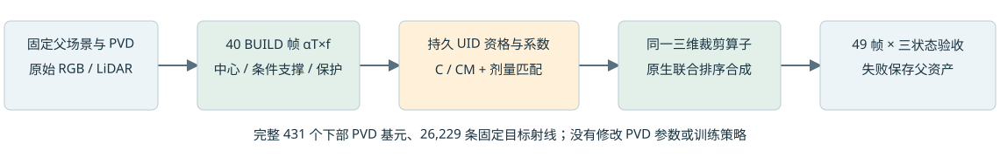

# Scene008：完整下部深度一致性规则验证

五臂完整49帧三状态评价结束。C32个UID、CM30个UID；资格分支仅略超raw97既定累计outside_rgb变化门槛，未采用。固定PVD与父资产保留。模式资格相对剂量匹配C几乎没有额外显露收益，不能据此声称主要混合支撑已解决。

## 固定方法与对照

原431 lower PVD、26,229目标像素固定。动作是旧36cell corridor的精确条件质量裁剪，原生联合center-depth排序，跨时刻/编辑状态共享native-ID系数。只改变资格，不改PVD、颜色、几何、道路或轨迹；神经训练0。

BUILD40帧：实际父alpha*T乘完整crop fraction登记目标及保护责任。C要求>=80%目标责任的实际排序中心在独立PVD加权深度前12cm；CM再要求条件mode（包含继承半空间与物理crop截断）也在前。每项有>=2个独立BUILD帧支持、full target mass>=.05、P/(G+P)<=.02。参数见contract；PVD参考不是隐藏真值，缺观测不是free。继承protected ratio常用P/G；本轮归一化已显式固定，32/30当前行在旧归一化下也都通过。

五臂：parent；corridor所有ID .5；C .5；CM .5；C剂量匹配。匹配系数.4969669952607887，依据选中UID的完整目标crop质量，包含off-class命中。保存float32后第一阶剂量差2.11e-7。主候选预先固定CM，控制臂不参与事后挑赢家。

|分支|黑底下部贡献比|删a37街景贡献比|失败帧黑/keep/delete|
|---|---|---|---|
|parent|50.934123%|48.859336%|0/0/0|
|corridor|53.680354%|51.584133%|34/0/16|
|center|50.998251%|48.923431%|1/0/0|
|dual|50.997895%|48.923076%|1/0/0|
|center_matched|50.997829%|48.923009%|1/0/0|

原本可裁剪目标责任1010.4665，protect gate排除95.9004%。CM仅覆盖2.7977%；比C额外排除的质量只占全量0.0171%。相对parent黑底增加.063772个百分点；相对匹配C仅增加.00006522个百分点。资格分支raw97 outside_rgb约.0050022667，上限.005，parent为.00499979175，超出约2.27e-6。新增5mm实测深度保真和.05逐像素RGB tail门槛未触发。失败是累计变化预算，不能等同于明显新增色斑，也不放宽合同。

## 混合支撑覆盖预检

BUILD完整原生前方alpha*T为10081.149863，现corridor可裁剪条件质量仅占7.9741%。原生前方贡献归因与PVD visibility deficit是不同量。

用真实BUILD LiDAR点和独立PVD提案点，按父传输责任回到实际时刻车体坐标建立双侧关联。全部满足双role质量/跨帧/分离条件的1502个UID覆盖40.2563%原生前方贡献；其前方clip责任占0.4200%。没有按无clip或画质挑子集。仍有未覆盖前景，不能泛化为完整场景恢复。

该预检只登记责任与候选平面，尚未运行children换基。后续设计见next_reexpression_contract.json：先P->完整双侧R无退役检验保真，再比较选择退出S与剂量匹配U。解析概率和矩守恒不等于投影峰值opacity或联合图像守恒；继承clip必须正确处理，不复制旧precision到新几何。若R已不保真或S无安全额外作用，停止零训练标量/矩替换，独立设计有界局部重拟合。

## 验证和重放

真实GPU smoke：零操作与旧volume常系数.5输出精确一致；实际排序center与feature深度最大差4.77e-6m。40帧稀疏质量账本精确聚合，3BUILD真实质量重算通过。4探针97/105/113/130共60场景指标独立保存状态重放，选中零操作与父资产精确一致。预检又在3BUILD按独立raw K/world变换核对实际测量点坐标与质量。代码/模型不变与独立CPU审计见对应JSON。

原有HELD9帧89/95/101/105/113/121/125/130/137已经多轮机制诊断；参数仅BUILD，full49保护veto参与最终选择。这不是未触碰验证或独立泛化。隐藏域无独立RGB/depth真值，不以PVD贡献增加当作补全准确率。原生高斯透明合成未实现不透明表面首交。

远端目录：/root/autodl-tmp/drivingeditor_repro/campaign/scene008_a6_depth_consistency_20261105

入口：source/smoke_consistency.py -> register_consistency.py -> evaluate_consistency.py -> verify_consistency.py + verify_failure.py -> reexpression_preflight.py -> verify_preflight.py -> make_delivery.py。使用/root/autodl-tmp/envs/drivingeditor/bin/python，Torch2.2.2/cu118与RTX4080SUPER。依赖旧campaign父模型、PVD、道路与helpers，state_interface.json定义额外物理裁剪系数；零为保留父资产。

本地交付outputs/scene008_depth_consistency/delivery/index.html，含组件图、49黑底帧、街景、735项指标、40帧稀疏账本、源码与原始JSON。包SHA见delivery.tar.gz.sha256。Git文本统一LF/文件尾，原始字节与来源hash保留在campaign及交付包。AutoDL保持开机；全部子代理sol6.1/max。
