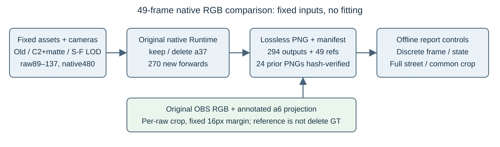

**49 帧原生 RGB 双状态对照补齐**

本轮为现有报告补齐 raw89–137 的实际 full480 图像，不新增训练、颜色拟合或资产参数更新。三列固定为旧 formal、新 C2+matte、同一 S/F 的 SurfaceLOD；每帧同时保留 keep/delete a37 两种状态。科学结果和既有限制沿用主报告。

共 294 张方法图和 49 张真实480参考。45个缺图raw执行270次实际原生forward，耗时77.50秒；既有105/106/113/130的24张PNG通过归档SHA、资产/S/F、`.so`、runtime/loader与背景metadata一致性校验后逐字复用，没有插值或混用其它版本。执行期间原a5任务继续运行，本进程allocator上限为设备显存40%，峰值实际分配3.20GB；未关机、未停止其它任务或服务。

|列ID|固定来源|
|---|---|
|`old_formal`|旧 projective formal，资产 SHA `70826fc7…`|
|`c2_matte`|正式 C2+matte canonical，资产 SHA `0b1f69e1…`|
|`surface_lod`|同 canonical RGB/alpha 与固定 C2 spline，仅随相机采样，资产 SHA `0b1f69e1…`、posterior SHA `b98a0d93…`|

每raw的公共crop来自原OBS中a6标注padded-box投影足迹与reviewed轮廓的并集bbox，统一加16像素margin并截断到480×320。三方法、两状态与真实参考使用完全相同的crop；它只用于显示，不改变评价域，也不用预测alpha挑窗口。默认全景便于保留道路与原暗斑，局部裁剪不作为去影证据。

真实参考来自原观测库同raw的RGB，a37仍在；它不是delete状态的隐藏道路真值。所有PNG均无损保存。父报告可用classic inline JavaScript在离散raw之间切换，不能制造中间帧；主页面、PNG目录与静态fallback应一起保留。

权威清单为 `native49_v1/manifest.json`，SHA `efbcf40049521eecb947e3e9a2282b83796ccf36433dc328e2724a2e0c90c9dd`。清单显式列出49个raw、两状态、三列ID、每PNG路径/SHA/480×320/raw/state/method、相机与公共crop、资产和renderer文件SHA。独立图片包52,382,968字节，SHA `a60b38cadf9b4e616b5b920366480163ceed24e946ee6b3745ffefc78d90ec5c`；不含大CSR矩阵、训练states或checkpoint。

素材取回后343张PNG逐张核对SHA、解码RGB尺寸，并交叉检查raw/state/method和公共crop，结果见 `download_qa.json`。独立QA与浏览器交互验收由原审查流程单列。本轮PVD/预训练模型/颜色/几何优化更新均为0；人工质量采用不在此补图任务中代填。

远端来源：`/root/autodl-tmp/drivingeditor_repro/campaign/scene008_a6_insert_artifacts_20261105/frame_compare/native49_v1`。Git发布可由这份同SHA远端原PNG直接复制，避免将本地83MB图片重新上传。
