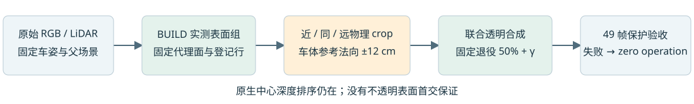

# Scene008：近/同/远物理支撑对照

固定三组实测面，对旧原生a6做近/同/远法向支撑对照，9个case全部按合同执行，8个存在可归因退役量，0个通过全部方法验收。324个保存状态指标精确重放，另有81条实际选中状态的重载验证。最终资产选择见summary与各selected.npz，失败case明确保存零操作。

本轮接续[薄壳/贡献登记失败](../scene008_a6_coupled_handoff_20261105/README.md)。保留7/5/5个实测代理面、755/175/310个登记原生行，固定几何/颜色/尺度、PVD、道路和轨迹。物理区域沿固定车体参考法向分为camera侧>12cm、同面±12cm、反侧>12cm；完整normal范围来自原车框每边+.28m的8角投影，原tangent盒与测量分母不变。BUILD相机侧必须一致。精确条件质量crop只作用于登记a6支撑，不整行退役。

物理法向层与原生Gaussian中心排序深度是不同概念；本轮不改变排序或实现不透明首交。真实GPU smoke核对三层之和等于完整物理柱，最大误差约1e-7，零操作所有输出通道与父资产精确一致。

每层四臂：parent、retirement only、proxy only、coupled。退役.5固定，仅一个BUILD标量加入系数，在0至0.35内二分10步匹配组贡献预算。没有额外阈值扫描，没有神经训练。零责任层NO_LOST_GROUP_SUPPORT属于不适用，不作为反证。

BUILD40帧，内部留出9帧89/95/101/105/113/121/125/130/137。分母与上一轮一致：BUILD/留出141/26、49/9、65/6。系数拟合不用留出；留出veto参与最终candidate/zero操作选择。留出已多轮诊断，不是未触碰独立测试或泛化证据。

严格parent目标RGB不恶化、深度改善>1e-5m只在black验证；相对同退役分支要求RGB/深度改善、组贡献绝对误差<=.01。全49帧black/keep/delete继承保护。额外非目标深度保真仅覆盖group外固定a6测点，各帧各状态mean absolute change<=.005m；其他对象/道路通过继承RGB保护，不宣称全场测量深度保真。

|组|层|留出RGB parent->coupled|留出深度m parent->coupled|贡献绝对误差|退役预算状态|接受|
|---|---|---|---|---|---|---|
|1|near|0.012256->0.012309|0.25158->0.25153|0.007594|BRACKETED|False|
|1|same|0.012256->0.012916|0.25158->0.25557|0.018665|BRACKETED|False|
|1|far|0.012256->0.012279|0.25158->0.25059|0.006985|BRACKETED|False|
|2|near|0.003285->0.003285|0.03080->0.03099|0.000196|BRACKETED|False|
|2|same|0.003285->0.004967|0.03080->0.02448|0.022558|BRACKETED|False|
|2|far|0.003285->0.003238|0.03080->0.02976|0.001961|BRACKETED|False|
|3|near|0.020704->0.020704|0.32310->0.32310|0.000000|BRACKETED|False|
|3|same|0.020704->0.021287|0.32310->0.30894|0.011302|BRACKETED|False|
|3|far|0.020704->0.020704|0.32310->0.32310|0.000000|NO_LOST_GROUP_SUPPORT|False|

retired_depth_audit.json.gz记录BUILD父transmittance下的first-order pre-retirement alpha*T归因，按实际合成中心depth相对测量±12cm重新分类；校验等于.5倍parent层native coverage。不等同于退役后真实alpha*T差，不是隐藏几何真值。完整观察与后续设计见交互报告。

## 入口与复现

目录：/root/autodl-tmp/drivingeditor_repro/campaign/scene008_a6_layered_handoff_20261105

Python /root/autodl-tmp/envs/drivingeditor/bin/python；Torch2.2.2/cu118；RTX4080SUPER。

source/smoke_layered.py -> source/run_layered.py -> source/verify_layered.py -> source/retired_depth_audit.py -> source/make_delivery.py。父规则依赖scene008_a6_registered_handoff_20261105与coupled/heuristic/depth_order等保留目录，输入观测与模型未覆盖。

本地：outputs/scene008_layered_handoff/delivery/index.html；远端：/root/autodl-tmp/drivingeditor_repro/campaign/scene008_a6_layered_handoff_20261105/delivery/index.html。包含9case四臂黑底/街景、全部5292行指标、几何登记、选择状态NPZ与源码。原始字节由SHA256包和MANIFEST保存；Git文本规范化LF，不改变数值/二进制。AutoDL保持开机，子代理均sol6.1/max。
