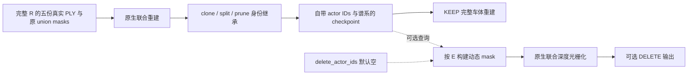

# 完整五身份重建与身份保持

`dynamic_actor_ids` 声明完整五身份建模集合。全部真实 PLY 与原 union masks 进入原生联合重建，clone、split、prune 保持每个动态高斯的身份，checkpoint 自带完整恢复信息。主要输出是 KEEP 完整车体，车顶与挡风玻璃按真实重建图验收。`delete_actor_ids` 是独立的可选查询，默认空集合，不决定哪些车辆进入静态分支。



初始化后，按 loader 的实际 PLY 行顺序调用 `bind_initial_ownership`。例如原 Full5 的输入顺序为 `[5,26,18,6,37]`，与公开集合 `[5,6,18,26,37]` 的排序无关。原生 clone/split/prune 通过真实父索引维护谱系；checkpoint 同时保存来源 actor 表和当前逐行 actor ID，并交叉验证。

```python
install_identity_serialization()  # 在创建/恢复动态模型之前
# 仅 fresh 初始化时绑定，counts 来自实际输入 PLY 行数。
bind_initial_ownership(dynamic, [(5,21358),(26,15193),(18,2444),(6,11625),(37,98452)],
                       dynamic_actor_ids=[5,6,18,26,37])
keep = render_scene(camera, static, dynamic, args, background,
                    dynamic_actor_ids=[5,6,18,26,37], delete_actor_ids=[], env_map=env)
deleted = render_scene(camera, static, dynamic, args, background,
                       dynamic_actor_ids=[5,6,18,26,37], delete_actor_ids=[37], env_map=env)
```

KEEP 直接调用原生函数。DELETE 只在每次调用私有的 `prepare_rasterization` 输出上相交动态 mask，随后使用原生 joint rasterizer。模型参数、opacity、优化器和共享模块 globals 均不改写，背景与保留车辆共同参与原深度排序。

没有身份/谱系的旧混合权重不能作为可逐 actor 编辑的 checkpoint 加载；仍可用原始 renderer 做整体 KEEP 参考。身份过滤通过、参数不变和图像质量分别验收：背景若学有车辆残影，不额外删除背景或绘制补洞来隐藏它。

新 Full5 checkpoint 必须使用本模块的 metadata-aware loader。旧 a6/a37 helper 将 lineage 区间硬编码为两辆车，不能解释新五身份的 source IDs，否则会错绑身份。推理身份来自 checkpoint 自带的来源表和当前行标识，无需原 PLY；公开集合顺序不改变已保存 ID 的含义。`render_scene` 会拒绝声明集合与已训练模型不一致的调用，缺失、未知或损坏的身份格式同样拒绝。

仓库提供直接可用的重建/身份 CLI。`dynamic_actor_ids` 从 checkpoint 只读加载；只设置删除集合，默认空集合为 KEEP。默认只渲染 97/105/109 三帧以检查 a5 重建，完整49帧必须显式选择。

```bash
python -m scripts.worldsim_v82.drivingeditor_dynamic_edit.query \
  --model /absolute/model --iteration 5000 --describe
python -m scripts.worldsim_v82.drivingeditor_dynamic_edit.query \
  --model /absolute/model --iteration 5000 --output /new/keep
python -m scripts.worldsim_v82.drivingeditor_dynamic_edit.query \
  --model /absolute/model --iteration 5000 --delete-actor-ids 37 --output /new/delete37
python -m scripts.worldsim_v82.drivingeditor_dynamic_edit.query \
  --model /absolute/model --iteration 5000 --delete-actor-ids 6 37 --scope all49 --output /new/delete6_37
```

也可使用 `--config query_example.json`，命令行参数覆盖配置值。CLI 不创建优化器、不训练、不读取原始点云或 mask；输出逐帧 PNG 和记录实际建模集合、删除集合、帧范围与参数只读验证的 `query.json`。KEEP 的车顶/挡风玻璃质量单独按实际重建图验收，不以总 alpha 或身份数代替。

可用 `export_inference` 导出只读推理包：Gaussian 保留18tuple全部参数、身份和谱系，仅去掉 Adam 的 `state`/`param_groups`；环境 checkpoint 原样保留。包内配置和 manifest 明确标记 `inference_only`，不支持训练恢复。完整 Adam/RNG 训练现场保留在原目录。

```bash
CUDA_VISIBLE_DEVICES='' python -m scripts.worldsim_v82.drivingeditor_dynamic_edit.export_inference \
  --model /absolute/full-training-model --iteration 10000 --output /new/inference-package
python -m scripts.worldsim_v82.drivingeditor_dynamic_edit.compare_inference \
  --original /absolute/full-training-model --inference-package /new/inference-package \
  --iteration 10000 --output /new/equivalence.json
```

导出先逐字段 CPU 验证，再以97/105/109原生 KEEP RGB、alpha、可见身份贡献以及逐点 actor IDs 精确比较。推理包无需原 PLY、mask 或观测 RGB；仍需要兼容的原生 CUDA 引擎与本 metadata-aware loader。
