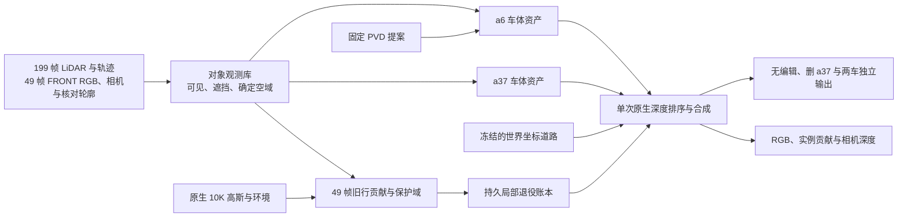

# Scene008 双实例恢复与局部替换

实验 `scene008_instances_20261105_r1`。固定 a6、a37 的实测轨迹，以各自车体坐标中的实测点约束新资产。两车各自从真实可见区域学习颜色，联合渲染监督实例贡献和测量深度。道路复用 R3 固定表面和既有门控，环境与其余原场景保持冻结。无编辑与删车共用持久局部替换状态。

| 阶段 | 输入与更新 | 检查点 |
| --- | --- | --- |
| A | 199 帧 LiDAR 按两车分别融合。49 帧 FRONT 使用逐帧核对的轮廓、原 RGB 和相机深度。明确遮挡、可能遮挡、确定空域和未知域各自保留。 | 两份带来源的车体锚点、49 份固定帧数据、CPU 候选账本 |
| B | 计划 1,200 步，前 200 步独立拟合。后续加入联合贡献和分组深度监督。颜色梯度只来自本车可见区域。位移和尺度有界，首轮关闭增密。 | 两车资产、Adam、采样器、全套 RNG |
| C | 用两种编辑状态的原生贡献归因建立 49 帧账本。计划 800 步，冻结 B 的资产并优化旧静态行共享系数。旧 a37 表达随接管进度退出，两种正式状态均用同一套退役系数。 | 旧行证据、保护域得分、共享退役状态与完整训练状态 |
| D | 接入同一份固定 PVD 的缺失面提案。移除与实测锚点重复的生成点，保留 PVD 的位置、法线和尺度。用 a6 已测颜色做低容量延续，固定几何并运行配对评价。 | 含 PVD 的候选场景与可复用诊断 |

阶段 C 的局部替换只在三维支撑和当前实际贡献同时成立时开放。持有显著保护域贡献的混合核留在账本中。若现有固定道路和新车辆表面仍无法接管其有效成像，需要先为相应表面补建表达，再重新验收该批旧行。R3 原有的小范围插值随冻结道路保留，评价已观测道路时剔除插值和弱证据域。

四组共用同一批像素和深度测量。强基线为单 a37 原生 10K 加 R3 道路恢复 1K。独立对象组保留冲突旧表达。替换组冻结同一批新对象，仅增加持久退役。PVD 组在替换组之上添加固定的 a6 几何提案。先看 raw105、113、130，再配对评价 raw089–137。已观测 RGB、贡献、测量深度、域外保护与隐藏几何假设分开报告。全部输入属于同场景 BUILD，隐藏面没有独立真值。本轮合成沿用高斯光栅。

CPU 阶段以 CRC 校验后的 199 帧建库。a6 有 4,667 个实测锚点，2,673 个带经核对的颜色。a37 有 8,225 个实测锚点，5,854 个带经核对的颜色。在同一批 39,308 个可见 a6 像素上重算归档 RGB，强基线的无编辑和删除 MAE 为 0.03050 和 0.02962，双动态并集监督为 0.02955 和 0.18066。这些数值来自归档图像的 CPU 重算，阶段 B–D 的新候选仍待实际光栅验证。[观测回执](observation_receipt.json) · [配对重算](history_cpu.json) · [CPU 接线回执](preflight_cpu.json)

GPU smoke 先复现强基线的归档 PNG，再检查实际前向和反向、有限梯度、显存、B/C 分阶段保存和完整恢复、D 的接入和重读、四组锚帧评价。正式配置见 `source/settings.json`。正式入口要求已通过的 GPU smoke 回执。CPU 准备与 GPU smoke 的更新分别记账。

远端运行目录为 `/root/autodl-tmp/drivingeditor_repro/campaign/scene008_instances_20261105_r1`。`source/run_gpu.sh` 包含 smoke 和正式入口。`observations/` 存放场景输入，`inputs/` 存放局部替换候选。观测库由 `/root/autodl-tmp/envs/driveeditor/bin/python` 建库，训练和评价使用 `/root/autodl-tmp/envs/drivingeditor/bin/python`。运行需要用户开启 GPU，之后由操作者显式启动。`failure_ledger_refs=[V82-F01,V82-F06]`，`failure_ledger_delta=none`，`human_verdict=null`。
