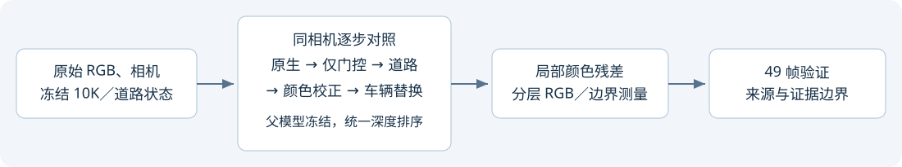

# Scene008：局部偏蓝与道路色彩边界

局部偏蓝确实超出原图；道路插入进一步增加颜色边界。49 帧同相机对照，另核对三帧删除状态，0 次训练更新。

- 左侧道路新增蓝色残差 +0.01610，49/49 帧为正。
- 右侧路缘新增蓝色残差 +0.00623，49/49 帧为正。
- 道路边界 RGB 跳变：原生 0.01585 → 固定道路插入 0.01975 → 既有颜色校正 0.01936。
- 三帧的覆盖权重参考替换指向方向背景蓝色残差与静态层补偿关系；这不等于物理照明估计或训练时序归因。
- 原生与道路状态保持冻结。AutoDL 保持开机；本对话不授权 subagent 或自动关机。

[完整可切帧报告](index.html) · [局部对照](local_comparison.png) · [指标](evidence/full49_metrics.json)

远端现场：`/root/autodl-tmp/drivingeditor_repro/campaign/scene008_local_colour_diag_20261105_r1`。
正式诊断约 203.4 秒，pilot 39.8 秒，额外分层诊断另存。所有工作均无训练更新。

failure_ledger_refs: existing color/compositing evidence; no new scientific-failure claim.
failure_ledger_delta: none.
