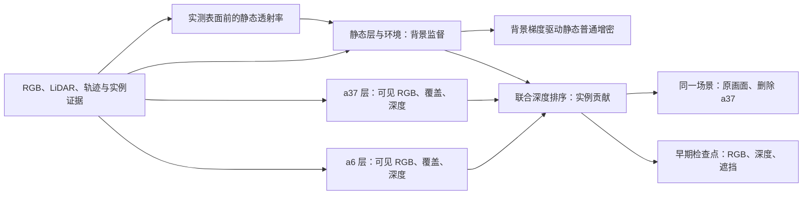

# Scene008 原生 10K 实例归属与静态遮挡

`scene008_native_ownership_20261105 / run_r3`。对照为旧双动态并集监督的 1K 和 10K 检查点。沿原生 30K 学习率时钟训练 10,000 步，seed 0，使用 raw089–137。输入是同场景真实 RGB、LiDAR、相机及轨迹，以及 199 帧观测库的审核掩码和实测深度。未运行 10K 后的 1K 道路修复、旧表示替换或 PVD 接入。

## 训练约束

- 沿用旧双动态初始化与持久行归属。a6 的 1,023 个初始源从静态层移出。clone、split、prune 继续传递源归属。原生动态仍采用原时域参数化。
- 两车各用可见内部的预乘 RGB 与覆盖拟合自己。覆盖的正域是各自可见掩码，负域是各自确定空射线，加上膨胀车体框和可见轮廓外的观测道路及保护区。两域合计按全图像素数归一，权重 100。两车 RGB 各保留旧动态系数 5。单车可见掩码之外的遮挡未知域保留。
- 同一次原生排序输出实例权重和实例条件深度。可见实例贡献负对数与确定空射线贡献平方按各域归一，权重 1。孤立及联合实例逆深度权重各 0.10，分别在实测域和已有联合支撑的实测域平均。
- 静态普通增密使用独立背景渲染的二维位置和时间梯度。背景排除两车的并集掩码及轮廓边缘。静态 RGB、背景 LiDAR 衰减、寿命、速度和天空项保留；背景逆深度按原生全图面积归一。原前景 NPS 与全图联合 RGB 由背景约束、各自的 RGB 和实测静态前缀项替代。静态前缀权重 0.5，只用 a6/a37 实测及 a6 跨时刻实测回投；训练深度余量 0.30 m，历史配对评价用 0.20 m。没有把固定 PVD 生成点当作训练深度。
- SGCM 及原生优化器保持启用。正式验收的场景和删除状态共用同一静态及环境层；删除只隐藏 a37 动态行。

## 验收

真实 GPU smoke 为 653.0 s、3900 步，执行保存、真实评价和重新载入后的两步训练。组件、优化器、采样器、SGCM、随机状态恢复审计通过。每百步记录的 CUDA 峰值分配量为 smoke 2.27 GiB、正式 3.01 GiB。正式训练 1994.3 s，全部 10,000 步的视角、时间偏移和学习率与并集对照相同。首轮失败工程预检 100 步。第一版 smoke 跑到 1915 步后停止并保存，因为 1K 道路域出现 a37 越界。第二版增加背景负约束后，试跑到 1929 步停止。1K 静态道路单层 MAE 0.0834，旧双动态 0.0393。第三版恢复原生背景 LiDAR 损失归一化。正式步数单独记账。

正式验收前移至 100、500、1,000、3,000、6,000 步。3,000 与 6,000 当步紧接原生透明度重置，另在其后 300 步复查。1K 在同三帧与旧并集监督做配对，全部继续条件通过。可见 a6 静态前缀 0.135626 → 0.000000，可见 a6 删后 RGB MAE 0.155065 → 0.115123，保护区 RGB MAE 0.047809 → 0.046563。阈值为预先登记的三帧工程门槛，1K 验收同时检查两车串车贡献、严格前后遮挡、RGB、深度和道路质量。

### 10K 同一批 49 帧

| 指标 | 有效像素 | 旧双动态并集 | 新训练 |
| --- | ---: | ---: | ---: |
| Static opacity ahead of measured a6 | 31,610 | 0.165282 | 0.000003 |
| Static opacity ahead of reprojected a6 | 12,210 | 0.593972 | 0.000671 |
| Visible a6 contribution after deletion | 39,308 | 0.898746 | 0.999886 |
| a6 contribution on reprojected rays after deletion | 12,210 | 0.139251 | 0.998851 |
| a37 contribution on visible a6 | 39,308 | 0.687383 | 0.000974 |
| a6 contribution on visible a37 | 536,128 | 0.003218 | 0.000016 |
| a37 contribution on strict occlusion rays | 17,213 | 0.971416 | 0.999693 |
| Isolated a6 RGB MAE | 39,308 | 0.202916 | 0.018730 |
| Isolated a37 RGB MAE | 536,128 | 0.017221 | 0.014532 |
| a6 RGB MAE after deletion | 39,308 | 0.190619 | 0.018728 |
| a6 RGB MAE before deletion | 39,308 | 0.029651 | 0.018847 |
| a37 RGB MAE before deletion | 536,128 | 0.016847 | 0.014531 |
| Measured a6 depth MAE after deletion (m) | 8,930 | 2.119530 | 0.268617 |
| Observed road RGB MAE before deletion | 1,075,281 | 0.008381 | 0.027203 |
| Protected-region RGB MAE before deletion | 6,312,448 | 0.014848 | 0.022589 |
| Full-frame RGB MAE before deletion | 7,526,400 | 0.014787 | 0.024374 |

删除后的道路评价使用 287,368 个同时具备跨时刻 RGB 与路面深度代理的像素。旧双动态 RGB MAE 0.144257，本轮 0.202554。49 帧联合 RGB 与原生无标签渲染的逐像素差异均在数值容差内。

本轮在已观测 a6 上同时改善了静态遮挡、实例串扰、删车 RGB 与实测深度。全场景及道路画质退化。raw113 和 raw130 的无编辑图仍有 a37 轮廓溢出，删除图中仍有后车未观测下部的灰块和深色道路缺口。道路代理域中，环境分量约占 50.9%。这部分是缺失背景读出，不能归入已测 a6 前方的静态遮挡。工程验收通过，整图画质尚未达到旧并集对照。

固定 a6 静态前缀使用与早先 0.519 → 0.165 相同的独立标记测量。重投显露参考来自同一辆车在其他时刻实测的表面，与训练有重叠，属于同场景机制验证。隐藏区没有独立准确率真值。串车权重在联合可见域统计，孤立投影重叠本身不作负样本。独立观测与原生端的解码、有效域和相机一致性检查见审计回执。

[早期继续条件](early_accept_01000.json) · [49 帧对照](union_10000.json) · [49 帧本轮](native_10000.json) · [恢复、采样和检查点回执](audit.json) · [实验入口](source/run_native.sh)。

人工验收字段 `human_verdict=null`。本轮使用原生高斯合成。AutoDL 电源由用户控制。跨版本失败条目沿用既有静态遮挡、串车诊断，`failure_ledger_delta=none`。
