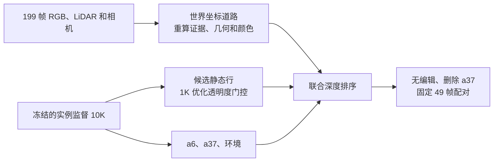

# Scene008 原生 10K 接 R3 道路恢复 1K

父模型使用[实例监督原生 10K](../scene008_native_ownership_20261105/README.md)检查点。对照为[旧强编辑 R3](../scene008_a37_only_B10k_road_20261103/README.md)。保留新父模型的 a6、a37、静态层、环境与原生时间状态。原始 49 帧相机和两个渲染状态共同使用同一份道路资产和静态门控。

## 适配和验收

- 沿用 R3 的道路几何、颜色校准、1K 优化流程、学习率 0.06、门控初值 2、损失权重、seed 0 和采样规则。颜色校准、道路覆盖和候选行依赖父模型，按原流程重算。道路资产确定后保持固定。
- 删除操作按持久归属隐藏 a37 动态行。a6 在选候选、训练和评价中参与联合深度排序。可见 a6 轮廓及 1 像素边缘加入旧车辆保护掩码。
- 静态候选按删 a37 后的 49 帧联合贡献重新登记，保留 171,366 行供训练，保护优势行 2,457。训练时只更新这些行的共享透明度系数。
- 32 步真实 GPU smoke 后两次完整恢复并分别训练一步，三帧渲染字节一致。正式从相同初始门控跑 1,000 步，逐步相机序列与旧 R3 完全一致，耗时 46.7 秒。最终恢复与 49 帧评价完成。父模型四个检查点 SHA-256 与上轮审计一致，关闭道路时的 49 帧删车 RGB 与直接原生渲染一致。

## 固定域配对

| 指标 | 像素数 | 本轮 10K | 本轮 10K+1K | 旧强编辑 R3 |
| --- | ---: | ---: | ---: | ---: |
| 删车后 · 有跨时刻 RGB 的显露道路 MAE | 287,368 | 0.202485 | 0.022067 | 0.013799 |
| 删车后 · 已观测 a6 RGB MAE | 39,308 | 0.018696 | 0.018696 | 0.029619 |
| 删车后 · a6 实测深度 MAE (m) | 8,930 | 0.268617 | 0.268617 | — |
| 删车后 · 已观测 a6 贡献 | 39,308 | 0.999991 | 0.999993 | — |
| 删车后 · 实测回投 a6 贡献 | 12,210 | 0.998938 | 0.999275 | — |
| 无编辑 · 可见 a37 贡献（恢复后） | 536,128 | — | 0.999336 | — |
| 无编辑 · 可见道路 RGB MAE | 1,075,281 | 0.027228 | 0.032757 | — |
| 无编辑 · 已观测 a6 RGB MAE | 39,308 | 0.018813 | 0.018813 | — |
| 无编辑 · 已观测 a37 RGB MAE | 536,128 | 0.014544 | 0.014740 | — |
| 无编辑 · 保护区 RGB MAE | 6,312,448 | 0.022599 | 0.023087 | — |
| 无编辑 · 全图 RGB MAE | 7,526,400 | 0.024378 | 0.025534 | — |

raw113 与 raw130 的删车路面大暗块大幅减轻，修复区边缘仍有接缝和色差。a6 的可见上部保持，未观测下部缺可靠外观。无编辑中 a37 轮廓周围的原生溢出依旧可见，路面误差小幅上升。RGB 均从一致量化的 PNG 重算，a6 贡献来自联合排序的半精度读出，深度使用实测相机 Z。显露道路 RGB 来自同场景的跨时刻观测。道路准备保留原 R3 的少量有标记插值样本，固定显露路面评价使用重观测像素。a6 未观测下部缺独立真值，本轮只训练道路门控，未追加车辆补全或车辆外观拟合。

[49 帧指标与回执](summary.json) · [1K 回放校验](checkpoint_receipt.json) · [R3 训练入口](source/repair37.py) · [完整队列](source/run_road_queue.py)。

工程审计通过，人工验收字段 `human_verdict=null`。AutoDL 电源由用户控制。没有新增跨版本失败条目。
