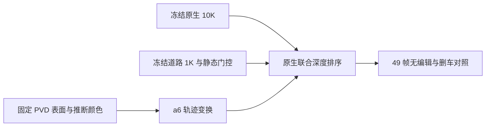

# 固定 PVD 接入原生 10K + 道路 1K

scene008_native_road_pvd_compare_20261105。保留原生 10K、R3 道路和静态透明度门控，从已有阶段 D 检查点复用 1,477 个 a6 生成面高斯及其推断颜色。两种编辑状态都加入同一份资产，训练更新为零。删 a37 仍按持久归属过滤动态行。

| 固定域指标 | 道路 1K | 道路 1K + PVD |
| --- | ---: | ---: |
| 删车后已观测 a6 RGB MAE | 0.01873 | 0.03993 |
| 删车后 a6 实测深度 MAE (m) | 0.26862 | 0.45123 |
| 删车后显露道路 RGB MAE | 0.02203 | 0.02203 |
| 无编辑已观测 a6 RGB MAE | 0.01885 | 0.04006 |
| 无编辑可见 a37 RGB MAE | 0.01473 | 0.01473 |

PVD 在 53,356 个固定补全足迹像素上的平均贡献为删车时 0.1888、无编辑时 0.0152。删车后它在 39,308 个已观测 a6 像素上贡献 0.2175，覆盖了部分原生外观。无编辑时，它在可见 a37 上的平均贡献为 0.00000036。raw113 和 raw130 可见新增表面，未观测下部的连贯性仍有限。固定补全足迹用于读出诊断，隐藏表面缺独立准确率真值。直接叠加的方案未达到已观测车身保真要求。

[49 帧逐项指标](pvd_compare.json) · [联合渲染入口](source/render_pvd.py) · [报告追加入口](source/add_column.py)。本次新增训练步数为 0，人工验收字段留空。

## 第五列的黑底读出

上格单独渲染同一份 1,477 行 PVD。下格记录 PVD 颜色乘以真实联合排序的可见权重，再显示在黑底上。对照包含无编辑、删 a37，以及删 a37 后再隐藏原生 a6 的遮挡诊断。关闭诊断开关后，联合 RGB 与上一轮逐像素一致。49 帧均沿用相同相机、轨迹和道路门控。

| 联合 PVD 权重与独立 PVD 透明度之比 | 无编辑 | 删 a37 | 再隐藏原生 a6 |
| --- | ---: | ---: | ---: |
| 已观测 a6 像素 | 23.8% | 23.8% | 100.0% |
| 固定补全足迹像素 | 1.6% | 20.3% | 98.8% |

固定足迹中，删 a37 后的剩余遮挡主要来自原生 a6 的重叠。raw113 和 raw130 的独立渲染已具备大致车尾轮廓，颜色仍较粗，且局部有孔洞。显露比例衡量当前表示的读出，隐藏几何精度仍缺独立真值。

[49 帧常规读出](black_column.json) · [隐藏原生 a6 的读出](black_diagnostic.json) · [黑底渲染入口](source/render_black.py)。
