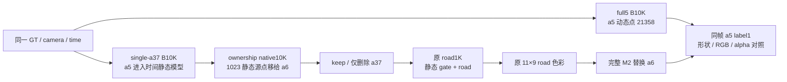

# a5 真蓝 Honda：只读入口与证据清单

2026-11-05。本审计不训练、不执行 GPU、不改远端或 runtime。a5 的蓝色车漆是真实 GT；本任务检查车顶/挡风玻璃缺失、变灰黑与遮挡，不用此前异常蓝斑的阈值评判这辆车。

**当前最早可见回退区间是 full5 B10K → single-a37 B10K 重新训练。** 已保存的 full5 raw105 native keep 中车顶/挡风玻璃完整但模糊；single native keep 已缺失。single 的 a5 仍受 global/static RGB 监督，因此不能称为“缺失 RGB 监督”。a5 由单独动态分支进入时间静态分支、源点密度与损失角色同时变化，是优先机制候选；现有证据没有同初始化、只改表示的反事实，不能宣布唯一原因。

## 身份、可见帧和共同评价域

精确观测：`/root/autodl-tmp/drivingeditor_repro/campaign/scene008_instances_20261105_r1/observations/frames/{raw:03d}.npz`。`rgb` 是 float32 `[320,480,3]`，a5 是 `actor_labels == 1`，shape `[320,480]`。原始图是 `.../scene008_a37_only_B10k_20261103_r1/inputs/scene0008_089_137/image/image_0/0008{raw:03d}.png`，1920×1280。以 observation `rgb` 作为共同指标 GT，避免重采样口径变化。

49 帧中 a5 仅 raw89–112 可见，共 24 帧；raw113–137 的 label1 全空，不能追踪左边另一辆车代替 a5。完整逐帧计数、bbox、mask 交叠和 road 权重见 `mask_audit_49.json`。以下 bbox 为 xyxy，右下界不含：

| raw | model time | a5 像素 | bbox |
| --- | ---: | ---: | --- |
| 89 | −0.48 | 1227 | [151,170,196,205] |
| 97 | −0.32 | 3010 | [103,174,175,229] |
| 105 | −0.16 | 10773 | [0,182,130,286] |
| 109 | −0.08 | 8178 | [0,197,81,320] |
| 112 | −0.02 | 637 | [0,248,12,320] |
| 113–137 | 0…0.48 | 0 | 无 |

full5 输入根目录：`/root/autodl-tmp/drivingeditor_repro/campaign/nearby_actors_20261015_v1/baseline_engineering_20261018/full5_pipeline/inputs/scene0008_089_137`。其 `dynamic_multi_actor_preparation.json` 中 actor_index 0 是 a5 / track `3S_GJHyCGGK4ypFPVKOOqA`，有 21358 个真实点；actor_index 3 是 a6，actor_index 4 是 a37。**single 输入中的 actor_0 已重命名为 a37，不能按 actor_0 跨输入比较身份。** labels 1/4/5 分别是 a5/a6/a37。

## 最早阶段的文件与渲染入口

| 阶段 | 精确文件 / API | 身份和可复现限制 |
| --- | --- | --- |
| full5 B10K 已存原生输出 | `/root/autodl-tmp/drivingeditor_repro/campaign/r15_gn11_stage1_v41_20261023/arms/B/run30k/checkpoint_events/iteration_010000.json`；其 `frames[].channels`；`eval/train_10000_render/*.png` | event 将原始帧号绑定到输出，不按目录顺序猜帧。10K `.pth` 已不存在，30K 不能冒充 10K。已取回 `existing_images/raw105_full5_keep.png`。 |
| single-a37 native10K | `/root/autodl-tmp/drivingeditor_repro/campaign/scene008_a37_only_B10k_20261103_r1/formal10k/{chkpnt,dynamic_chkpnt,env_light_chkpnt,training_state}10000.pth` | 仅 a37 在动态分支；a5/a26/a18/a6 留在时间静态模型。 |
| single 原生 evaluator | 同 single 根下 `source/evaluate_layers.py:24` CLI；`:31` CPU mmap 加载；`:46` 同相机、K/4 和时间；`:50` 调真实 `gaussian_renderer.render`；`:51` composite/render_s/render_d | `--quick` 仅89/105/137，不能覆盖97/109。输出 `evaluation/{raw}/composite.png,delete_a37.png,dynamic_a37.png,gt.png`。相机 `image` 填零，不能把 Camera.original_image 当 GT。 |
| single 已存 reload 证明 | 同 single 根下 `evaluation/summary.json` 与 `formal10k/checkpoint_events/iteration_010000.json` | 49 帧 PASS_NATIVE_LAYER_RELOAD，PNG replay 最大差值0。raw105 的 keep/delete/dynamic 三者均 replay0。 |
| single 通用包装 | `/root/autodl-tmp/drivingeditor_repro/campaign/scene008_native_road1k_20261105_r1/source/editor_common.py:43` `Native()`；`:62` camera(raw)；`:74` render | 此模块默认 `B` 在 `:11` 指向 single/formal10k。`n.render(cam,dynamic=True)` keep；False 删除单独 a37。`:73` 相机 dummy image 全零，GT 必须另取。 |
| ownership native10K | `/root/autodl-tmp/drivingeditor_repro/campaign/scene008_native_ownership_20261105/run_r3/formal` | 原始 ownership parent，不是本轮被拒绝的 RCR global parent。 |
| ownership 包装 | 原 road source `native_binding.py:20` 改 `common.B`；`:23` Native；`:32` actor_kwargs；`:39` render | `dynamic=True` keep a6+a37；False 仅保留 a6。使用 raster kwargs mask，不改模型 opacity。oldclean/current 必须独立 worker，避免 import 的 `common.B` 污染。 |

single `evaluation/summary.json` 在 raw105 a5 的 10773 像素上，a37 dynamic alpha 均值为 `4.803910996997729e-6`，keep→delete RGB MAE 为 `9.911140068652458e-7`。这直接限制了 **old single raw105** 的删除解释；不外推到全部 camera 或 current ownership。

## 输入、RGB 与运动正则：已证变化

single `source/prepare_single_input.py:20–28` 固定 full5 actor4=a37，把原静态 PLY 原样链接，只复制 `points3d_dynamic_4.ply` 为 single `points3d_dynamic_0.ply`；`:29–45` 动态 RGB 和 appearance/body masks 仅使用 a37；`:63–69` identity contract 明确 retained aliases `[5,26,18,6]` 进入“original B temporal static/background model; initialized and trained from scratch”。不是 full5 checkpoint warm start。

实际 engine 根目录：`/root/autodl-tmp/drivingeditor_repro/campaign/r15_baseline_owner5_20261018/training_source/scene0008_089_137`。以下文件行号均相对于该根：

| 事实 | 真实代码位置 | 解释 |
| --- | --- | --- |
| 初始化读取哪批点 | `scene/waymo_loader2.py:294–317` | 读取静态600000行；只查询当前输入中动态 PLY；离 a37 动态点 <.1m 的静态行剔除，余591672。没有把其他完整动态 PLY 补进静态。 |
| 初始时间字段 | 同 loader `:296,308,317` | 使用 PLY normals[:,0] 作时间。CPU 验证本数据 nx 与显式 time 完全一样。 |
| 初始颜色 | 同 loader `:592–597` | transform 后创建 static/dynamic BasicPointCloud，两者颜色均以零初始化；不能把原 PLY paint 直接当已加载 SH。 |
| a5 seed 数 | single `source/audit_static_seeds.py:16–24` 及 `static_seed_audit.json` | 按每个 a5 源点查同时间静态源近邻（<.002m），1442/21358 个 a5 源点有匹配，1442 全保留。 |
| 独立反向匹配 | 本地 `initial_source_proximity_reconcile_cpu.json` | 静态源中精确 xyz+time 匹配 a5 共1496行，但只1442个 unique xyz+time（54重复）；全部保留，0被 a37 剔除，0移给 ownership a6。两种统计口径一致。近邻仍不是完整语义 ownership 图。 |
| 实际 Md | `utils/paper_masks.py:24–42` | 用 cfg.source_path/dynamic_masks 的显式 mask，NEAREST 缩放到相机大小；可并 shadow。不是经 image symlink 回读 full5 多车 union。 |
| a5 未被 Md 排除 | 本地 `mask_audit_49.json` | single 的 a37 appearance Md（含存在时的 shadow）与 a5 label1 在49帧交叠总数0；a6 body 也0。 |
| RGB 监督存在 | `train.py:369–390,398–411` | global RGB 全图；static RGB 作用于1−Md。因此 a5 同时有 global 和 static RGB。不是静态监督缺失。 |
| RGB 名义权重 | `utils/hybrid30k_losses.py:153–157` | global=1，dynamic=5，static=1。full5 中 a5 属 dynamic；single 中属 static。不同全图归一化/SSIM使它们不能简单解读为每个 a5 像素精确5倍比例。 |
| 时间静态仍可移动 | `scene/gaussian_model.py:152–158,182–183` | xyz随速度、点时间的 SHM 变化；marginal_t 有时间宽度。不能说 a5 被硬冻结在世界位置。 |
| 静态专有运动/寿命正则 | `train.py:299–306,381–383,407`；`utils/hybrid30k_losses.py:61–75,140–164` | static feature/combined alpha 的速度图有 L1，权重.01；时间宽度图有1/mean(abs)，权重.1，偏好长寿命。没有对应 dynamic 速度幅值/寿命项。combined velocity smoothness（.1）仍涉及两分支。没有 a5 的豁免。 |

两个实际 config（single `config.json` 和 full5 B `run30k/effective_config.json`）名义权重相同，均 NPS=true、lambda_dssim=.2、frame_interval=.02。原参数与解释已保存 `supervision_regularization_audit.json`。**表示、有效监督分项、初始支持数同时变化；目前没有测逐 a5 正则梯度，也没有单变量隔离这些变化。**

## ownership、road guard 与 M2 入口

ownership 源：`/root/autodl-tmp/drivingeditor_repro/campaign/scene008_native_ownership_20261105/source/dual_actor_runtime.py`。

- `:28–34` 仅允许 owner6/37：persistent source ID <591672 记6，否则记37。标签是源编号构造，不能单凭 owner 数字证明每个 splat 的实际语义区域。
- `:49–84` 在优化器创建前，精确移动原参数；初始 a37 的98452行不变，1023个选中静态源从 static 移到 a6，绝不复制；`:73–74` 保持原 static source ID，不重新 arange 压缩身份。
- assignment：`/root/autodl-tmp/drivingeditor_repro/campaign/scene008_a6_a37_dynamic_20261104_r1/inputs/init_assignment.npz` 中 `original_static_indices`。上述 CPU 精确 a5 点匹配1496行均不在这1023移动集合内。这不排除未精确匹配的语义点或训练后扩张/遮挡。
- `:86–97` supervision union 仅 a37 与 full5 actor3 的 a6 body，a37 overlap 优先。49帧 a5 mask 与二者无交叠。
- 不使用 `hide_actors` 修改原 opacity 再恢复来做冻结审计；即使值恢复也增加 tensor version。现有 Native.actor_kwargs 和 Runtime.scene 的 kwargs mask 已能完成只读删除。

原 road 根：`/root/autodl-tmp/drivingeditor_repro/campaign/scene008_native_road1k_20261105_r1`。

- `source/prepare_road37.py:33` 把 labels1–4 膨胀并入 other_vehicle_guard；`:38` 目标车域是 label5=a37；`:121–127` 在 guard 外拟合并设置 native_keep_weight。
- 全部24个 a5 非空帧的旧 road inputs/views：other_vehicle_guard=1、native_keep_weight=1、fit_weight=0、repair_mask=0、marking_mask=0（逐帧见 mask JSON）。这是直接保护域，不能证明跨帧挑选的 static point gate 完全不影响 a5。
- `source/repair37.py:95–110` 在49视图通过真实 joint-delete alpha*T 挑 static contributor；排除 guard_score>20×fit_score 的点。其本身标注“not semantic ownership GT”。`:29–34` Experiment.render toggles road+gate；`:35–47` 包含 native preserve 和 vehicle guard 损失。
- 必须加载同 parent 的 `formal/checkpoint001000.pt`，不能用新建 Experiment 的默认 gate 当已训练 gate；不能把新 parent 套旧 row IDs。

完整当前 pipeline：`/root/autodl-tmp/drivingeditor_repro/campaign/scene008_a6_asset_controls_20261105/source/scene_runtime.py`。

| API / 行号 | 控制内容 |
| --- | --- |
| `Runtime(fine_road=True)` `:80–126` | 加载原 road1K，校验 step1000/parent_identity；fine coefficient 验证 baseline逐值一致、shape(99,3)、world knots后才加颜色。 |
| `raw(raw)` `:169–192` | 取原 observations，并与 saved camera timestamp 和 model_to_camera 对齐。 |
| `_static` `:194–200` | 仅对旧 repair.ids 的 raster opacity 应用 gate；模型参数不动。 |
| `_road` `:202–210` | 使用同已拟合 road baseline/fine colors。直接 `Native.render(road=...)` 没有这层 fine。 |
| `scene(...,baseline=True)` `:219–224` | 保留原 native a6；delete只关 a37，road/fine保持同场景。 |
| `scene(raw,asset,delete=...)` `:225–245` | 完整移除全部 native-a6行，插入完整 M2；delete物理移除a37；static/M2/a37/road在同次真实深度排序。 |
| `render_rows` `:247–261` / `render_scene` `:263–264` | 可对临时 kwargs mask 做阶段拆分，不改模型。环境按(1−alpha)合成；四组件 alphaT之和校验。 |

M2 精确资产：`/root/autodl-tmp/drivingeditor_repro/campaign/scene008_a6_asset_controls_20261105/m2/complete_a6.npz`；用同 source 的 `sh_asset.SHAsset` 加载，完整27张量冻结。a5 不是它的目标，但需用同深度场景的逐像素对照确认实际影响。

## 已完成零训练阶段消融与最省后续入口

root 准备并运行的本地脚本 `render_stage_ablation.py` 用独立 oldclean/current worker，raw89/97/105/109，同 observations GT/labels、saved camera/time，只在 kwargs 副本上关 road 或替换 coarse road RGB。模型与 M2 逐值不变，0训练更新。此审计仅 CPU 读取已取回的 `oldclean/receipt.json`、`current/receipt.json`；未执行 GPU。

| raw | old single keep→delete 的 RGB MAE | current native keep→delete 的 RGB MAE | current delete→M2+road fine 后 a5 MAE | M2 delete vs 同 road fine/native-a6 |
| --- | --- | --- | --- | --- |
| 89 | .04764916→.04790578 | .09729433→.03753684 | .03753663 | RGB相同 |
| 97 | .03806090→.03811207 | .06000863→.05854069 | .05870139 | RGB相同 |
| 105 | .08327936→.08327919 | .08537532→.08537532 | .08752809 | RGB相同 |
| 109 | .03945640→.03945640 | .03071845→.03071845 | .03308098 | RGB相同 |

这些 MAE 用共同 observation RGB，和旧 evaluator 的 PIL resize GT 口径略有区别，不交叉拼数。current raw105 road/gate/fine 相对 native delete 的 MAE约+.002153；raw109约+.002363，说明有小幅后续损失，不能宣称 road 毫无影响。它们不能解释早在 single native keep 中已存在的车顶缺损。raw89 的 current a37删除影响明显且改善a5，不能把105/109零影响外推到所有帧。

最省 GPU 的原生来源核查已经有既存 full5 event/native PNG、single 49帧 reload0 和这4帧真实直接消融，不需要再重复49帧。后续若继续源头诊断，应围绕 full5→single 的表示/初始化/运动约束区间提出具体单变量验证；本清单不启动训练、不添加修复方法。当前仍不能从2D mask保护或近邻源点推断每个时间点所有 splat 的归属与可见贡献，也没有证明 a5 缺陷只由某一正则、SGCM、颜色 clamp 或删车引起。

## 本地证据

- `mask_audit_49.json`：所有49帧 a5 counts/bbox、appearance Md/a6交叠、road输入权重、旧 single replay摘要。
- `initial_source_proximity_cpu.json`：源行近邻保留和 a6转移覆盖。
- `initial_source_proximity_reconcile_cpu.json`：1496行/1442 unique口径、full5源点去重、nx/time核对。
- `supervision_regularization_audit.json`：两个实际 config 及准确正则范围。
- `stage_ablation_summary_cpu.json`：已取回4帧真实消融摘要；CPU重读保存ROI `[0,160,175,320]` 与a5 mask的交集，raw89实检658/1227像素，其余计数见JSON。四帧M2 delete与同road fine/native-a6在完整a5 mask内RGB零差由原GPU receipt验证，不能把CPU ROI重读称作全mask验证。
- `oldclean/receipt.json`、`current/receipt.json`：root 真实零训练消融，全部camera/time及模型冻结。
- `existing_images/raw105_full5_keep.png`、`raw105_oldclean_keep.png`、`raw105_gt.png`：最早退化区间目视依据。原 full5 10K仅存输出而没有可恢复权重，保留这一限制。
