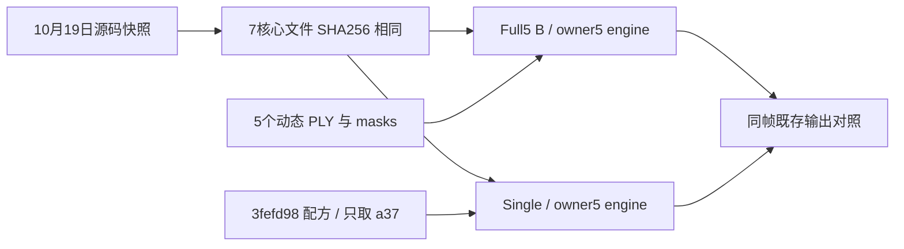

# a5 Git 配方引入与实现版本核对

首个可追溯 single-a37 配方提交是 **3fefd98**。已证变化是仅保留 a37 动态输入、a5 转入时间静态层；尚无证据把它称为唯一破坏 a5 的 bug commit。
核对的7个核心 engine 文件没有发现 Full5→single 实现回退；两个10K事件均缺运行时源码/Git SHA，不能补认运行时 HEAD。

| 提交 | 时间（+08） | 证据作用 |
| --- | --- | --- |
| `fa17363623fa0e38006ef3e426cfd3c8d35a7dda` | 10-19 02:44:44 | Git blob ZIP中7个核心文件与现有owner5逐字节相同 |
| `c5ce9610a59d1e59ac1fd69723917ec12ab12f40` | 10-19 22:35:11 | 明文code/base又独立核对5个文件相同 |
| `52ce5714c991b5d23df4066f048feb8b4ef53afc` | 10-24 09:52:46 | Full5 B启动器首次归档，Git blob与实际启动器相同 |
| `3fefd98ecf5dfd5a73898bf46717cc8afe4ca147` | 11-03 14:04:58 | single配方、wrapper、config、identity四者首次归档，均匹配实际字节 |

精确Git recipe：`docs/autoresearch/scene008_a37_only_B10k_20261103/source/prepare_single_input.py:22,28,35`只取actor4=a37；`:63–69`明确retained[5,26,18,6]进temporal static、fresh、非warm start。log/follow与blame均指3fefd98；相对父提交是新文件添加，并非旧engine的a5分支删除补丁。
共同实际engine：`/root/autodl-tmp/drivingeditor_repro/campaign/r15_baseline_owner5_20261018/training_source/scene0008_089_137`。
Full5真实链：`r15_gn11_stage1_v41_20261023/tools/run_v41_formal_serial.py:50`→`run_v41_baseline.py:65,74,83`→`plan.V1_source`；已完成B的`phase_0_30000_returned.json.source`独立记录同owner5。不是道路R的campaign/engine。
single链：`scene008_a37_only_B10k_20261103_r1/source/train_single.py:7,34,35,41–42,106`断言owner5导入、唯一动态PLY、98452个a37初始动态行，然后调用native training。
7文件为train.py、gaussian_renderer/__init__.py、scene/gaussian_model.py、scene/waymo_loader2.py、utils/hybrid30k_losses.py、utils/paper_losses.py、utils/paper_masks.py；均直接从fa173636的Git blob ZIP取字节比较，完整SHA在summary.json。
ZIP路径：`docs/autoresearch/worldsim_v82/drivingeditor_shadow_rebuild_20261017/v3_backend_restore_r15/baseline_engineering_20261018/gn11_static_duplicate_20261019/actual_source_bytes.zip`。c5ce9610明文位于`scripts/worldsim_v82/drivingeditor_shadow_rebuild_20261017/r15/gn11_stage1_v2_20261019/ai_review_sources/code/base`。
Full5 saved config→single config顶层仅source_path、model_path、followup_scene_spec不同；scene spec内部仅source_path与actor_ply_paths不同。输入变化仍改变初始化支持、监督分支和RNG轨迹，不构成同初始化配对实验。

两个10K checkpoint event有config_sha256，没有engine hash或运行时Git HEAD。历史快照与当前字节一致且入口同源，不能排除未记录的临时原位改动再还原。
single事件观测mtime为11-03 13:54:23+08，归档提交14:04:58+08；提交还含完成结果。因此3fefd98是“首次配方归档提交”，不能直接叫运行时版本或确定bug提交；mtime仅辅助证据。
结合既存图像，可定位Full5→single输入/表示回退区间。21358动态源点→1442匹配独立静态位置（1496行）、RGB分项与static正则同时变化；尚未单变量隔离，不能宣布唯一机制或某次增密/SGD事件。
全部JSON、diff/blame和元数据保存在本目录；`single_recipe_added.patch`、`single_train_wrapper_added.patch`给出完整新增源码。没有远端/仓库写入、GPU、训练或关机，不改变RCR-1已采用状态。
