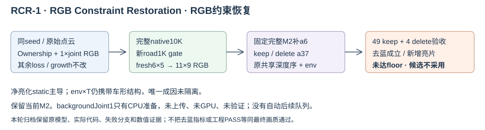

# RCR-1：RGB Constraint Restoration（RGB约束恢复）

本轮研究归档，候选不采用，保留当前 M2。full-joint native10K + 新 road1K + fresh6×5→11×9 + 固定完整 M2 已完成，原框去蓝成立，但 raw130/137 车尾新增银灰亮片，未达当前 floor。工程 PASS 和局部误差改善不能替代最终画质要求。

## 实际方法与结果

原 ownership 训练缺旧的整图 joint RGB。RCR-1 只补回系数1的原 `photometric_rgb_loss`，保持 static2、其它 loss、ordinary XY/time 增长、SGCM、阈值、初始化、采样和学习率不变。实际 native10K 已完整发布，并通过10000→10002的真实完整状态恢复；新 road 从该新 native 重新准备、选择和拟合，正式1000更新。之后重新求解 coarse6×5/fine11×9，用同一固定完整 M2 评价49 keep、4 delete。

- lineage64990 在原 ownership10K 为64颗蓝SH；RCR-1 native10K 为7颗，SH输出黑色。补 global 支持“阻止持续正B”，不证明最初正B或旧版不clone的唯一原因。
- 完整管线同共同ROI中，raw113原框/白线、raw137右框/横条的强蓝像素分别462/224/664/8→0。它们排除了原actor区域，不能覆盖所有删车后新露出的伪影。
- 49 keep道路 MAE `0.03168865→0.01645815`；天空 MAE `0.02317623→0.02051919`，逐raw/mask SHA/count/GT严格匹配，共1,948,391天空像素。天空预测RGB均值变化很小，实际数值保留于证据。
- keep a6 pooled略改善，但23/49帧回退，最大raw129 `+0.00052418`；a37 pooled `0.01472654→0.01491633`，32/49帧回退，最大raw122 `+0.00202537`；delete a6 pooled `0.03553222→0.03561446`。所有回退保留。

**HELD9只对6×5/11×9道路RGB校准target留出。** 这49帧属于同一训练clip，native与road gate阶段已经使用该clip，未按HELD9隔离；不能把HELD9或BUILD40称作独立native泛化验证。delete道路误差使用重观测proxy，不是真实删物RGB GT。

## 新亮片的已证与未证

raw137亮化315像素的实际RGB增量由native static正增量主导：`(+0.293346,+0.333195,+0.366756)`；env×T为`(−0.200625,−0.191717,−0.186205)`，road约`(+0.000019,+0.000022,+0.000028)`，M2/a37均0；净增量`(+0.092740,+0.141500,+0.180580)`。static alpha×T均值`0.177727→0.828968`。

净亮化主导项不等于纹理唯一来源：**env×T层仍携带明显车形结构**。EnvLight纹理与T空间变化的份额、具体static行/谱系，以及RGB训练、拓扑、opacity和gate的分别作用，尚未隔离。315点原来全属a37，两端road fit/native_keep/guard权重均0，road lookup未覆盖；这不是每颗Gaussian跨帧训练或gate成员身份的证明。

旧新road物理覆盖和opacity确有变化，但指定130/137紧框的道路中心opacity只升不降，不支持“road透明度下降后露出残影”。这些审计不能替代真实层RGB归因，也不支持直接套用旧road包。

## 计算账本与处置

| 已完成更新 | 次数 |
|---|---:|
| 本会话前期颜色后拟合失败尝试（含smoke/恢复） | 12,532 |
| growth control/joint/half反事实 | 3,000 |
| RCR-1 native0→10K | 10,000 |
| native预检与两次完整恢复检查 | 9 |
| 4K parent道路工程预检 | 34 |
| 新10K parent road正式与预检/恢复 | 1,034 |
| **合计** | **26,609** |

正式 coarse/fine 共54次鲁棒线性求解、0梯度更新；4K parent finalizer工程预检另有54次，单列后与正式合计108次已知新finalizer求解。渲染、评价和反事实/层归因新增SGD为0，但仍消耗GPU渲染。历史原native/资产训练不计入本会话账本，前期后拟合不并入其他线程的车辆appearance实验。

hide64、cleanSH、oldEnv交换、half均未采用。backgroundJoint1只有本地源码和CPU mask/梯度审核，**未上传、未GPU、未验证，不是实验结果，也不是下个自动队列**。所有GPU研究工作已按收尾指令停止，不关机；原模型、完整状态、实际训练/渲染代码和失败分支保留。

## 交接文件

- [运行清单](run_manifest.json)：方法、实际节点、账本与未采用状态。
- [最终数值对照](evidence/comparison.json)：固定域、HELD9/BUILD40、四delete、天空RGB均值与逐帧回退。
- [实际收据](evidence/receipts.json)：10K完整发布、10002恢复、新road与正式校色。
- [315像素真实贡献](evidence/rcr1_silver315_contributions.json)：RGB分量和支持域边界。
- [V82-F13草稿](V82-F13.md)：供根代理合入repo；本子任务未修改remote/Git。

归档包含交互验收页面、机制研究子页、实际执行源码和轻量证据。原始checkpoint、数据与失败分支继续保留于AutoDL campaign；源码包不是完整模型备份。RCR-1是研究代号，未重命名仓库目录或部署候选。Git发布结果在交付回执中单列；这里不把待交接动作写作研究结论。
