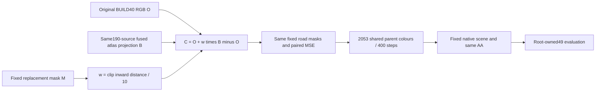

# Posthoc fixed10pixel edgeblend control C

C is the single approved fallback after A/B's small native-render gain and the target hard-replacement boundary diagnosis. The unexecuted legacy-static proposal is closed. Original A/B code, targets, states and outputs stay immutable.

The thin worker is `fit_shared_edgeblend.py`, its independent output is `engineer/material_fit_edgeblend_v1/edgeblend/`, and targets are `targets_edgeblend_v1`. It reuses the same qualification, exact mask714546 pixels and baseline cache without new qualification forwards. Initialization is the untouched cellfit1000 canonical material. The 8045 unsupported parent rows remain absent from the trainable tensor and Adam state and preserve baseline bytes. The same [0,1] projected parent-colour Adam .01 runs exactly400 paired asset steps after a real two-frame save/evaluate/restore/next-step lifecycle. Geometry, alpha, SH/native base, trajectory, vehicles, old static and view policy stay fixed.

This is strong real-RGB anchoring, not a pure atlas target or evidence that Poisson fusion alone improved the scene. A/B information matching remains a separate scientific comparison. C's HELD9 constructed target includes query observation O for diagnostic construction and cannot be reported as held prediction. Fitting reads only BUILD40 targets; the fitted native renderer does not condition its colour on query O. The unchanged evaluation loader can still load O for contracts and metrics, which is distinct from a colour-conditioning path. The prior frozen parent material/proxy was already conditioned on199 source views.

The target builder supplies one final immutable manifest with `fusion_ready=true`, `edgeblend_ready=true` and `selected_target_key=edgeblend_rgb`. Its LOCK SHA is required before fitting. No width/weight sweep, no extra legacy route, no geometry or opacity changes, and no formal-step extension is permitted by this control.
