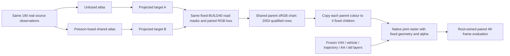

# Fixed-world road material writeback control

Both scientific branches use the same 190 nonHELD real RGB sources, geometry support, masks, persistent colour capacity, optimizer and budget. Branch A projects an unfused atlas; branch B projects the shared Poisson-fused atlas. Outside the fixed atlas replacement domain both targets equal the original RGB. Original raw observations remain a separate evaluation reference. No deleted render or hidden RGB is used as a source witness.

The canonical baseline contains 40392 children and 10098 parents, source asset SHA `53de3cb31be234865995766eaeb11a5fced59160456bb139b08cdb3eb0031baf`, manifest SHA `48ac926aafb1cb07ddd98c4ee6c9ffdc7c4501076a1cdbc7ffb99cc9736e84c7`. Parent material is the prior cellfit1000 result; relative Mip stays enabled and its parameters do not change.

Native colour rendering is affine when geometry, order and alpha are fixed: `RGB = F + A c`, with nonnegative pixel-parent weights and one world colour `c` shared by all views and states. The original inference wrapper encloses rendering in `no_grad`; the new module uses its frozen scene rows but calls the same native raster directly. Every old tensor is detached. Only supplied parent RGB enters autograd. Existing 24 feature channels retain their meanings, with new road group RGB and extra newroad RGB tags updated together for conservation.

Shared80F/B qualification on the exact old BUILD40 mask (714546 independent pixels) found 2053 contributing parent rows and 8045 exact-zero rows. Only the 2053 × 3 eligible values enter the trainable tensor or Adam state. The other 8045 preserve initial parent bytes. This is a limited writeback domain; projecting a full atlas does not establish that all of it was written into 3D.

Each branch uses 400 paired asset steps (10 deterministic 40-frame epochs), Adam lr .01, betas (.9,.999), eps 1e-8, identical sampler and masks. One step averages keep/delete RGB MSE equally. There is no anchor, texture or extra protection loss. Eligible RGB is projected to [0,1] after each step. Geometry, sigma, rotation, opacity, vehicle, trajectory, oldroad, static gates, environment and view-AA remain fixed. Protection and original-observation errors are independent evaluation domains.

Before scientific fitting, each branch runs two real BUILD training frames (90,128), with initial baseline parity, save, evaluation, complete checkpoint reload, and two disposable next steps in both the original and fresh process. Parameter, full Adam, Python/NumPy/TorchCPU/CUDA RNG and sampler restoration are checked by hashes. Any next-step CUDA discrepancy is reported with actual error rather than relabelled exact. These lifecycle costs are separate from each fixed400-step formal budget. A one-variant original-raw-RGB placeholder lifecycle is explicitly engineering-only and cannot enter formal fitting. Final source/target manifests must be frozen and `fusion_ready=true` before scientific smoke/formal.

The root's original-real-RGB pixel-capacity audit is reused. A separate CPU check will apply the existing80F cache to the new atlas targets, recording the legal pixel relaxation `[F,F+W]`, exact zero W, and near-zero W inside the actual atlas replacement domain. This interval is only a necessary bound; it ignores world-colour sharing. It cannot certify shared3D reachability, and asset-exterior zero W cannot establish an internal static-layer obstruction. Only a root-approved, geometry-qualified persistent legacy-road takeover may be considered as a single fallback; this module does not implement or trigger it.

Formal outputs are `material_fit_v1/{direct,fusion}/material_override.npz` with `colours_srgb[10098,3]`, eligibility, source/target roles and hashes. The root owns the complete 294F baseline/direct/fusion paired49 evaluation. This module does not duplicate that evaluation or claim whole-scene adoption. AutoDL remains on.
