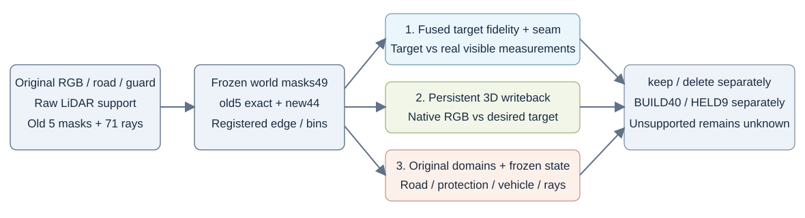

# 融合目标 → 3D回写：三层独立CPU评价接口



本轮输入是上一轮 **n2 + relativeMip + 父cellfit材质** 的canonical40392行。车辆、轨迹、几何、normal、sigma和opacity固定。两状态使用同一持久材质，delete只关闭a37。评价程序只读输入和原生输出，0 GPU forward，不写共享repo或旧科学文件。

## 冻结分母

`world_masks49_v1/registry.json`已在读取本轮target或candidate前冻结，SHA256：
`0af33f63171cc34b404e4a0719495a16a49b993c5aaa36d1a442b1695251e7d8`。

原5key105/113/128/130/137的NPZ逐字节复用；其余44按同原始road、车辆guard、每raw真实ground规则构建：8近邻、半径.8m、相对z中位±.15m、加权z spread≤.08m、12次迭代、位置收敛<.02m。仅对原road&~guard射线求交以节省CPU，不根据target/候选/alpha选像素。direct scene-depth副分层保留±.3m资格检查。

世界patch为anchor-local x[19,32.6]、y[.5,3.5]m；边界near-x19.8、far-x31.8、lateral-y2.71；两侧signed distance为[-.4,-.08]、[.08,.4]m。切向bin宽.2m，每侧≥3个原资格像素。全部matched bins与实际两侧像素数逐frame登记。新44视图是**同场景开发扩查**，不是独立test。ground与R0共享BUILD测量，并非隐藏路面GT。

原raw128用户近似蓝框 `[165,188,208,234)` 独立保留：1385原road像素；near-x两侧42/34、配对35/33、6bins。其worldpatch副视图是772road、near-x43/35、配对36/33、6bins；两套分母不能拼接。keep/delete分别输出，不跨状态概括。

## 三层指标

1. **目标本身**：desired full-composited encoded-sRGB target相对原可见RGB的固定区域MAE、固定边界残差jump、原观测road内四邻接梯度差。梯度差只是测量外观保真度，不冒充标线/阴影语义GT。主固定分母、共同legal fit、fusion replace区域均报告计数；atlas支持与imputed另计，目标不是GT。
2. **3D回写接近目标**：原生joint-rendered RGB对同一个desired full-image目标的MAE与固定bin residual jump。不能把full-image目标与alpha预乘newroad RGB或intrinsic albedo混比较。目标文件缺失或固定pair内不全有限时标缺测/不完整，不从6个bin悄悄缩成较好的几个。
3. **原场景保留**：原road、protected、可见C2、keep态可见a37，以及固定世界patch/原蓝框的原始RGB误差；alpha/depth/group/newroad/oldroad weight位等检查；固定红71射线的车辆权重变化。expected centre depth和Gaussian alpha不是不透明首交。

每帧的边界score保持原定义：先减原可见RGB，再比较同切向bin两侧均值，最后等权平均各bin的通道绝对jump。全49摘要同时提供等bin与等有效视图的平均，明确分母；unsupported为None，不作为零参与平均。

BUILD40与HELD9分表；HELD9=[89,95,101,105,113,121,125,130,137]。当前目标应从190非HELD源构建，HELD9仅投影评价，具体source ledger还须独立核。继承场景/几何/旧材质曾看过这些视图，因此不称端到端独立盲测。

## 接口与原生读出

根统一评价输出：`results/full49/<raw>/{baseline,direct,fusion}_{keep,delete}.npz`。全49有float32 RGB CHW；5key另有完整float fields。全49其余帧geometry/hash与冻结车辆预乘RGB检查来自原生receipt，须明说“重读收据”，不冒充独立重载了未保存的全图数组。

目标agent确认：`targets/projected_BUILD40/rawNNN.npz`、`targets/projected_HELD9/rawNNN.npz`：`direct_rgb`与`fusion_rgb`为HWC encoded-sRGB期望完整合成图；两状态共用。共同`fit_mask`、`fusion_replace_mask`、`atlas_support_mask`、`source_count_map`、`source_confidence_map`、`imputed_mask`保留资格与来源。正式direct是同190源未融合atlas，fusion是同atlas Poisson结果；域外为原观测RGB。只有final target_manifest锁定后才能作正式监督审计，临时prequal文件不作为最终证据。

颜色控制预期alpha、depth、group/newroad/oldroad权重逐位相同，C2/a37预乘RGB保持；红raw128固定23chart-first/12ground-first/1contact与raw130原24/11共71射线不重选，权重增量应0。隐藏车体真值未知，颜色变化不称轮胎准确率改善。原6/7条chart-first严重缺失预计仍保留，不能用颜色掩盖几何/排序限制。

调用（待根294F全49native输出完成；本命令仅CPU）：

```bash
RUN=/root/autodl-tmp/drivingeditor_repro/campaign/scene008_road_fusion_bake_20261107_r1
OLD=/root/autodl-tmp/drivingeditor_repro/campaign/scene008_road_seam_contact_20261107_r1
/root/autodl-tmp/envs/motionproj/bin/python "$RUN/red_review/evaluate_fusion_writeback.py" \
  --run "$RUN" --previous-run "$OLD" \
  --mask-registry "$RUN/red_review/world_masks49_v1/registry.json" \
  --readouts "$RUN/results/full49" --methods direct,fusion \
  --target-root "$RUN/targets/projected_BUILD40" \
  --target-root "$RUN/targets/projected_HELD9" \
  --output "$RUN/red_review/full49_three_layer_review_v1.json"
```

程序会拒绝覆盖已有结果。原AA key5自检已完成：全部旧世界边界jump最大差0，原raw128两状态蓝框near jump完全一致，71红射线权重变化0且原6/7严重缺失计数复现。自检结果为[old_AA_key5_evaluator_selfcheck_v1.json](old_AA_key5_evaluator_selfcheck_v1.json)。

## 旧接口来源

- 旧世界mask：上一轮 `blue/fivekey_world_patch_masks_v1/{registry.json,NNN.npz}`。
- 旧主蓝框：上一轮 `blue/{fixed_masks_raw128.npz,roi_registration.json}`。
- 旧指标实现：上一轮 `blue/{evaluate_fivekey_world_patch.py,evaluate_primary_both_states.py,compare_fixed_blue.py}`。
- 固定红射线：上一轮 `red/raw128_contact_audit_v2.json`；更早R0 `review/asset_ground_conflict/canonical_chart_35ray_first_hit_probe.json`。
- 新工具：[prepare_world_masks49.py](prepare_world_masks49.py)、[evaluate_fusion_writeback.py](evaluate_fusion_writeback.py)。所有新脚本仅在本轮red_review内。
