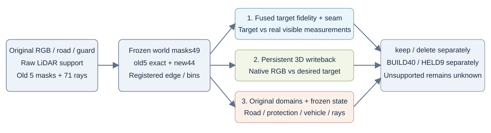

# 190源目标与匹配优化合同：独立CPU审查

数据与合同核验通过，仍保留同场景限制。审查不执行GPU、不更新模型，不把合同符合性写成方法成功。详细数值与输入SHA见[source_and_fit_contract_audit_v1.json](source_and_fit_contract_audit_v1.json)。

直接从旧真实source_valid/source_rgb，排除HELD9后重算190源source chart：source_agree与source_supported逐元素相同，source_chart_rgb最大差0。BUILD40的源RGB/资格映射一致；梯度来自同raw两端见证，1650条弱fallback边标为synthetic。外边界使用BUILD KEEP基线且仅core外103节点，经原真实RGB、source cohort、车辆guard与newroadW筛选；没有读HELD9边界。B确实额外使用这项已登记的边界context，不能把它写成没有信息增量的像素identity变换。

49个最终target文件SHA、shape、float32有限性、[0,1]范围、真实observation_rgb均核过。A/B在共同replace域外逐位等于原RGB；replace域不包含imputed点。BUILD fit714546像素逐数组等于已冻结supervision mask，replace仅10492；原图恒等部分的零误差不能算融合能力。目标是期望完整joint image的encoded-sRGB apparent radiance，不是alpha预乘road色、intrinsic albedo、阴影分解或隐藏GT。

正式两分支使用相同190源、mask、初始化、sampler、Adam LR.01与400 paired keep/delete steps；仅目标是否经过共享Poisson融合不同。实际trainable为2053父行/6159标量，8045无legal influence父行不进入Parameter或Adam，导出保留初始bytes。不是10098父行都可拟合，也不是40392子行独立优化。atlas/projection目标覆盖大于可写父域，因此必须把目标质量与3D可达性分开。

已读两分支实际smoke/restore/formal收据：各400正式paired steps、800正式forward与800backward，正式约142.34/142.74秒。恢复起点parameter、Adam、sampler和全部RNG精确；续2步参数完全相等、sampler/RNG相等，但Adam moments并非bitwise：exp_avg最大差1.4211e-14、exp_avg_sq最大差4.2352e-22。保留该差异，不称续步全状态逐位一致，也不因极小moment差额外重跑GPU。详见[续步moment审查](restore_continuation_moment_audit_v1.json)。

HELD9本轮不进入atlas统计、边界或正式fit，仅投影评价；但继承几何、旧源proxy与父材质曾看完整199源。同场景结果不能冒充端到端独立盲测、全相机泛化或道路学习先验成功。
