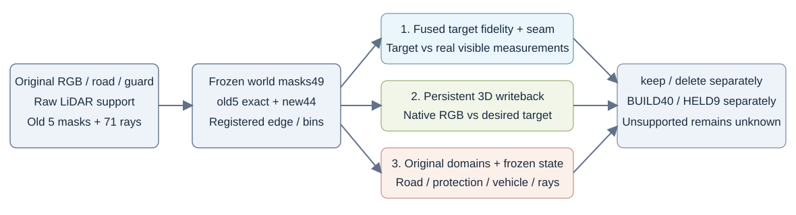

# 唯一C控制：道路外观与lateral改善，near接缝仍未解决

C是已登记的唯一固定10px图像边缘融合回写控制，**不是纯共享world-atlas投影**：`C=O+clip(distance_inside(M)/10,0,1)*(B-O)`。O为该视图真实RGB，M与原A/B同一合法替换mask，B为原Poisson目标。三维输出仍是同一套持久父RGB材质，query原生render不输入O；keep/delete同资产，仅删除a37。旧A/B与全部固定mask未改。

## 目标与优化口径

独立CPU检查49个C包：原A/B/O/fit/M数组均精确不变，10px公式重算差<2e-7，域外精确=O。BUILD10492替换像素平均w=.186557897，没有任何w=1点；raw128主框平均w约.2104、最大.6。C对O的低目标误差大部分是强真实RGB锚定的构造结果，不能归因纯Poisson。

HELD9 C-target也在replace内读取query O，只是诊断目标，不是盲预测。实际材质只在BUILD40拟合；native HELD9渲染不condition query O。继承场景已预曝的限制依旧。C实际固定400paired步骤/800forward/800backward、同Adam LR.01、同40-frame sampler每帧10次、同2053父/6159标量；8045排除行导出逐byte初值。恢复起点state精确；续步参数精确、Adam moments收据非bitwise，保留该数值口径。详见[C目标源审核](edgeblend_source_contract_audit_v1.json)、[C实际fit审核](edgeblend_fit_contract_review_v1.json)。

## raw128原蓝框：明显色差下降，近边仍负

固定原road1385，fit1071、replace545、identity840；near为6个配对bin、实际两侧35/33像素。

|状态|指标|AA基线|C持久回写|
|---|---|---:|---:|
|KEEP|原road RGB MAE|.028254776|.014516061|
|KEEP|near residual jump|.007119644|.007784822|
|DELETE|原road RGB MAE|.029598031|.015966303|
|DELETE|near residual jump|.009794056|.011724605|

不能用较大的MAE改善掩盖预登记near接缝退化。C目标本身原框near jump为.002274987；其545替换像素的target−O MAE为.007664270，但3D写回受固定贡献与共享材质约束，不能由目标光滑直接推出成像光滑。

## 全49世界边界：两个方向的结果不同

旧5key mask逐字节保留，新44仅按旧原road/guard/rawground规则冻结。near47/49视图有支持、共248bins；lateral40/49有支持、277bins。far49均无支持，保持None。

|状态|边界|AA基线|C|C−AA|退化/改善/相等bin|
|---|---|---:|---:|---:|---:|
|KEEP|near-x|.008399349|.008708925|+.000309576|112 / 72 / 64|
|DELETE|near-x|.009340286|.009738869|+.000398584|107 / 77 / 64|
|KEEP|lateral-y|.015084540|.008787826|−.006296714|108 / 146 / 23|
|DELETE|lateral-y|.016714933|.009164084|−.007550849|107 / 147 / 23|

C有实际的lateral平均改善，同时保留局部退化bin；不称“整条边界一致改善”，也不把unsupported算零。全部frame/bin与worst tails见[摘要JSON](full49_edgeblend_summary_v1.json)。

## 原观测保护与红侧

原road1,075,281像素、protected6,312,448像素，pooled相对AA：

|状态|原road delta / 退化帧|protected delta / 退化帧|
|---|---:|---:|
|KEEP|−.000369201 / 1|−.000064144 / 7|
|DELETE|−.000612479 / 0|−.000109151 / 4|

protected逐帧仍有负例，最坏KEEP raw115 +.000044180、DELETE raw114 +.000028136。平均改善不表示每个像素/每帧都改善。

98个C/frame/state的5项geometry hash、车辆row hash、C2/a37预乘RGB均精确相同；独立重载5key共50个full-float geometry字段，0差。其余44仅存RGB，geometry依据原生receipt hash审查。196个native记录的24个pooled sum/count重算无差。

原71条红侧delete射线权重变化全部0，ground-first无新露>.01，原raw128的6条、raw130的7条chart-first严重缺失依旧。车辆参数与自身贡献保住，不代表隐藏车轮GT正确或不透明surface首交已实现。Gaussian expected depth/alpha不冒充首交。

## 文件与结论边界

- [完整C三层审查](full49_edgeblend_review_v1.json)，SHA256 `174102ccab088d8536bff6a3d3e03d4b74a76fe85f3034e04650db85d80305ee`。
- [同schema独立摘要](full49_edgeblend_summary_v1.json)，SHA256 `e3ccf764b08dee630fb46d7878ab85dd04401143104a832f5122727d640bebbd`。
- [C目标预检](edgeblend_target_key5_preflight_v1.json)，只描述目标与旧AA到目标的差，非C回写结果。
- [原A/B独立审查](full49_review_summary_v1.md)，保持失败参照。

C可保留为**外观/lateral改进研究候选**，不能写成near接缝解决、Poisson独立增益、纯world一致目标或全场景采用。此独立审查CPU-only、0额外GPU forward；不执行新方法、宽度或legacy修改，AutoDL保持开机。
