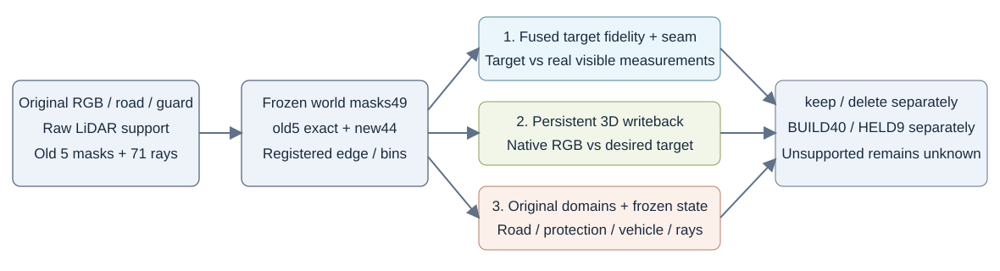

# 固定400-pair A/B：RGB小幅下降，原生接缝退化

本轮A=同190非HELD源未融合atlas目标，B=同atlas经注册Poisson融合的目标；各自从相同AA父材质起点，400 paired keep/delete步骤，仅2053父RGB可写。**A/B均未解决接缝，不选作替代AA的场景资产。** B的平均边界jump比A小，但两者对AA基线都退化，不能把相对较好的B写成seam成功。车辆、几何、opacity与原生排序未改。

## 1. 目标不是GT，且混有原图恒等区域

BUILD40 fit714546像素中仅10492由atlas替换，其余target直接等于真实原RGB。raw128主蓝框原road1385=545replace+840identity；fit1071是另一个分母。replace-only目标MAE A .038873129→B .037565862；全1385的MAE .015296646→.014782234不能全部计为融合能力。

raw128主框near-x固定6bins实际配对35/33px，只有14/18px替换；1个bin两侧均identity、5个mixed、0个纯atlas。目标residual jump A .009696462→B .010322402反而增加。raw137副worldpatch为1447road=816replace+631identity，fit1332；replace-only目标MAE .032775017→.031538558，near12bins目标jump .010576652→.006191509。正负例、主框/副patch分母均保留。

source190、HELD排除、共同mask与2053/8045参数资格数据核查见[SOURCE_FIT_AUDIT.md](SOURCE_FIT_AUDIT.md)。target source/fit合同通过不代表target的接缝质量通过。

## 2. 三维回写：主框原图误差与接缝指标方向不同

原raw128近似蓝框始终使用1385原road、near6个匹配bins：

|状态|指标|AA基线|A direct写回|B fusion写回|
|---|---|---:|---:|---:|
|KEEP|原road RGB MAE|.028254776|.026162337|.025730176|
|KEEP|near residual jump|.007119644|.011608693|.010230045|
|DELETE|原road RGB MAE|.029598031|.028348081|.028103102|
|DELETE|near residual jump|.009794056|.016431121|.016020678|

完整三层文件还分别记录render−target误差，不能用target−原图的改善代替3D写回验收。固定atlas/Poisson目标覆盖宽于2053可写父域；newroadW=0的点可能属于旧road、native static或其它成分，不统一归因static。旧native与新road混合、共同3D参数的跨视图约束和目标hard-replace边缘都在这组结果中，不能从一个指标断言唯一根因。

## 3. 全49固定世界边界：keep/delete分别统计

旧5key mask逐字节复用，新44mask在读新target/candidate之前按原road/guard/rawground冻结。下表等权平均所有有效matched bins；near为47/49视图、248bins，lateral为40/49视图、277bins。far在49视图均无支持，值为None而非0。

|状态|边界|AA基线|A direct|B fusion|B比AA退化bin数|
|---|---|---:|---:|---:|---:|
|KEEP|near-x|.008399349|.009915840|.008742119|112/248|
|KEEP|lateral-y|.015084540|.020644161|.019427537|185/277|
|DELETE|near-x|.009340286|.011023286|.009919009|115/248|
|DELETE|lateral-y|.016714933|.021839800|.020751462|182/277|

不能把不同state的正负例混并。数据保留每frame、每edge、每bin及两侧实际像素；同时另列等有效frame平均以说明聚合权重。[独立摘要JSON](full49_review_summary_v1.json)包含worst bins、逐帧tails和A/B直接比较。

## 附属原观测保护与红射线

原road分母1,075,281，protected分母6,312,448。相对AA的pooled RGB MAE改变量如下；“退化帧”只计逐帧delta>0，不是新接受门。

|方法/状态|原road delta / 退化帧|protected delta / 退化帧|
|---|---:|---:|
|A KEEP|−.000025312 / 20|−.000003884 / 19|
|A DELETE|−.000012874 / 16|+.000001476 / 14|
|B KEEP|−.000032033 / 19|−.000005496 / 18|
|B DELETE|−.000009458 / 16|+.000002557 / 14|

B DELETE原road最坏raw89 +.000357468，protected最坏raw114 +.000090972。pooled小改善不能掩盖接缝退化或逐帧负例。

196个material/frame/state记录的5项geometry hash、车辆row hash、C2/a37预乘RGB均相同；独立重载5key共100个full-float字段检查0差。其它44帧只保存RGB，geometry依据原生receipt hash审查，不冒充独立重载全图。294个原native记录的36个pooled sum/count重算无差。

红侧沿用raw128的23chart-first/12ground-first/1contact与raw130的24/11，共71条固定delete射线。两种写回权重变化均0，ground-first没有新露>.01，原6/7个chart-first严重缺失仍在。RGB改变不作为隐藏轮胎GT或几何修复成功。

## 文件与范围

- [完整三层审查](full49_three_layer_review_v2.json)，SHA256 `eecda33b3fa3733658863fdbcf52f12847a8de355822d555b35ec0424b9ee6f7`。
- [独立摘要](full49_review_summary_v1.json)，SHA256 `c430b5a62571f574b6b3b4332c78d65fef49384dcbbfc3be0dcd7e06471f16f0`。
- [目标关键帧v3预检](final_target_key5_preflight_v3.json)，包含替换/恒等域与逐bin计数，不是新3D写回结果。
- [source/fit合同审查](source_and_fit_contract_audit_v1.json)、[恢复续步moment审查](restore_continuation_moment_audit_v1.json)。

本审查CPU-only、0额外GPU forward。HELD9仅排除本轮source/fit，继承几何与旧材质已预曝；仍是同场景开发比较，不是独立道路先验、全相机或隐藏场景恢复证明。A/B文件与指标冻结，后续唯一另立C控制不回写本次结果。
