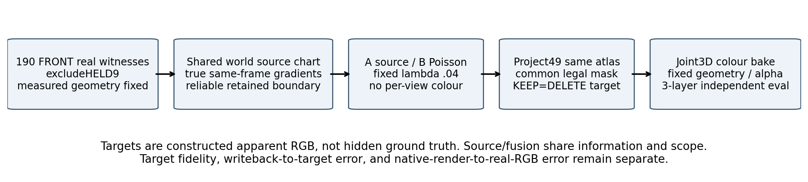
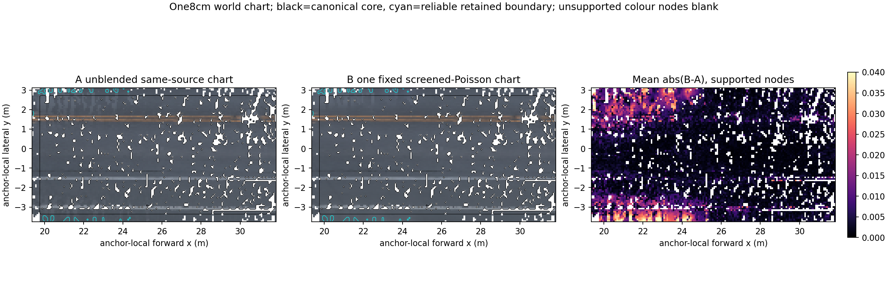
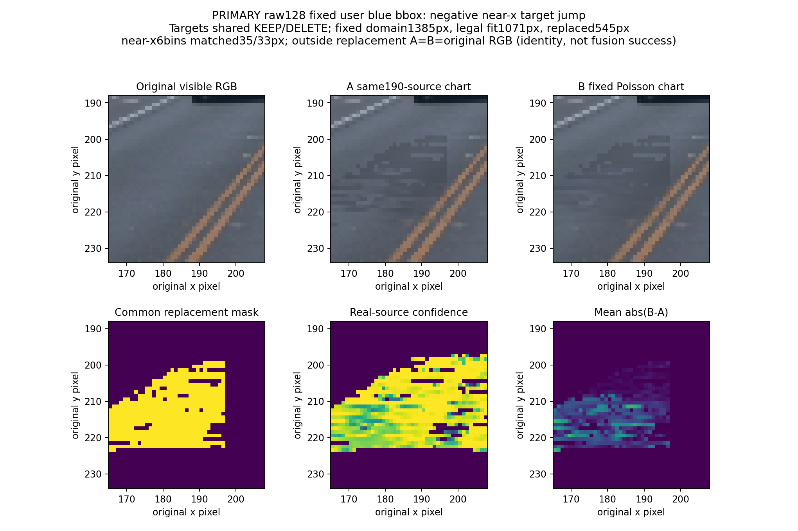
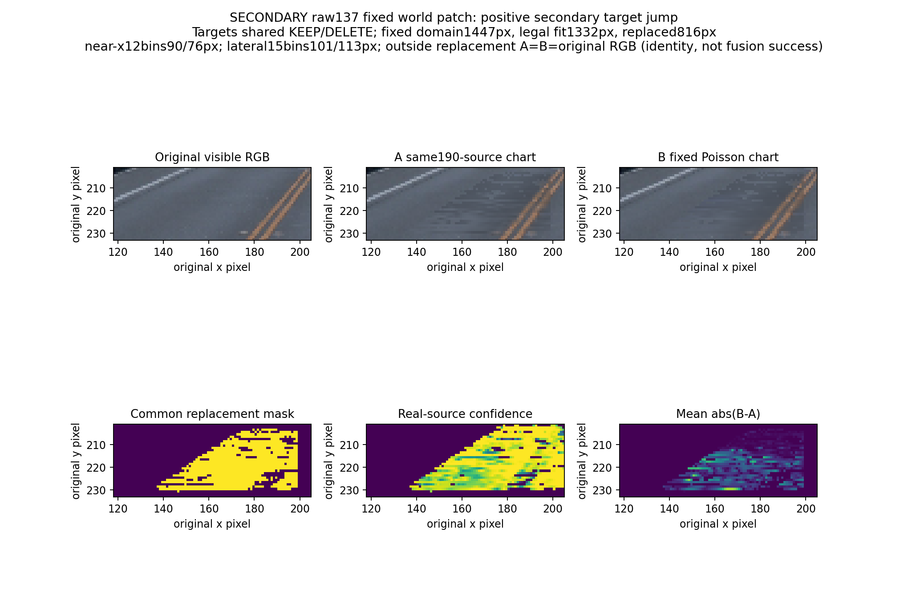

# 共享世界融合目标：已锁定，非场景采用

两试控制只差融合算子：A投影未融合source chart，B投影一次固定screened-Poisson chart。两者使用相同190个非HELD的FRONT轨迹视点实拍见证、同8cm世界几何、同合法投影域及固定BUILD40的714546道路像素。HELD9只投影/评价；原场景曾曝光all199，此处不宣称独立盲测或全五相机验证。目标为encoded sRGB期望完整合成图RGB，非预乘roadRGBT、非albedo；KEEP/DELETE共用同一文件。

chart共13358节点（10098core+3260外halo），11806节点获稳定颜色支持，其中core10094；142节点无有效真实见证。26451邻边中24801有至少2个同帧真实梯度见证，1650弱fallback边另列。沿用固定q75光照cohort，不进行反射/阴影分解；标线没有语义GT，只评价真实梯度保留。

外环只在source资格/guard合法、newroadW≤.05、KEEP保留成像与真实source最大通道残差≤.03、与共享chart一致、至少3 BUILD帧且span≥6时保留。103个节点成为硬边界；1485条RGB前资格记录中接受1411条，残差拒14条，其中staticW>.5的污染拒5条/5独立节点；cohort拒64条可重叠。没有把暗蓝static整体当道路真色。边界pin误差从.0112343变0是硬约束满足，不是独立准确率。

一次固定λ=.04，未调权重/阈值/来源。原解范围[-.0103743,.6523792]；60节点/131通道裁剪到[0,1]。方程残差max从1.998e-15增至.00800715，裁剪事实与残差保留。相对于同帧真实梯度，source chart平均绝对残差.00450150→Poisson .00149455；这是构造与源梯度的一致性，不能代替当前真实RGB或最终native质量。

BUILD40实际替换10492/714546像素；atlas外/不合格处A=B=observation RGB，不能把这些恒等区误差0算作融合能力。投影要求四角均有可靠实测source支持、固定测量高度有效，并拒绝可用scene-depth冲突；不为颜色移动道路、不新增单目深度。49帧全部替换像素从同一世界atlas与保存localXY重放，最大RGB误差9e-07，只有float32坐标舍入；这证明共享表示，不是独立跨视角光度准确率。

raw128 **原用户近似蓝框**：固定原road1385、合法fit1071、实际replace545，near-x6bins实际配对35/33。目标A→B相对真实RGB的near jump **.009696462→.010322402回退**，即使road MAE改善，也不写接缝解决。以下同裁剪不重选负例：

raw137为 **副世界patch**，不是用户蓝框：原road1447，near-x12bins实际90/76、lateral15bins实际101/113。A→B near jump .010576652→.006191509、lateral .017606065→.013906171改善，但不能覆盖raw128负例。裁剪只取原冻结world-patch mask整体bbox[118,201,205,233)，不是按改善点挑选。

目标trueRGB偏差、native写回目标误差、native对真实RGB误差由独立评价分别报告。无隐藏车/道路纹理GT、无shadow decomposition、无完整PBR/新道路生成/全场景采用声明。目标阶段新增GPU0F，复用engineer80F/B基底；一次未执行括号语法错误与顶层ready schema修复均保留源/首manifest，不改变数组或科研方法。

[目标合同](atlas_contract.json)、[不可变49目标manifest](target_manifest.json)、[源支持](source_chart_receipt.json)、[可靠边界审计](boundary_receipt.json)、[解算与裁剪](poisson_receipt.json)、[共享采样重放](target_consistency_receipt.json)、[详细构造summary](target_construction_summary.json)。
