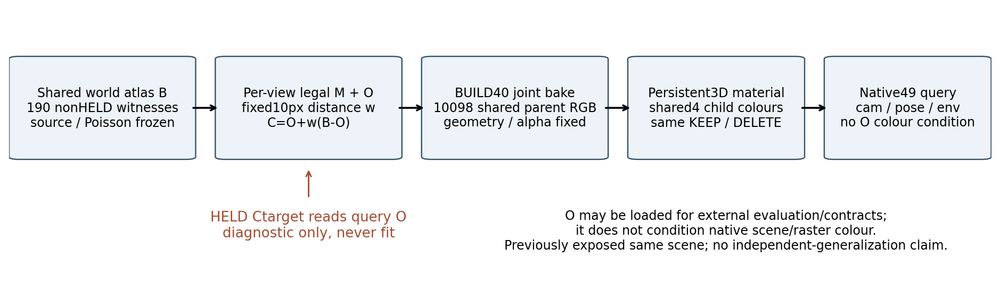
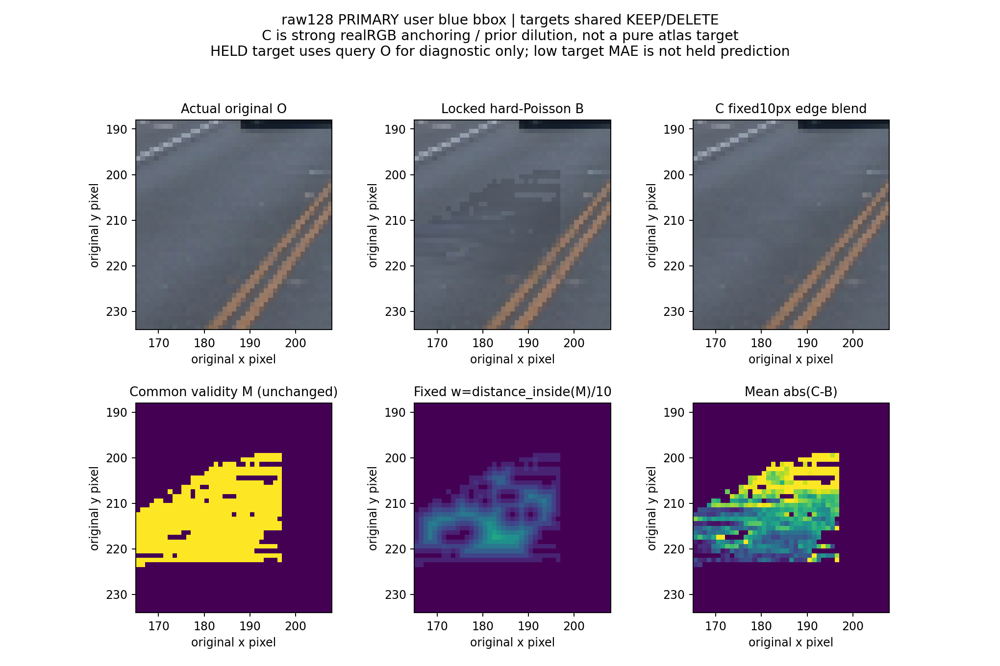
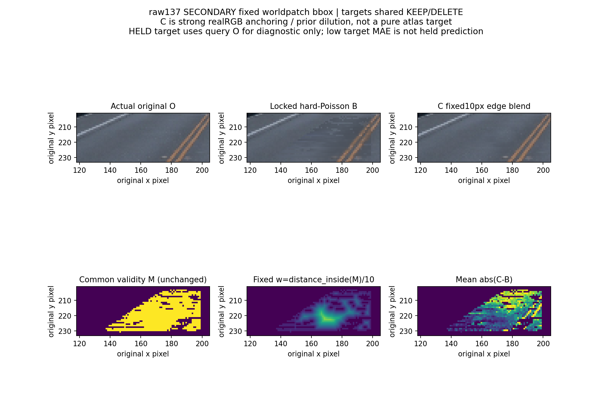

# 唯一10px边缘融合控制：强真实RGB锚定

旧目标的world Poisson只约束103个外环节点，没有约束各相机validity-mask与原RGB硬拼接的边界。原target与manifest均保留；这一轮只加一个固定10px控制，替代未执行legacy，不搜索width或来源。

raw128原蓝框、原road1385像素中，216条四邻接跨replace边上的额外残差梯度均值为：旧B .041196、AA .016872、已烘native-B400 .020683。216边分别为chart四角几何资格117、source资格71、scene-depth拒11、A37保守guard17；这里chart edge不是物理首交/真实车辆边。边外AA newroadW均值.472、assetW=0，说明mask资格洞处渲染仍有道路贡献。该结果支持目标拼接缺口，不能用来宣称固定3D表示必然失败。

新目标只用公式 `C = O + clip(distance_inside(M)/10,0,1) * (B-O)`，对所有M边界含内部洞同样处理；同190真实见证、同Poisson、同原fit/protect/M，两状态共享。outside仍C=O逐值相同；不改几何/alpha/深度/来源/旧目标。C字段为edgeblend_rgb，原fusion_rgb仍旧B，不能混用。

BUILD10492个替换像素的平均w=.186557897、max=.728011，0个w=1；raw128主蓝框545替换点平均w=.21037847、max=.6，也无纯atlas内域。HELD2623替换点均w=.1985438、max=.806226，仍0个w1。因此这是很强的真实RGB锚定/先验稀释，不叫纯atlas目标。跨M边C残差约按构造降到B的10%，不能作为融合或native成功证据；验收仍用原冻结世界分桶、trueRGB、native49与保护域。

HELD9的Ctarget明确读取query真实O，只用于目标构造/诊断，低targetMAE不是held预测。只有BUILD40用于拟合持久3D材质。native查询的scene/raster颜色不以queryO为条件；现有rt.raw可以读取/加载obs用于评价/合同，因此不声称文件不读O。旧场景历史曝光过all199，始终是preexposed same-scene控制，不是独立泛化。原atlas继续世界共享；C的完整投影目标因观测RGB/合法域而view-conditioned，没有新增自由逐帧颜色。

[C合同](edgeblend_contract.json)、[不可变49目标manifest](target_manifest.json)、[0F预检](target_preflight_0F.json)、[queryRGB角色](QUERY_RGB_SCOPE.json)、[详细summary](edgeblend_target_summary.json)。新增目标阶段GPU0F，native训练/恢复/评价由独立执行与评价收据记账。
