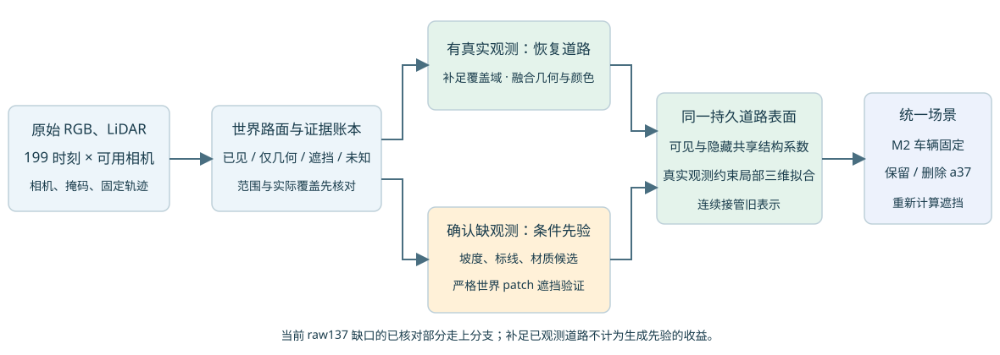

# Scene008 road-prior assessment: observed coverage first

The current M2 vehicle prior remains fixed. This task diagnoses missing road support and designs the next branch; no road asset was repaired and no prior was trained.

An independent raw137 ROI x[230,270),y[204,222) has720 pixels. The user's570-pixel mask was not supplied, so this is not an exact570 replay. Isolated and joint road alpha are exactlyzero, static mean is.150586 and environment.849389. All141,888 current road rows are active, but their scene-local x spans only8.17–19.75m; the295 valid underlying road queries start at21.24m and extend to28.27m. No effective road footprint overlaps the ROI. The immediate cause is finite road world-domain coverage, not old-static occlusion or runtime masking.

Of those295 queries,294 have qualified realFRONT RGB/geometry witnesses at raw154–175;286 pass the existing stable-colour proxy.425 other ROI pixels lack a trustworthy inherited intersection and remainunknown. Stable high-radiance clustering is not clean-albedo ground truth. The vehicle's grey moving extension stays part of the car.

The old199 RGB recovery cache isFRONT-only. Four sampled raw records contain five cameras and fiveLiDARs with two returns, but a full all-camera observability audit has not been executed. Zero qualified samples, lowalpha and missingUID do not prove never visible.

The next sequence isR0 observed coverage restoration and persistent takeover;R1 strict world-patch blinding;R2 interpolation/structured shared-prior/candidate-teacher controls;R3 fixed-M2 scene integration and all49 paired evaluation. Geometry-known appearance completion and jointly geometry/appearance-blind completion are distinct contracts. Source removal includes all declared views, LiDAR,initialization,features,caches and target-encoded parent models. A separate blinded road branch avoids using the old complete scene as a hidden-answer teacher.

R4's frozen-representation keep/rebind/defer boundary cannot supply a missing road surface. MOG2's visible-hidden shared structural coefficients provide the intended recovery framework, with explicit local replacement and visibility checks. The current Gaussian renderer is not declared to implement the full MOG2 opaque first-hit guarantee.

Official literature and code trees were checked: RoGs(2024preprint),2DGS(SIGGRAPH2024),StreetUnveiler(ICLR2025),StreetCrafter(CVPR2025),InfiniCube(ICCV2025). None was installed or executed here. Candidate images are not truth and must be fused into one persistent world road representation. Current32GB feasibility of large published teachers remains to be tested before selection.

The latest vehicleI/O wrapper was checked onCPU: geometry,normal,scale,opacity,SH and inferred flags are bitwise identical to the diagnosticM2. PVD producesXYZ, notRGB; fallback lower-body colour is not a road target.

[Report, figures and execution plan](index.html) · [Machine-readable road plan](road_plan.json) · [Coverage evidence](coverage/coverage_summary.json) · [Real later-view witnesses](observations/patch137_observation_ledger.json) · [Benchmark leakage contract](observations/benchmark_contract.json) · [Literature audit](literature_review.json) · [Receipt](assessment_receipt.json)

Sources/numeric evidence have byte-exact snapshots; published text is LF-normalized for Git. Eight no-grad GPU renders and CPU evidence checks performed; zero optimizer updates, no original checkpoint overwrite. AutoDL remains on as explicitly requested.
