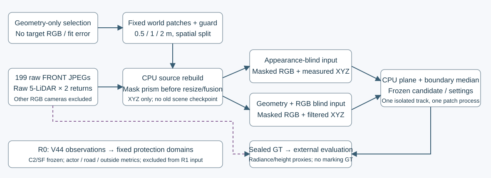

# R0 protection and FRONT-only R1 benchmark

The authoritative R1 generation is `FRONT_geometry_v2/`. The first `public/`
selection is preserved as a draft because its old `source_valid` field also
depended on full-image sharpness. Version 2 recomputes direct measured-return
witnesses with no RGB or quality gate. Both happened to select the same bounds.

`integration_domains/` contains the exact original V44 masks for R0. It is
outside R1 public inputs and must never be mounted into a blinded estimator.
The current integration asset is C2/SH0/RGBA with SurfaceLOD, not old M2.

R1 separates appearance-blind (target XYZ permitted, all intensity/RGB removed)
and geometry+RGB-blind (target+guard XYZ removed before fusion). Each prepared
track directory is self-contained. Mount or copy **only one track directory**
for its estimator; keep the other track, original scene, old checkpoints and
`evaluator_only/` unavailable. Manifest allowlists are not OS-level isolation.
The final estimator entry point is `FRONT_geometry_v2/isolated_inputs/<track>/`.
`export_isolated_inputs.py` strips selector support counts and sealed reference
diagnostics from the per-track manifest; the source reconstruction directories
are audit intermediates and must not be mounted wholesale.

Selection uses fixed metric patches of 0.5, 1 and 2 m, a 0.75 m world guard,
and a spatial hash to reserve validation/test patches. It does not read target
RGB, marking classes, color stability or fit errors. Height masks use a broad
context-derived interval, not an exact target-height silhouette.

Native FRONT JPEG is masked before resize. The CPU raw LiDAR decoder processes
all five sensors and both returns; the geometry-blind prism filter precedes any
pool, normal/ground inference or feature extraction. No renderer or neural
framework is imported. A native-color intervention must leave masked outputs
exactly unchanged. Source SHA256, CRC, removed-point and masked-pixel counts are
recorded for each of the 199 declared FRONT frames.

The projection uses all nine Brown intrinsics and a conservative interval
rectangle; rolling-shutter constant-velocity inflation is recorded as an
assumption. Physical timing/distortion bounds and actual estimator process
isolation are not independently certified. The other four RGB cameras are
excluded and unsearched. This is never an all-five-camera strictness claim.

Seal only after the patch hash is fixed. `seal_patch_references.py` writes real
FRONT radiance and measured-height references outside public inputs.
`evaluate_external.py` requires frozen prediction/settings/seed hashes and
refuses a second sealed-test candidate hash. Target marking labels are absent;
normal/slope and stable radiance are qualified proxies, not independent hidden
geometry or unshadowed-albedo ground truth.

The minimum CPU baseline is now executed separately in
`baseline_runs/fixed_plane_boundary_median_v1/`: 12 independent patch/track
processes, fixed51 input frames, robust local plane plus nearest legal boundary
color median. `baseline_settings.json` and all predictions are frozen before
external evaluation. Each estimator starts with Python `-S`, verifies its one
track's file allowlist/hashes, blocks a real sealed-manifest open attempt, and
records actual reads. This remains Python path enforcement, not an OS sandbox.

Colors require valid unmasked RGB, original FRONT actor-rectangle guards,
actual near-return depth agreement and context-plane consistency. Two patches
have no qualified local color support in either track; no RGB errors are
invented there. Support flags and full denominators accompany every score.
Marking accuracy is unscored. RBF/spline and pretrained completion are not run.

Two entry smokes are retained separately. The first exposed Qhull diagnostic
temporary files outside the allowlist; the corrected entry restricts them to
its own new output directory. This changed wiring only, with fixed method and
parameters. Original smoke and extra work remain in the compute ledger.

No training run, GPU operation or power change is performed by this subtask.
R0's root-frozen numerical protection contract is linked by SHA256 in the
preparation receipt; original alpha >= .98 and residual environment <= .02 road
gates remain. Engineering pass does not imply quality acceptance.
