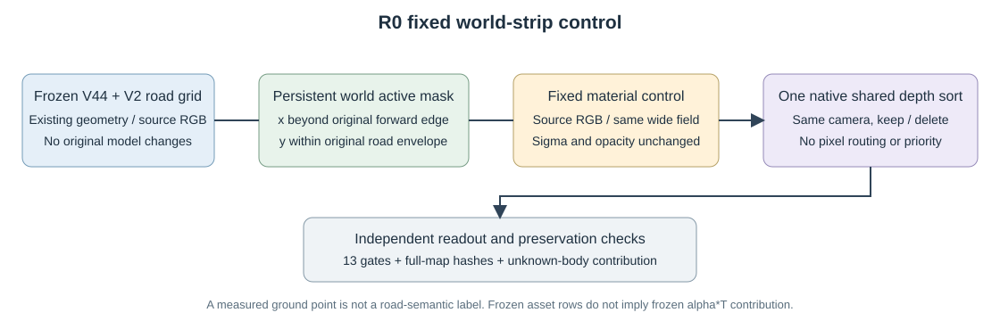
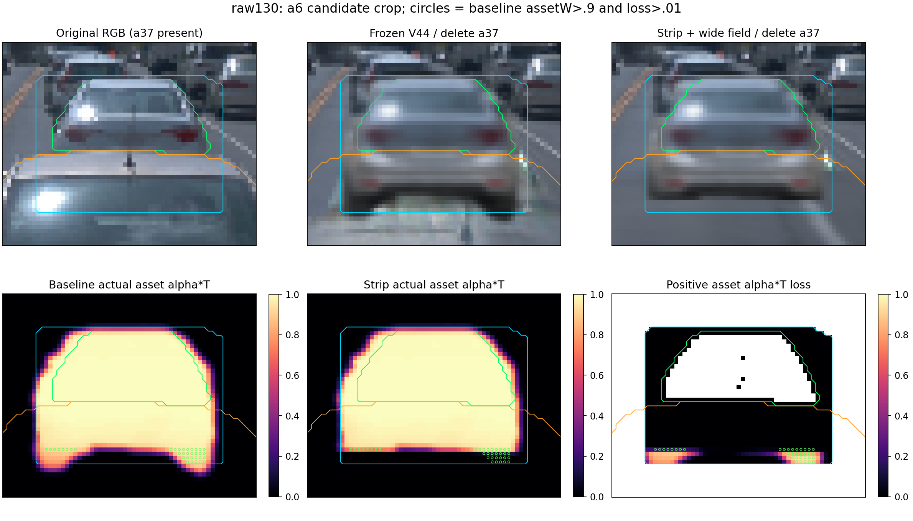
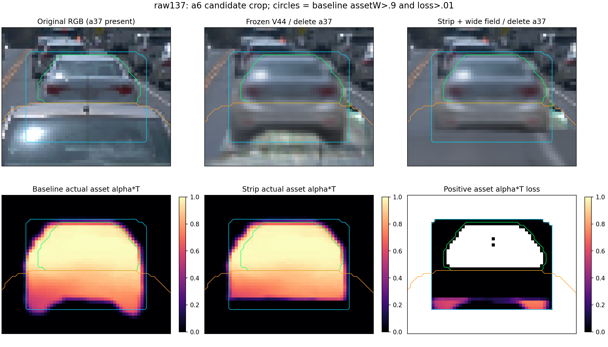

# 未知车地界面诊断

raw130的35个baseline assetW>.9、损失>.01像素全部位于原a37可见区域，距原a6 reviewed边缘11–14px，非a6观测轮廓削边：5像素a6 measured-occluded、30像素unknown，0自由road。raw137的W>.5损失>.01共68像素，也全部原a37可见（20 occluded、48 unknown）。原RGB不能作隐藏a6或删后road GT。

原C2 S/F与保存du重构实际LOD行数。raw130这35点中，主导Gaussian mean离地中位0.0876m，5点mean低于road超过0.02m；3σ下界最低-0.1136m。现有连续chart有5点低于road超过0.03m，另24点高于road超过0.03m且ground真实ray交点在后，说明不能唯一归因“PVD穿地”。

35-ray canonical activeUV三角片opaque probe在matte阈值.01与.5均得到24点chart先、11点ground先；最严重18点分别7/11。三角与局部连续S交点差最大4.05e-5m。此为开放单面chart近似，不含retained非chart的闭合表面，不是真隐藏GT或完整renderer。

最严重18点的主导roadGaussian投影中心距目标1.08–2.02像素、中心depth相对body中位近0.763m。CPU仅C2+road近似复合对真实GPU new-assetW最大差0.006，支持足迹/中心排序干涉也是候选机制；不是唯一物理根因。独立ground仍是实测池插值，有高度/遮挡边界，不把模型首交当真实车体首交。

所有模型、车体、road几何/alpha均未改；本诊断0 GPU forward。最终材质拟合的全图alpha hash与该strip对照相同，所以未知部分风险持续，需与原13个已观测门分列，不宣布场景采用。
