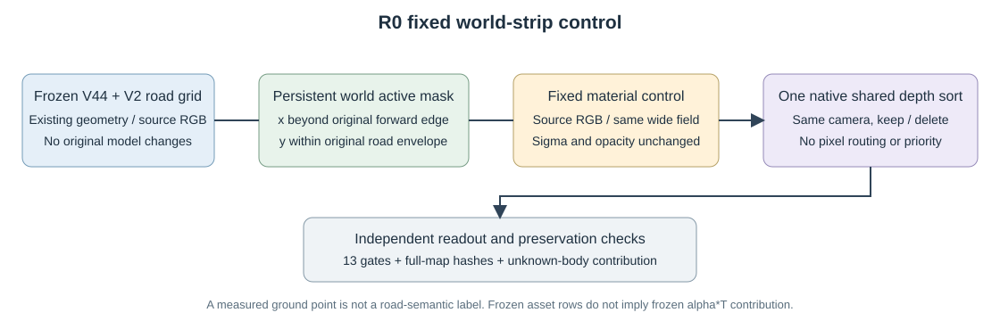

# 材质对照独立复核

full49_corridor_cellfit: **FAIL_CALIBRATED_PRESERVATION_DO_NOT_ADOPT**；49帧成对核查。

固定几何/alpha，仅对2171个有真实renderer监督质量的new-road cell优化6513个RGB标量，恰1000次Adam；matched-strip 11×9 field初始化。 HELD9未参与材质拟合，但冻结V2proxy使用all199，不构成严格盲测。

|状态|指标|baseline|extension|calibrated|
|---|---|---:|---:|---:|
|keep|observed_road_RGB|0.016458|0.017828|0.016946|
|keep|protected_RGB|0.015194|0.015541|0.015379|
|keep|observed_road_depth_m|4.560699|4.554774|4.554774|
|delete|observed_road_RGB|0.021273|0.023796|0.022317|
|delete|protected_RGB|0.015359|0.016161|0.015859|
|delete|observed_road_depth_m|3.777926|3.746443|3.746443|

calibrated 对原 V44 的13项保护门失败 1 项。相较extension改善不能代替全部保护门通过。

保存的8组 calibrated/extension 全图 alpha、depth、group-alpha、extension-alpha 逐位相同；原车辆行哈希逐帧六状态/变体恒等。baseline与原V44所有可用float RGB精确一致，PNG亦相同。 Corridor只改变固定world active域，不要求与旧wide V2图像相等。

独立重算40份监督mask、全部输入SHA、sigmoid导出颜色与资格/冻结区；核1000步记录及smoke/restore独立预算，未重跑训练。 material SHA `70a9f7262977099f875ebd18dd359313232d0662025e6213b799bce41ea90968`。新 observed-road depth 是原生 Gaussian 透射权重期望深度（ΣTαz/ΣTα）对稀疏真实LiDAR最近回波的残差，不是首交点精度；只作本轮实测描述，不写回旧收据或伪造原门限。全部帧的alpha/depth摘要及road-alpha PNG亦一致，未保存的非关键帧float不冒称独立逐像素重读。

首跑因 baseline if/else 接线失败，在2次成功forward后终止，未产生 calibrated 分数；失败目录及源快照保留，新目录重跑。未改旧模型/几何/alpha，未使用隐藏GT或生成模型。

固定横向world mask独立重算通过：保留10098行，inactive4563行。 本轮为固定1000步per-cell材质对照。全49×keep/delete共98组四张全图读出hash均相同；关键帧保存数组的hash已独立复算。

最终原13门逐项（calibrated 对原V44；门限未改）：

|状态|指标|门|阈值|退化|结果|
|---|---|---|---:|---:|---|
|keep|a6_RGB|max_frame_regression|0.001000|+0.000174350|PASS|
|keep|a6_depth_m|max_frame_regression|0.010000|+0.004632096|PASS|
|keep|a37_RGB|max_frame_regression|0.001000|+0.000000068|PASS|
|keep|observed_road_RGB|max_frame_regression|0.005000|+0.001079613|PASS|
|keep|observed_road_RGB|pooled_regression|0.001000|+0.000488502|PASS|
|keep|protected_RGB|max_frame_regression|0.005000|+0.000457807|PASS|
|keep|protected_RGB|pooled_regression|0.001000|+0.000184718|PASS|
|delete|a6_RGB|max_frame_regression|0.001000|+0.000175291|PASS|
|delete|a6_depth_m|max_frame_regression|0.010000|+0.004632134|PASS|
|delete|observed_road_RGB|max_frame_regression|0.005000|+0.001672149|PASS|
|delete|observed_road_RGB|pooled_regression|0.001000|+0.001043788|FAIL|
|delete|protected_RGB|max_frame_regression|0.005000|+0.000664054|PASS|
|delete|protected_RGB|pooled_regression|0.001000|+0.000499588|PASS|

结论：12/13，唯一delete observed-road pooled +0.001043788仍超过+0.001；不采用、不延长1000步、不改门。保护域keep/delete pooled与原车辆/深度门通过。

raw137固定720机制计数：

|状态|solo min|solo≥.98|combined alpha min|env>.02|extension W均值|
|---|---:|---:|---:|---:|---:|
|keep|0.994790|720/720|0.999888|0/720|0.000000|
|delete|0.994790|720/720|0.994790|0/720|0.973858|

alpha/solo/环境计数只证明表示覆盖与透射机制；总alpha包含车体和static，不能冒充720像素road RGB准确或隐藏GT。与前一strip对照的98组四张全图readout hash一致，8key保存数组独立复算一致；未知推断车体的贡献损失仍保留，不能宣布场景采用。

35-ray只读probe：raw130严重35点原RGB均为a37，距a6 reviewed边缘11–14px；同一现有C2 chart三角首交24点chart在前、11点ground在前。最严重18点为7/11。开放chart/matte近似不含封闭完整车体；A型几何贴地/穿地与B型Gaussian足迹/中心排序机制并存，不提供隐藏first-hit GT，也不代表完整MOG已实现。
