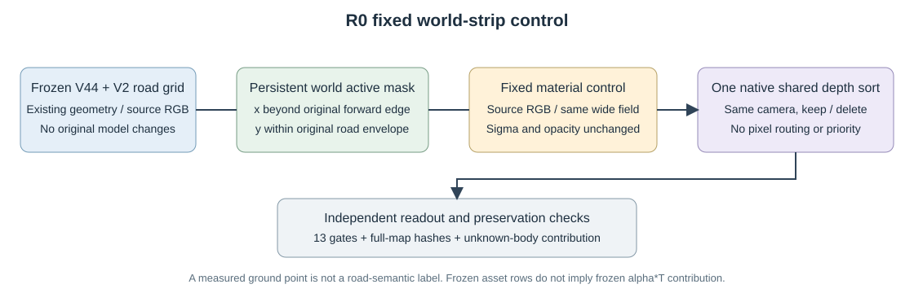

# 未观测车体贡献诊断

仅诊断a6 candidate且非visible像素；不作为隐藏车体GT，不默认unknown是road。冻结资产行与冻结实际贡献是不同条件。

|raw|baseline assetW阈值|像素|assetW损失>.01|损失>.1|最大损失|RGB最大通道变化|
|---:|---:|---:|---:|---:|---:|---:|
|105|0.5|1786|0|0|0.004592|0.036610|
|105|0.9|1594|0|0|0.004592|0.010811|
|113|0.5|1289|0|0|0.003505|0.086525|
|113|0.9|1150|0|0|0.003505|0.019391|
|130|0.5|750|89|67|0.943457|0.441521|
|130|0.9|616|35|26|0.943457|0.441521|
|137|0.5|566|68|68|0.731104|0.323683|
|137|0.9|122|0|0|0.000000|0.000000|

如road在实际深度排序中取得权重，只报告这一机制。没有证据可将旧PVD隐藏几何视为正确答案，也不能把已有贡献下降自动判为补全错误。全部像素例及loss map另存JSON/NPZ。
