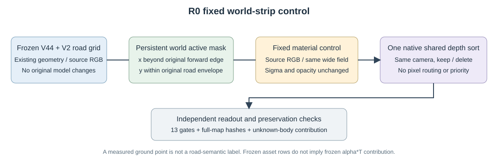

# 材质对照独立复核

full49_corridor: **FAIL_CALIBRATED_PRESERVATION_DO_NOT_ADOPT**；49帧成对核查。

固定几何/alpha，仅使用原始 BUILD40 可见道路 RGB 拟合11×9世界色场；HELD9未参与本次 residual solve，但冻结V2proxy使用all199，不构成严格盲测。

|状态|指标|baseline|extension|calibrated|
|---|---|---:|---:|---:|
|keep|observed_road_RGB|0.016458|0.017828|0.017143|
|keep|protected_RGB|0.015194|0.015541|0.015409|
|keep|observed_road_depth_m|4.560699|4.554774|4.554774|
|delete|observed_road_RGB|0.021273|0.023796|0.022539|
|delete|protected_RGB|0.015359|0.016161|0.015869|
|delete|observed_road_depth_m|3.777926|3.746443|3.746443|

calibrated 对原 V44 的13项保护门失败 1 项。相较extension改善不能代替全部保护门通过。

保存的8组 calibrated/extension 全图 alpha、depth、group-alpha、extension-alpha 逐位相同；原车辆行哈希逐帧六状态/变体恒等。baseline与原V44所有可用float RGB精确一致，PNG亦相同。 Corridor只改变固定world active域，不要求与旧wide V2图像相等。

独立重算40份监督mask与全部输入SHA、297参数ridge解及一次全局scale，结果一致；field SHA `4a06539be18722f3fb3eddcfb7cf289d0d032e46878ca8d12d0b856a938e5f73`。新 observed-road depth 是原生 Gaussian 透射权重期望深度（ΣTαz/ΣTα）对稀疏真实LiDAR最近回波的残差，不是首交点精度；只作本轮实测描述，不写回旧收据或伪造原门限。全部帧的alpha/depth摘要及road-alpha PNG亦一致，未保存的非关键帧float不冒称独立逐像素重读。

首跑因 baseline if/else 接线失败，在2次成功forward后终止，未产生 calibrated 分数；失败目录及源快照保留，新目录重跑。未改旧模型/几何/alpha，未使用隐藏GT或生成模型。

固定横向world mask独立重算通过：保留10098行，inactive4563行；仍用原wide field，未重新拟合。全49×keep/delete共98组四张全图读出hash均相同；关键帧保存数组的hash已独立复算。

原13项保护门逐项（calibrated 对原V44）：

|状态|指标|门|阈值|实际退化|结果|
|---|---|---|---:|---:|---|
|keep|a6_RGB|max_frame_regression|0.001000|+0.00015287|PASS|
|keep|a6_depth_m|max_frame_regression|0.010000|+0.00463210|PASS|
|keep|a37_RGB|max_frame_regression|0.001000|+0.00000004|PASS|
|keep|observed_road_RGB|max_frame_regression|0.005000|+0.00138936|PASS|
|keep|observed_road_RGB|pooled_regression|0.001000|+0.00068595|PASS|
|keep|protected_RGB|max_frame_regression|0.005000|+0.00049631|PASS|
|keep|protected_RGB|pooled_regression|0.001000|+0.00021433|PASS|
|delete|a6_RGB|max_frame_regression|0.001000|+0.00015339|PASS|
|delete|a6_depth_m|max_frame_regression|0.010000|+0.00463213|PASS|
|delete|observed_road_RGB|max_frame_regression|0.005000|+0.00199066|PASS|
|delete|observed_road_RGB|pooled_regression|0.001000|+0.00126552|FAIL|
|delete|protected_RGB|max_frame_regression|0.005000|+0.00064173|PASS|
|delete|protected_RGB|pooled_regression|0.001000|+0.00050945|PASS|

结论：原13门通过12项，protected keep/delete在全部49帧的pooled门真正通过；delete observed-road pooled仍+0.00126552，超过+0.001阈值，不采用。固定world-strip保留10098行、inactive4563行，沿用原wide field，不混入材质重拟合因素。

保真补充诊断：4key delete中，a6 candidate且非visible、baseline assetW>0.9的3482像素里35像素贡献损失>0.01、18像素损失>0.5；最大0.94346，严重变化位于raw130。此为shared-sort贡献机制，旧PVD隐藏几何不是GT，unknown也不能默认road。冻结资产行不等于贡献不变。

720目标的solo/实际alpha均值不等于720/720逐像素过阈值；本轮未保存min及98计数，不向旧收据补写。新depth是ΣTαz/ΣTα对稀疏LiDAR最近回波的描述性残差，不是首交精度。
