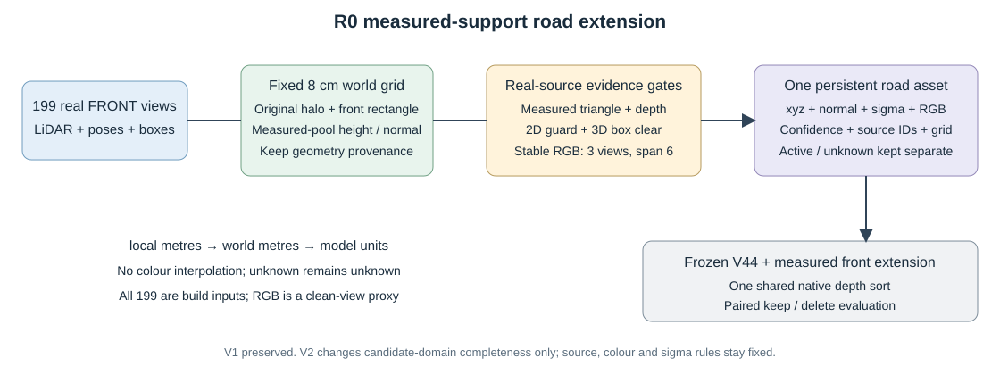

# R0 full49 V2 独立复核

V2 未通过保护门，不采用；当前仅有未标定的 baseline/extension 对照。

逐帧49份 metrics 与 receipt 一致；重新由 sum/count 汇总的 pooled 数值精确一致。以下为 sRGB MAE（depth 单独按米审查）：

|状态|指标|V44 baseline|V2 extension|变化|
|---|---|---:|---:|---:|
|keep|a6_RGB|0.054988|0.055004|+0.000016|
|keep|a37_RGB|0.014916|0.014916|-0.000000|
|keep|observed_road_RGB|0.016458|0.020193|+0.003735|
|keep|protected_RGB|0.015194|0.016937|+0.001742|
|delete|a6_RGB|0.054945|0.054961|+0.000016|
|delete|observed_road_RGB|0.021273|0.026210|+0.004937|
|delete|protected_RGB|0.015359|0.017618|+0.002259|

保护门共 13 项，失败 6 项。最差逐帧退化：

- keep a6_RGB: raw93 +0.000185；18/49 帧变差。
- keep a37_RGB: raw127 +0.000000；9/49 帧变差。
- keep observed_road_RGB: raw137 +0.006584；49/49 帧变差。
- keep protected_RGB: raw130 +0.002867；49/49 帧变差。
- delete a6_RGB: raw93 +0.000186；20/49 帧变差。
- delete observed_road_RGB: raw109 +0.008262；49/49 帧变差。
- delete protected_RGB: raw130 +0.003040；49/49 帧变差。

98 次运行时 RGB baseline parity 的最大差为 0。独立重读全部98张 baseline PNG（与原V44文件SHA和像素均精确一致），以及本轮保存的8个 full-precision baseline：RGB/alpha/group 位等；depth 因 Torch 与 NumPy 端除法舍入，最大差 7.63e-6 米，不称位等。其余90个本轮 float 未保存，未冒称独立重读。另对16个可用 baseline/extension float 重算原始观测误差，全部一致。

机制域分母是 extension solo alpha≥0.98，扣除 a6 膨胀候选框和其他车辆 guard；这是由模型几何得到的机制域，未逐像素保存独立实测深度及 source agreement。固定720 ROI 的贡献增加不作为准确率通过证据，隐藏删后地面仍没有独立 GT。

原冻结合同仍指向 V1 资产 SHA；V2 是新增7313候选的显式谱系变体。contract_v2_lineage 在 full49 之后记录，未冒称预注册；保护阈值沿用原合同。颜色、法线和三套投影另经 CPU 审核，无编码或坐标接线错误。材质场对照尚未包括在本次审查。

直接查看最差帧PNG：raw109/delete、raw130/delete新增道路有明显暗带及横向足迹/颜色边界；raw137/keep车体保持稳定，道路颜色改变。这与数值保护失败一致，未把视觉补面当隐藏真值验收。另独立重算14661个扩展行的选择及资产SHA，均与运行记录一致；49帧四种状态/变体的车辆资产行hash逐帧一致。
