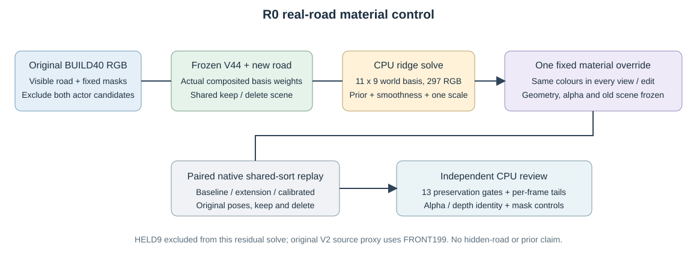

# 固定监督mask残差定位

同一原始观测分区，未按预测颜色或误差挑像素。关键4帧用完整float，全49另用PNG代理，后者不替代精确保护门。

|范围|状态|区域|像素占比|正退化占比|净退化占比|
|---|---|---|---:|---:|---:|
|full49_PNG_proxy|keep|road_fit_allowed|81.960%|79.439%|79.571%|
|full49_PNG_proxy|keep|road_amodal_excluded|18.040%|20.561%|20.429%|
|full49_PNG_proxy|keep|road_other_excluded|0.000%|0.000%|0.000%|
|full49_PNG_proxy|keep|protected_fit_allowed_road|7.817%|23.349%|23.558%|
|full49_PNG_proxy|keep|protected_amodal_excluded_road|1.332%|6.044%|6.048%|
|full49_PNG_proxy|keep|protected_other_road|0.000%|0.000%|0.000%|
|full49_PNG_proxy|keep|protected_nonroad|90.851%|70.607%|70.394%|
|full49_PNG_proxy|delete|road_fit_allowed|81.960%|60.495%|60.418%|
|full49_PNG_proxy|delete|road_amodal_excluded|18.040%|39.505%|39.582%|
|full49_PNG_proxy|delete|road_other_excluded|0.000%|0.000%|0.000%|
|full49_PNG_proxy|delete|protected_fit_allowed_road|7.817%|17.970%|18.051%|
|full49_PNG_proxy|delete|protected_amodal_excluded_road|1.332%|11.732%|11.823%|
|full49_PNG_proxy|delete|protected_other_road|0.000%|0.000%|0.000%|
|full49_PNG_proxy|delete|protected_nonroad|90.851%|70.298%|70.127%|
|key4_float_exact|keep|road_fit_allowed|84.435%|87.140%|87.250%|
|key4_float_exact|keep|road_amodal_excluded|15.565%|12.860%|12.750%|
|key4_float_exact|keep|road_other_excluded|0.000%|0.000%|0.000%|
|key4_float_exact|keep|protected_fit_allowed_road|8.535%|30.545%|30.794%|
|key4_float_exact|keep|protected_amodal_excluded_road|1.009%|4.509%|4.498%|
|key4_float_exact|keep|protected_other_road|0.000%|0.000%|0.000%|
|key4_float_exact|keep|protected_nonroad|90.456%|64.947%|64.708%|
|key4_float_exact|delete|road_fit_allowed|84.435%|75.802%|75.811%|
|key4_float_exact|delete|road_amodal_excluded|15.565%|24.198%|24.189%|
|key4_float_exact|delete|road_other_excluded|0.000%|0.000%|0.000%|
|key4_float_exact|delete|protected_fit_allowed_road|8.535%|25.736%|25.892%|
|key4_float_exact|delete|protected_amodal_excluded_road|1.009%|8.207%|8.250%|
|key4_float_exact|delete|protected_other_road|0.000%|0.000%|0.000%|
|key4_float_exact|delete|protected_nonroad|90.456%|66.057%|65.858%|

分区能发现保守amodal排除的像素监督缺口，但不能证明相应世界单元在其他视角没有监督；不能据此只归因于色场容量。所有数值完整见同名JSON。
