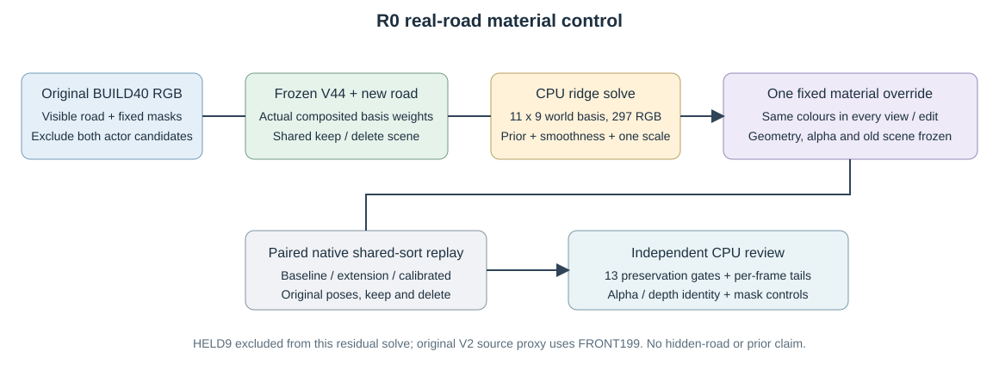

# 材质对照独立复核

full49_worldfield: **FAIL_CALIBRATED_PRESERVATION_DO_NOT_ADOPT**；49帧成对核查。

固定几何/alpha，仅使用原始 BUILD40 可见道路 RGB 拟合11×9世界色场；HELD9未参与本次 residual solve，但冻结V2proxy使用all199，不构成严格盲测。

|状态|指标|baseline|extension|calibrated|
|---|---|---:|---:|---:|
|keep|observed_road_RGB|0.016458|0.020193|0.018403|
|keep|protected_RGB|0.015194|0.016937|0.016313|
|keep|observed_road_depth_m|4.560699|4.569598|4.569598|
|delete|observed_road_RGB|0.021273|0.026210|0.023836|
|delete|protected_RGB|0.015359|0.017618|0.016820|
|delete|observed_road_depth_m|3.777926|3.763233|3.763233|

calibrated 对原 V44 的13项保护门失败 4 项。相较extension改善不能代替全部保护门通过。

保存的8组 calibrated/extension 全图 alpha、depth、group-alpha、extension-alpha 逐位相同；原车辆行哈希逐帧六状态/变体恒等。baseline与原V44、extension与旧V2的所有可用float RGB精确一致，PNG亦相同。

独立重算40份监督mask与全部输入SHA、297参数ridge解及一次全局scale，结果一致；field SHA `4a06539be18722f3fb3eddcfb7cf289d0d032e46878ca8d12d0b856a938e5f73`。新 observed-road depth 是原生 Gaussian 透射权重期望深度（ΣTαz/ΣTα）对稀疏真实LiDAR最近回波的残差，不是首交点精度；只作本轮实测描述，不写回旧收据或伪造原门限。全部帧的alpha/depth摘要及road-alpha PNG亦一致，未保存的非关键帧float不冒称独立逐像素重读。

首跑因 baseline if/else 接线失败，在2次成功forward后终止，未产生 calibrated 分数；失败目录及源快照保留，新目录重跑。未改旧模型/几何/alpha，未使用隐藏GT或生成模型。

原13项保护门逐项（calibrated 对原V44）：

|状态|指标|门|阈值|实际退化|结果|
|---|---|---|---:|---:|---|
|keep|a6_RGB|max_frame_regression|0.001000|+0.00015287|PASS|
|keep|a6_depth_m|max_frame_regression|0.010000|+0.00463210|PASS|
|keep|a37_RGB|max_frame_regression|0.001000|+0.00000004|PASS|
|keep|observed_road_RGB|max_frame_regression|0.005000|+0.00348471|PASS|
|keep|observed_road_RGB|pooled_regression|0.001000|+0.00194533|FAIL|
|keep|protected_RGB|max_frame_regression|0.005000|+0.00191062|PASS|
|keep|protected_RGB|pooled_regression|0.001000|+0.00111858|FAIL|
|delete|a6_RGB|max_frame_regression|0.001000|+0.00015339|PASS|
|delete|a6_depth_m|max_frame_regression|0.010000|+0.00463213|PASS|
|delete|observed_road_RGB|max_frame_regression|0.005000|+0.00427517|PASS|
|delete|observed_road_RGB|pooled_regression|0.001000|+0.00256292|FAIL|
|delete|protected_RGB|max_frame_regression|0.005000|+0.00204863|PASS|
|delete|protected_RGB|pooled_regression|0.001000|+0.00146076|FAIL|

深度定义：原生Gaussian输出为Σ(Tαz)/Σ(Tα)期望相机深度；scene_depth_m是稀疏真实LiDAR最近回波。此比较不是first-hit精度；大绝对残差如实报告，不能用材质对照中的depth恒等冒充几何准确。

横向域定位：关键4帧exact float中，前方且超出原y[-3.35,2.71]范围的像素占observed-road仅3.59%，却贡献keep66.98%/delete59.44%正退化；protected占4.51%却贡献71.46%/62.45%。主要来自y>2.71，且几乎都有actual extension W>.01。固定world-strip是值得真实重放的领域边界控制；此关联不等于已验证裁剪会通过所有门。
