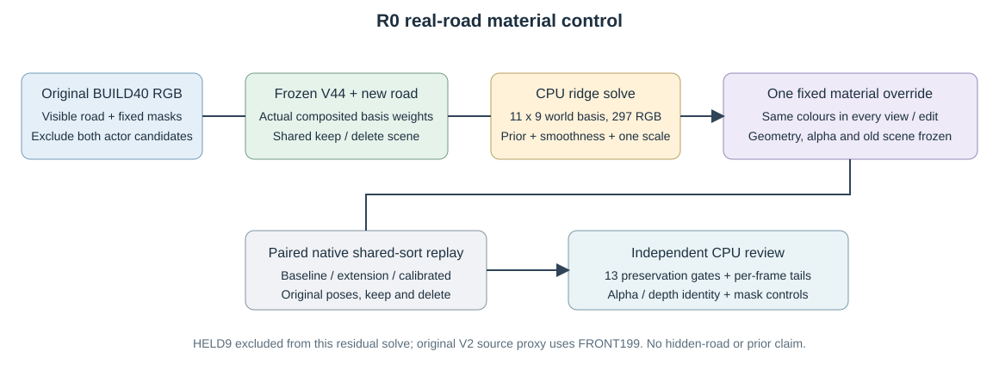

# 材质对照独立复核

pilot_worldfield_r2: **FAIL_CALIBRATED_PRESERVATION_DO_NOT_ADOPT**；4帧成对核查。

固定几何/alpha，仅使用原始 BUILD40 可见道路 RGB 拟合11×9世界色场；HELD9未参与本次 residual solve，但冻结V2proxy使用all199，不构成严格盲测。

|状态|指标|baseline|extension|calibrated|
|---|---|---:|---:|---:|
|keep|observed_road_RGB|0.017569|0.022700|0.020198|
|keep|protected_RGB|0.016708|0.018884|0.018045|
|keep|observed_road_depth_m|3.675834|3.679668|3.679668|
|delete|observed_road_RGB|0.025063|0.031046|0.028092|
|delete|protected_RGB|0.016818|0.019396|0.018410|
|delete|observed_road_depth_m|3.090630|3.068903|3.068903|

calibrated 对原 V44 的13项保护门失败 4 项。相较extension改善不能代替全部保护门通过。

保存的8组 calibrated/extension 全图 alpha、depth、group-alpha、extension-alpha 逐位相同；原车辆行哈希逐帧六状态/变体恒等。baseline与原V44、extension与旧V2的所有可用float RGB精确一致，PNG亦相同。

独立重算40份监督mask与全部输入SHA、297参数ridge解及一次全局scale，结果一致；field SHA `4a06539be18722f3fb3eddcfb7cf289d0d032e46878ca8d12d0b856a938e5f73`。新 observed-road depth 只作本轮实测描述，不写回旧收据或伪造原门限。

首跑因 baseline if/else 接线失败，在2次成功forward后终止，未产生 calibrated 分数；失败目录及源快照保留，新目录重跑。未改旧模型/几何/alpha，未使用隐藏GT或生成模型。

本次仅pilot4，不能替代完整49帧验收。

原13项保护门逐项（calibrated 对原V44）：

|状态|指标|门|阈值|实际退化|结果|
|---|---|---|---:|---:|---|
|keep|a6_RGB|max_frame_regression|0.001000|+0.00008766|PASS|
|keep|a6_depth_m|max_frame_regression|0.010000|+0.00000000|PASS|
|keep|a37_RGB|max_frame_regression|0.001000|+0.00000000|PASS|
|keep|observed_road_RGB|max_frame_regression|0.005000|+0.00348471|PASS|
|keep|observed_road_RGB|pooled_regression|0.001000|+0.00262912|FAIL|
|keep|protected_RGB|max_frame_regression|0.005000|+0.00191062|PASS|
|keep|protected_RGB|pooled_regression|0.001000|+0.00133757|FAIL|
|delete|a6_RGB|max_frame_regression|0.001000|+0.00008772|PASS|
|delete|a6_depth_m|max_frame_regression|0.010000|+0.00000000|PASS|
|delete|observed_road_RGB|max_frame_regression|0.005000|+0.00384303|PASS|
|delete|observed_road_RGB|pooled_regression|0.001000|+0.00302837|FAIL|
|delete|protected_RGB|max_frame_regression|0.005000|+0.00201592|PASS|
|delete|protected_RGB|pooled_regression|0.001000|+0.00159214|FAIL|

深度定义：原生Gaussian输出为Σ(Tαz)/Σ(Tα)期望相机深度；scene_depth_m是稀疏真实LiDAR最近回波。此比较不是first-hit精度；大绝对残差如实报告，不能用材质对照中的depth恒等冒充几何准确。
