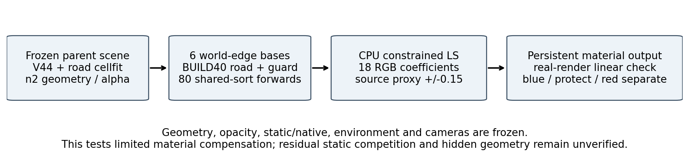
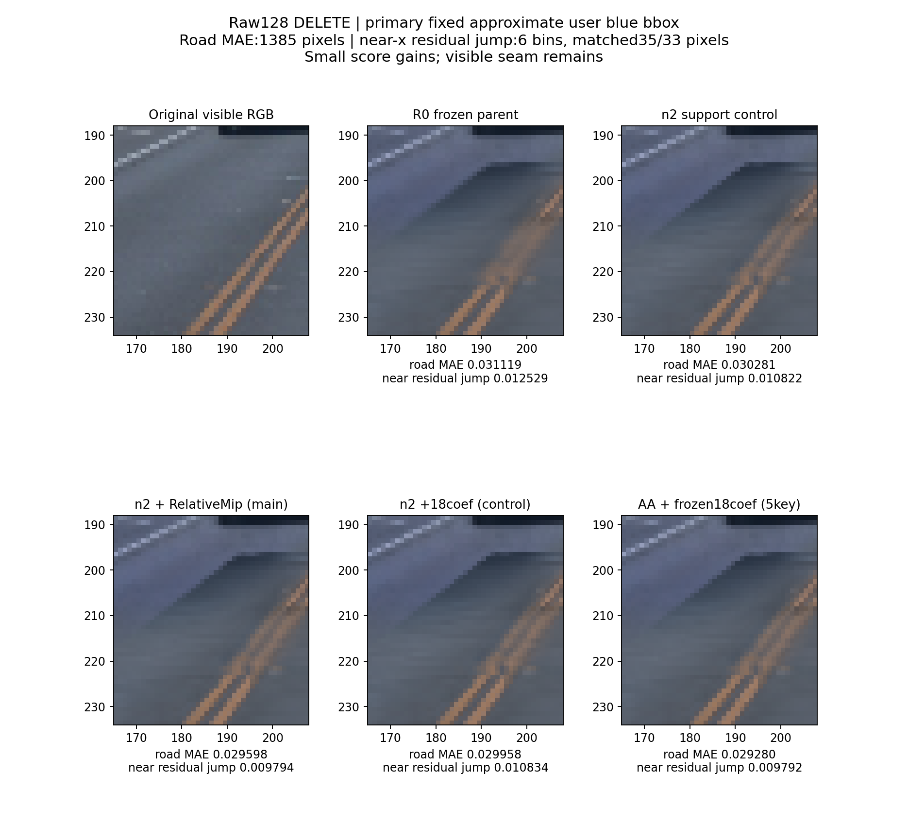
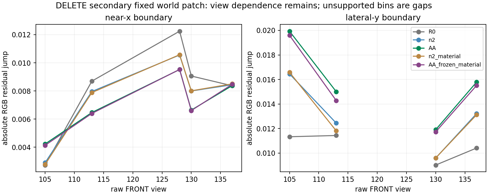

# 蓝圈：仅小幅改善，接缝未解决

主工程候选为 **n2 + RelativeMip，沿用父cellfit1000材质**。18系数材质控制保留为对照，不并入主资产。蓝圈与红圈独立验收；此文不宣称整场景采用。

主评价为 **raw128 / DELETE / 原蓝框**。用户蓝圈只登记近似框 `[165,188,208,234)`，不是精确圈选。框内1978px，原观测road1385px，排车辆guard后1340px；其中214px同时有合格直接scene-depth与实测ground支持。593个非road像素不作为道路GT。世界patch在结果比较前固定为anchor-local x[19,32.6]、y[.5,3.5]m，边界x=19.8、x=31.8、y=2.71；两侧带宽.08–.4m。以下第一表始终为raw128 DELETE，near-x原两侧42/34px，实际配对35/33px、6bins。

|方法|绝对RGB误差sum / road像素数|road MAE|near-x两侧残差jump，固定6bin|
|---|---:|---:|---:|
|R0|43.100456238 / 1385|0.031119464|0.012529406|
|n2|41.939865112 / 1385|0.030281490|0.010822454|
|AA|40.993274689 / 1385|0.029598031|0.009794056|
|n2_material|41.492416382 / 1385|0.029958425|0.010833922|
|AA_frozen_material|40.552909851 / 1385|0.029280081|0.009792360|

误差sum先对每像素3通道取平均绝对误差，再对像素求和；float32不同归约顺序最后数位可有舍入差。jump先减原观测RGB，再在同.2m切向bin中比较两侧均值；每侧至少3px，6个bin等权。因此它不直接惩罚真实标线/阴影造成的原图色差。主框far没有样本；lateral虽有146/75px，但无满足配对规则的bin，其jump **unsupported**。

以下单列 **raw128 / KEEP / 同原蓝框**，仍为1385road，near-x同42/34px、配对35/33px、6bins，不能混用DELETE数值：

|方法|绝对RGB误差sum / road像素数|road MAE|near-x两侧残差jump，固定6bin|
|---|---:|---:|---:|
|R0|41.195846558 / 1385|0.029744294|0.009747075|
|n2|40.041545868 / 1385|0.028910864|0.008037737|
|AA|39.132865906 / 1385|0.028254777|0.007119644|
|n2_material|39.593257904 / 1385|0.028587190|0.008042784|
|AA_frozen_material|38.691051483 / 1385|0.027935777|0.007112209|

在 **raw128 DELETE主框**，AA相对R0的原road MAE下降约4.89%，near-x jump（6bins，配对35/33px）约下降21.83%，仍保留明显接缝。18系数在n2上让ROI MAE再降约1.07%，同near-x jump却从.010822454升至.010833922；冻结迁移到AA后ROI再降约1.07%，jump几乎不变。因此“ROI误差下降”不能写成“接缝解决”。所有材质对照alpha、分组alpha、new/oldroadW与depth相对各自固定表示逐元素完全相同。

**raw128 DELETE父R0主框**的边界机制也不是单一的“新旧road颜色不合”：near-x外42px的new/old/static W均值=.5065/.3729/.1200，内34px=.9312/.0023/.0661；newroad自身mass-normalized RGB两侧接近。lateral-y内146px为.6995/.0052/.2948，外75px为.1822/0/.7313，主要是newroad与native static混合。主框原road中newW>.5的598px，newroad solo alpha均值.99385，joint/solo均值.82081，剩余static颜色偏暗蓝；已有solo支撑，但joint贡献受到其它层/排序影响。此条件分组仅诊断，不替代固定road分母。

“这些cell没有参与fit”的预设已被反证：蓝框中心投影2163行中2026行eligible；这不是每像素真实归属。source_valid128为139行；前方深度冲突71中心均未获source_valid128。source_valid是源资格缓存，不是密集可见性/未观测真值。Gaussian中心深度moment也不是物理首交，不能把中心残差直接记为路面高度误差。

同一预登记世界patch在5个FRONT视图作副审计，使用原road、车辆guard和各raw真实ground，先保存所有mask才读各方法数组。它在pilot已开封后进行，是同场景开发支持证据。它与原蓝框是 **另一套mask**：例如raw128副世界patch有772road，near-x两侧43/35px；即使也有6bins，不能与主框1385road、42/34px、6bins拼接。

副世界patch的raw128 lateral-y仍unsupported；其余4个 **DELETE** view虽然可配对，AA lateral-y jump相对R0反而增加：raw105 DELETE lateral-y 8bins约.011334→.019934；raw137 DELETE lateral-y 15bins约.010415→.015789。KEEP可能反向，以下按frame/state/boundary、配对bin/两侧实际配对像素完整分表，不概括为整条边界一致改善。

|raw|state|副世界patch边界|配对bins / minus像素 / plus像素|R0 residual jump|AA residual jump|
|---:|---|---|---:|---:|---:|
|105|DELETE|near_x|6 / 38 / 33|0.002725210|0.004227476|
|105|DELETE|lateral_y|8 / 51 / 45|0.011333846|0.019934212|
|113|DELETE|near_x|7 / 34 / 34|0.008697785|0.006464752|
|113|DELETE|lateral_y|6 / 41 / 34|0.011436119|0.015002592|
|128|DELETE|near_x|6 / 36 / 33|0.012249608|0.009521702|
|128|DELETE|lateral_y|0 / 0 / 0|unsupported|unsupported|
|130|DELETE|near_x|8 / 41 / 56|0.009060470|0.006635681|
|130|DELETE|lateral_y|9 / 56 / 53|0.009026642|0.011908283|
|137|DELETE|near_x|12 / 90 / 76|0.008367117|0.008378881|
|137|DELETE|lateral_y|15 / 101 / 113|0.010415042|0.015788813|
|105|KEEP|near_x|6 / 38 / 33|0.002514420|0.003429648|
|105|KEEP|lateral_y|8 / 51 / 45|0.008962359|0.007796616|
|113|KEEP|near_x|7 / 34 / 34|0.007244565|0.005120992|
|113|KEEP|lateral_y|6 / 41 / 34|0.011535584|0.015294544|
|128|KEEP|near_x|6 / 36 / 33|0.009467277|0.006847290|
|128|KEEP|lateral_y|0 / 0 / 0|unsupported|unsupported|
|130|KEEP|near_x|8 / 41 / 56|0.008808334|0.006321902|
|130|KEEP|lateral_y|9 / 56 / 53|0.009026642|0.011908283|
|137|KEEP|near_x|12 / 90 / 76|0.008139444|0.008141188|
|137|KEEP|lateral_y|15 / 101 / 113|0.010415042|0.015788813|

唯一材质控制为3条固定世界边界，各一项compact distance taper×[常数,归一化切向]，共6basis/18RGB系数。10098父cell中1270行非零；4个n2子cell继承父basis。BUILD40原观测road与固定车辆guard监督714546个独立像素，keep/delete同掩码共1429092像素状态；域外目标保持同n2父RGB。一次固定约束LS，ridge=.01、域外权重1；每个cell限于原source proxy±.15且0..1，δ0可行。无阈值/lambda/预算搜索、无逐cell加步数、无held9调参；几何/alpha/native/static/env/相机不变。

保存raw90两状态normal equations后，新进程恢复再加raw91两状态，完成拟合入口及真实渲染线性smoke。正式80F约18.15s；smoke测量4F+smoke验证4F+正式验证4F，独占账本共92F、0反向。正式 `baseRGB+Mcoef` 对真实render最大误差3.454e-7；父色最大改.022875，source proxy最终最大差.15，basis域外精确冻结。继承source proxy已看全199，raw128属于BUILD，场景/test曾开封：均属于same-scene开发控制，不能作为盲测或泛化证据。

原图仅提供可见radiance。当前没有阴影/材质分解GT、没有隐藏路面阴影GT，不能将剩余暗static直接认证为真实阴影，也不能从截图认定仅是颜色错误。实测稀疏深度与局部ground插值不是稠密隐藏road GT；无标线准确率、无roadprior成功或360/全相机泛化结论。组合只验5key，不声称full49。

复现与核验：[最终JSON](blue_final_metrics.json)、[原蓝框双状态](raw128_fixed_roi_both_states.json)、[精确计算账本](blue_compute_ledger.json)、[固定原始mask登记](roi_registration.json)、[五视图世界patch证据](fivekey_fixed_world_patch_comparison.json)、[CPU/GPU测量与QP代码](boundary_material_control.py)、[冻结合同](boundary_material_v1/contract.json)、[拟合状态收据](boundary_material_v1/formal/fit_receipt.json)、[真实线性验证](boundary_material_v1/formal/linear_validation.json)、[取回SHA核验](retrieval_verification.json)。源码/fitstates私有取回包19,865,523bytes，SHA256 `b54c61d2291b22cebe8e5f9e93cb3803a9c4d2ee289335a22d60478ea8cd53f0`；29个成员和6个独立读出均核验匹配。该包含实际观测probe供重放，公开HTML仅带轻量代码/JSON/图，不打包probe。
